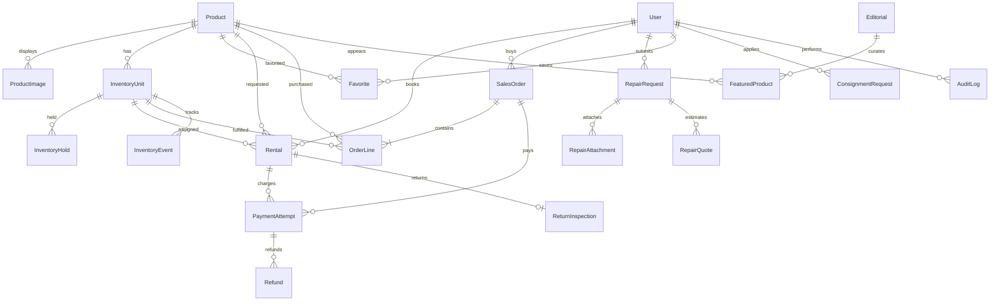

# luxuryRental M1 — 논리 ERD · MySQL 데이터 모델 v1.0

**대상:** [lR Node.js API](https://github.com/nalkarowndal/lR) · **기준일:** 2026-11-02 · **형태:** 스키마 설계서(DDL 아님, 실제 DB 미변경).
**DB 전략:** 기존 웹 MySQL 데이터 보존 우선. 신규 앱 초기 MySQL/InnoDB. 과거 SQLite ERP 스타터는 모델·테스트의 참고이지 운영 데이터 원본이 아님.

## 1. 논리 ERD (핵심 도메인)

관계 유효성: `Rental`은 고객 소유 및 개별 실물 FK를 가진다. `SalesOrder`의 여러 `OrderLine`은 물품 단위 배정이며, 중복 배정 금지. `PaymentAttempt`는 rental 또는 order 중 **정확히 하나**의 외부 거래를 참조하는 DB 제약/서비스 검증 필요(둘 다 null 또는 둘 다 지정 금지). `InventoryHold`는 할당 중인 실물과 독점 기간을 기록한다.

## 2. 핵심 테이블 정의 (추천 논리 컬럼)

| 테이블 | PK·FK 및 주요 컬럼 | 고유/인덱스/정책 |
|---|---|---|
| `users` | id UUID, email, providerSubject, status, createdAt | unique(email 정규화, provider+subject), 민감 필드 접근통제 |
| `user_roles` | userId FK, role, scopeId | unique(userId,role,scopeId); 관리자 역할 재검증 |
| `products` | id UUID, legacyProductId nullable, title, brandId, categoryId, conditionSummary, published, createdAt | unique(legacyProductId nullable), sku/slug 별도 |
| `product_images` | id, productId FK, mediaId FK, order, isCover | 라이선스/촬영출처 메타데이터 포함 |
| `product_offers` | id, productId, channel RENTAL/STORE, dayRateKrw nullable, salePriceKrw nullable, policyVersionId | product+channel+validFrom 조합; 요금 이력 보존 |
| `inventory_units` | id UUID, productId FK, serial, conditionGrade, physicalState, acquiredAt | unique(serial), index(productId,physicalState) |
| `inventory_holds` | id UUID, unitId, kind RENTAL/SALE, rentalStartDate, returnDateExclusive, blockedStartDate, blockedEndExclusive, expiresAt UTC, status, checkoutId | index(unitId,status,blockedStartDate,blockedEndExclusive), unique(checkoutId,unitId) |
| `rentals` | id, userId, productId, unitId, rentalStartDate, returnDateExclusive, blockedStartDate, blockedEndExclusive, totalRentalKrw, depositKrw, status, policyVersionId, createdAt | index(unitId,status,blockedStartDate,blockedEndExclusive) |
| `sales_orders` | id, userId, totalAmountKrw, paymentStatus, status, addressSnapshot, createdAt | unique(orderNumber), index(userId,createdAt) |
| `order_lines` | id, orderId, unitId, productId, priceKrw | unique(orderId,unitId); 단순 unique(unitId)만으로 이력 보존은 어려우므로 상태 검사 필수 |
| `payment_attempts` | id, rentalId nullable, salesOrderId nullable, provider, providerOrderId, expectedAmountKrw, providerPaymentKey nullable, status, createdAt | unique(provider,providerOrderId), unique(providerPaymentKey), CHECK 단일 거래 참조 |
| `refunds` | id, paymentAttemptId, amountKrw, reasonCode, status, providerRefundId | index(paymentAttemptId,status), 서버 승인만 처리 |
| `deposit_transactions` | id, rentalId, amountKrw, operation CHARGE/RELEASE/CAPTURE/REFUND, status | 잔액을 단일 임의값으로 수정하지 않고 이벤트 집계 |
| `inventory_events` | id, unitId, actorUserId, type, fromState, toState, contextId, createdAt | 인서트 중심 감사, 수정/삭제 제한 |
| `return_inspections` | id, rentalId, unitId, conditionBefore, conditionAfter, notes, reviewedBy | rental 1:1; 판정 이력은 별도 AuditLog |
| `repair_requests` | id, userId, targetUnitId nullable, itemDescription, issueDescription, status, createdAt | index(userId,status,createdAt), 고객 자체 소유품도 허용 |
| `repair_attachments` | id, repairId, mediaId, uploadedBy, createdAt | 비공개 object storage, 승인된 접근만 |
| `repair_quotes` | id, repairId, quotedAmountKrw, version, status, approvedAt | 승인/거부/만료 기록 |
| `favorites` | userId, productId, createdAt | unique(userId,productId) |
| `editorials` | id, title, slug, body, status DRAFT/PUBLISHED/ARCHIVED, publishedAt | unique(slug), 공개 API는 published만 |
| `featured_products` | editorialId, productId, sortOrder | unique(editorialId,productId), 순서 유효성 |
| `consignment_requests` | id, userId, brand, category, grade, status, createdAt | 고객 동의/감정/정산 별도 연결, P1 |
| `notification_events` | id, userId, kind, payloadRef, consentScope, status | 민감 필드 직접 포함 금지 |
| `policy_versions` | id, policyKind, version, effectiveAt, termsJson | 트랜잭션에 원본 요금 정책 ID 보관 |
| `audit_logs` | id, actorId, action, resourceType, resourceId, metadata, createdAt | 개인정보 마스킹·접근 통제 |
| `media_assets` | id, ownerId, storageKey, mimeType, byteSize, classification, rightsStatus | raw storageKey 공개 금지, 서명 URL 단기 발급 |

모든 `...Krw`는 원화 정수(가능하면 BIGINT)이며 음수 방지 제약을 갖는다. DB/앱 경계에서 `Date`가 아닌 ISO calendar date 텍스트/DATE 타입과 UTC TIMESTAMP를 구별한다. Unicode/collation, ID 생성법, 마이그레이션 SQL은 M3 실제 MySQL 버전 확인 후 정한다.

## 3. 예약 겹침·동시성 설계

### 3.1 기본 구간
- 공개 임대 구간은 `[startDate, returnDateExclusive)`; 시작일 포함/반납일 제외.
- 고객이 2026-11-10 ~ 2026-11-13을 선택했다면 **3일**.
- 운영 불가구간은 예약일과 물류·검수/청소·휴일 정책을 합성한 `[blockedStartDate, blockedEndExclusive)`.
- 두 반열린 구간 `[a,b)`, `[c,d)`의 겹침 조건: `a < d && c < b`.
- 배송/반납 버퍼 값은 확정된 `policy_versions`로 계산. 버퍼값 미정 상태의 예시는 시연 데이터로 구분.

### 3.2 원자적 예약
1. 동일 고객의 `Idempotency-Key`와 요청 hash를 검사, 이미 처리됐으면 이전 checkout 반환.
2. DB 트랜잭션 시작. **후보 `inventory_units` 행을 `SELECT ... FOR UPDATE`로 독점 잠금**(여러 실물 후보는 안정적 정렬).
3. 해당 실물에 있는 확정된 rental 구간, 유효 `inventory_holds`, 판매 또는 수선/청소 상태를 동일 트랜잭션에서 확인.
4. 겹치지 않을 때 `inventory_holds`를 삽입하고 `expiresAt` 지정, 가격을 서버에서 확정; 성공 후 commit.
5. 결제 승인에도 같은 단위 row lock을 잡고 홀드 유효·금액·상태 재검증 후 `rentals` 확정 및 이벤트 기록.
6. 충돌/데드락은 안전한 재시도(최대 횟수 정책), 실패 시 409/503. 멱등성 보장으로 중복 결제/배정 방지.

**주의:** MySQL은 일반적으로 PostgreSQL의 range exclusion 제약을 그대로 제공하지 않는다. `UNIQUE(unitId,startDate)` 하나만으로 서로 다른 시작일의 기간 충돌을 막을 수 없다. 반드시 unit row 잠금 + 겹침 조회 + 동일 트랜잭션 + 병렬 테스트를 적용한다. 참고: [MySQL 공식 잠금 읽기](https://dev.mysql.com/doc/refman/8.4/en/innodb-locking-reads.html).

### 3.3 판매와 대여 혼재
- `InventoryHold.kind=SALE`은 같은 실물에 대한 **모든 대여 홀드/예정 렌탈**과 충돌해야 한다. 보유 상품에 미래 확정 대여가 있으면 해당 실물의 즉시 매각은 불가(배송·반납 이후 매각 정책은 운영 정책에서 정의).
- `inventory_units.physicalState=READY`만으로 재고 이용가능이 결정되지 않는다. 예약된 미래 일정, 활성 홀드, 수리/검수/배송/판매 상태를 모두 검사.
- 결제 대기 상태에 `SOLD`로 바꾸면 안 된다. 결제 검증 성공 시에만 상태 전환.
- 정기 청소·복원은 예약과 충돌을 일으키는 추가 차단 기간으로 관리할 수 있다.

## 4. 상태 머신 기준

**Unit physicalState:** INTAKE → READY → SHIPPED → RETURNED_PENDING_INSPECTION → CLEANING/REPAIR → READY; SOLD/RETIRED는 판매·폐기의 종결 상태. 예약 확정은 물리 상태와 독립.

**Hold status:** ACTIVE → CONSUMED | RELEASED | EXPIRED. `expiresAt` 도래한 ACTIVE도 가용성 계산에서 유효하지 않으며, 백그라운드 청소 작업은 일관성을 회복할 뿐 실제 유효성의 유일한 판단 근거는 아님.

**Rental status:** PENDING_PAYMENT → CONFIRMED → PREPARING → SHIPPED → ACTIVE → RETURN_REQUESTED → RETURNED → INSPECTING → COMPLETED; CANCELED/REFUND_PENDING은 규정에 따라 분기. `Rental` 확정 전 실물은 홀드가 보호하며, 확정 시 단위 배정 한 번만 수행.

**Order status:** PENDING_PAYMENT → PAID → PROCESSING → SHIPPED → DELIVERED; PAYMENT_FAILED/CANCELED/REFUND_PENDING/REFUNDED 분기. 결제 취소나 환불이 항상 원래 실물을 자동 재판매 가능 상태로 만들지는 않음(검수 필요).

**Repair:** SUBMITTED → REVIEWING → QUOTED → APPROVED → IN_PROGRESS → COMPLETED; REJECTED/CANCELLED 분기.

## 5. 기존 DB → 신규 모델 비파괴 연결

**소스에서 직접 확인된 옛 MySQL:** `products(id BIGINT UNSIGNED, title VARCHAR, brand VARCHAR, type ENUM(RENT,BUY), price DECIMAL(12,2), created_at)`. 이 외 운영 DB 테이블 존재는 직접 확인되지 않았음.

| 기존 `products` | 신규 정규화 모델 | 매핑 규칙 |
|---|---|---|
| `id` | `legacyProductId` + `products.id` | 원본 numeric ID를 남기고 신규 UUID 키 매핑 |
| `title` | `products.title` | 문자열 유지, 실 상품/데모 구분 |
| `brand` | `brands.name` or normalized brand | 표기 유지, 중복 제거 전 검수 |
| `type:RENT/BUY` | `product_offers.channel` | 한 상품의 렌탈·구매 동시 제공 지원 |
| `price DECIMAL` | dayRateKrw 또는 salePriceKrw | 유형별 분리, 정수 변환시 소수·범위 검증 |
| `created_at` | `products.createdAt` | 시간대/타임스탬프 일관성 |

**기본 방침:** 기존 MySQL 원본 테이블 보존, 스테이징 DB에서 읽기 전용 변환 및 `legacy_product_mapping` 기록. 충돌/중복 및 총 건수·금액 교차검증 후 신규 앱의 canonical `products`로 절체. 동일 DB에서 테이블명이 겹치면 `lr_*` 스키마 프리픽스를 사용하고 DB 이름·스키마를 확정한다. 이전 중 기존 웹에 수정 기능이 추가되면 일방향 동기화/변경 이벤트/컷오버 정책이 필요.

**금지:** 백업 없이 `db push --force-reset`, `DROP TABLE`, 원본 테이블 재생성, 또는 운영 DB에 테스트 seed 삽입. Prisma 도입은 현 MySQL을 지원하는 **검증된 버전**에 한하며, 공식 introspection/baseline 가이드를 따라 검증한다.

## 6. M3 DB 품질 게이트
- FK/unique/check/인덱스 생성 테스트, migration forward + rollback/backout 계획, 기존 데이터 동등성.
- 동시성 20개 이상 병렬 checkout 시 동일 unit의 중복 할당 0건(테스트 조건/실물 수 기록).
- 서로 다른 unit은 정상 병렬 예약, 동일 unit과 다른 날짜는 허용, 인접 반열린 날짜는 버퍼 충돌이 없다면 허용.
- 만료·취소·결제 실패 재고 복구, 중복 멱등키, 수선 중 단위 예약 차단.
- 관리자·사용자 개인정보 및 파일 조회 소유권 검증, 감사 이벤트 원자성 테스트.

**본 문서는 논리 설계서다.** 실제 MySQL DDL, 연결, 실행 또는 마이그레이션을 수행했다는 뜻이 아니다.
