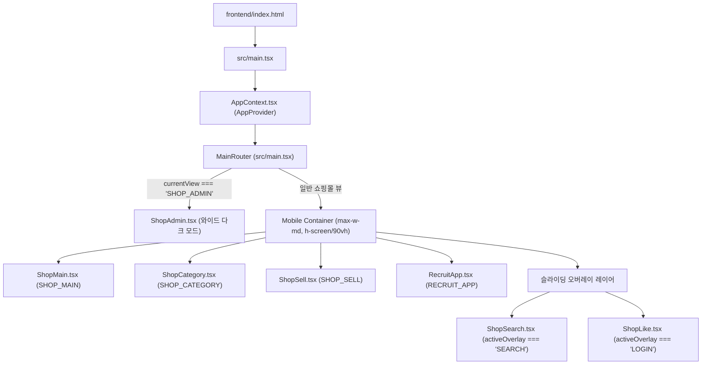

# LUXURY RENTAL 프로젝트 종합 분석 보고서 (PROJECT_ANALYSIS)

**작성일**: 2026-11-04  
**버전**: 1.0.0 (Phase 1 기준선 확립)  
**분석 대상**: `d:\JSW_React\8.portfolio\IIL` (프런트엔드, 스크린샷 46건, 스크립트)

---

## 1. 프로젝트 개요

`luxuryRental`은 명품 렌탈·구매·위탁 판매를 제공하는 프리미엄 모바일 중심 커머스 및 통합 관리자(매장/본사 구인·채용 관리 + 쇼핑몰 상품 관리) 플랫폼입니다.
본 프로젝트의 핵심 과제는 **기존 화면의 구조, 콘텐츠, 텍스트, 브랜드명, 카테고리, 관리자 다크 모드 등 동작 기능을 100% 보존**하면서 저품질 기본 이모지 교체, UI/UX 고도화, Node.js + Express + SQLite 백엔드 API 연동을 완수하는 것입니다.

---

## 2. 기술 스택 현황 및 진단

| 구분 | 현재 구성 | 버전/도구 | 진단 및 평가 |
|---|---|---|---|
| **Core Framework** | React 19 (TypeScript) | `react@19.2.7`, `typescript@~6.0.2` | 최신 React 19 적용됨. StrictMode 활성화됨. 빌드 정상. |
| **Bundler** | Vite 8 | `vite@^8.1.0`, `@vitejs/plugin-react@^6.0.2` | `vite.config.ts` 플러그인 배열에 빈 콤마(`, ,`) 오탈자 확인됨. |
| **Styling** | Tailwind CSS v4 + styled-components | `@tailwindcss/vite@^4.3.3`, `styled-components@^6.4.3` | Tailwind v4 기반 `@import "tailwindcss";` 사용. 일부 서브 컴포넌트에 styled-components 잔존. |
| **Icons** | Lucide React + Font Awesome | `lucide-react@^1.62.0`, FA 6.4.0 (CDN) | 기본 이모지(👜, 👗, 🧳, 💍, 🤝 등)가 다수 혼재되어 커머스 완성도 저하. |
| **State Management** | React Context API | `src/context/AppContext.tsx` | ViewState, Overlay, RecruitRequest, Message, Worker, Product 단일 관리. 단, ShopAdmin과 RecruitApp에 로컬 상태 중복 존재. |
| **Backend API** | 부재 (None) | - | 현재 완전한 클라이언트 단독 Mock 상태. Node.js + Express 백엔드 신규 구축 필수. |
| **Linter / QA** | Oxlint + Puppeteer Core | `oxlint@^1.69.0`, `puppeteer-core@^25.16.0` | `npm run lint` 실행 시 target 미지정으로 `node_modules` 전체 스캔 현상 발생 (`oxlint src`로 타겟 지정 필요). |

---

## 3. 디렉토리 및 파일 아키텍처 분석

```text
IIL/
├── .gitignore                      # [신규 추가] node_modules, dist, DB, env 격리
├── docs/
│   ├── analysis/                   # Phase별 종합 분석 산출물
│   │   ├── PROJECT_ANALYSIS.md     # 프로젝트 종합 분석 (본 문서)
│   │   ├── UI_UX_AUDIT.md          # UI/UX 상태 및 46개 기준선 검수 보고서
│   │   └── CHANGE_IMPACT.md        # 변경 영향도 및 안전성 평가 보고서
│   └── screenshots/                # 기준선 회귀 검사용 원본 캡처 46장
│       ├── 01_main_desktop_view.png ~ 46_admin_return_to_app.png
│       └── SCREENSHOTS_INDEX.md    # 46개 스크린샷 맵
├── frontend/
│   ├── public/                     # 정적 에셋 (favicon.svg, icons.svg)
│   ├── scripts/
│   │   ├── capture-all.js          # Puppeteer 46개 상태 자동 캡처 스크립트
│   │   └── test-capture.js         # 테스트 캡처 스크립트
│   ├── src/
│   │   ├── assets/                 # hero.png, react.svg, vite.svg
│   │   ├── components/             # 핵심 화면 컴포넌트 7개
│   │   │   ├── ShopMain.tsx        # 메인 화면 (모바일 컨테이너 + 데스크톱 QR 배너)
│   │   │   ├── ShopCategory.tsx    # 카테고리/브랜드 탭 & 서브카테고리 화면
│   │   │   ├── ShopSearch.tsx      # 우측 슬라이딩 검색 오버레이
│   │   │   ├── ShopLike.tsx        # 간편 로그인 슬라이딩 오버레이
│   │   │   ├── ShopSell.tsx        # 내 상품 판매 브랜드 검색 화면
│   │   │   ├── ShopAdmin.tsx       # 관리자 화면 (다크 테마 와이드 대시보드)
│   │   │   └── RecruitApp.tsx      # 모바일 라이트 테마 구인·채용 화면
│   │   ├── context/
│   │   │   └── AppContext.tsx      # 통합 전역 상태 관리 Context
│   │   ├── css/                    # styled-components 레거시 스타일
│   │   │   ├── AppLayout.styles.ts
│   │   │   ├── Layout.styles.ts
│   │   │   └── RentalStore.styles.ts
│   │   ├── sub/                    # 미사용/프로토타입 서브 컴포넌트
│   │   │   ├── App.tsx, Home.tsx, MyPage.tsx, RentalStore.tsx, RepairPage.tsx
│   │   ├── index.css               # Tailwind CSS 엔트리 (@import "tailwindcss";)
│   │   └── main.tsx                # 엔트리포인트 및 뷰 분기 라우터
│   ├── index.html                  # HTML 템플릿 (Font Awesome CDN 로드)
│   ├── package.json
│   ├── tailwind.config.js
│   ├── tsconfig.json / tsconfig.app.json / tsconfig.node.json
│   └── vite.config.ts
```

---

## 4. 컴포넌트 의존성 및 데이터 흐름도



---

## 5. UI 기능 맵 및 상태 전이표

| 화면/컴포넌트 | 진입 경로 / 트리거 | 주요 기능 및 상태 | 전환 가능 대상 |
|---|---|---|---|
| **ShopMain** | 앱 시작 기본 화면 / 로고 클릭 / Admin '앱으로 돌아가기' | - 상단 헤더 (검색, 장바구니, 관리자 설정)<br>- 렌트/구매/판매 액션 카드<br>- 8-Grid 메뉴 바로가기<br>- 맞춤 추천 탭 (20대~40대 남녀)<br>- Rent New Arrivals 가로 스크롤<br>- 에스크로 푸터 & 플로팅 바텀 네비 | - 검색: `activeOverlay = 'SEARCH'`<br>- 장바구니/좋아요/MY: `activeOverlay = 'LOGIN'`<br>- 관리자 설정: `currentView = 'SHOP_ADMIN'`<br>- 카테고리 탭: `currentView = 'SHOP_CATEGORY'`<br>- 판매 탭: `currentView = 'SHOP_SELL'` |
| **ShopCategory** | 바텀 바 '카테고리' 클릭 | - 카테고리 vs 브랜드 메인 탭<br>- 여성/남성/아동 서브탭<br>- 좌측 8개 대분류 LNB<br>- 우측 10개 세부 분류 및 3개 추천 카드<br>- 인기 브랜드 10 가로 칩 & 6개 상품 카드 | - 헤더 뒤로가기: `currentView = 'SHOP_MAIN'`<br>- 장바구니 클릭: `activeOverlay = 'LOGIN'` |
| **ShopSearch** | 헤더 돋보기 버튼 클릭 | - 우측 슬라이드 오버레이 (z-110)<br>- 11개 추천 검색어 칩<br>- 1~10위 실시간 검색어 순위표 | - 뒤로가기: `activeOverlay = null` |
| **ShopLike (Login)** | 헤더 장바구니, 바텀 좋아요/MY, 렌트/구매 카드 클릭 | - 우측 슬라이드 오버레이 (z-100)<br>- 첫 렌트 70% 할인 안내<br>- 카카오, 애플, 네이버, 페이코, 이메일 로그인 버튼 | - 뒤로가기: `activeOverlay = null` |
| **ShopSell** | 메인 판매 카드, 바텀 '내 상품 판매' 탭 클릭 | - 12개 럭셔리 브랜드 리스트 (Goyard, Gucci, Cartier 등)<br>- 실시간 브랜드 필터링 검색창<br>- '원하는 브랜드 직접 등록' 링크 | - 뒤로가기: `currentView = 'SHOP_MAIN'` |
| **ShopAdmin** | 헤더 설정(톱니바퀴) 아이콘 클릭 | - 상단 '쇼핑몰 관리' vs '구인/채용 관리' 메인 탭<br>- [쇼핑몰] 신규 상품 등록 모달 & 등록 상품 리스트<br>- [구인/채용] '매장' ↔ '본사 담당자' 역할 전환 토글<br>- [구인 대시보드] 구인 현황 카드 3종 & 지점 신청 리스트<br>- [구인 작성] 매장 지점, 날짜, 섹션, 시간, 인원 등록<br>- [근무자 DB] 근무자 인재 풀, 체크박스 선택 & 단체 문자 발송 모달<br>- [실시간 채팅] 지점-본사 실시간 대화창 및 메시지 전송<br>- [앱 복귀] '앱으로 돌아가기' 클릭 | - 앱으로 돌아가기: `currentView = 'SHOP_MAIN'` |

---

## 6. 브랜드 및 서비스 명칭 불일치 분석 (보존 지침 준수)

요구사항 1.1에 명시된 명칭 검토 사항:

1. **'리본즈' 명칭 출현 위치**:
   - `ShopMain.tsx` L.77: `"어서오세요, 로그인 후 리본즈를 이용해보세요"`
   - `ShopMain.tsx` L.128: `"리본즈만의 서비스"`
2. **'LUXURYRENTAL' / '럭셔리' 출현 위치**:
   - `ShopMain.tsx` L.35: `"럭셔리 (LUXURYRENTAL)"`
   - `ShopMain.tsx` L.56: `"LUXURYRENTAL"` (상단 헤더)
   - `ShopMain.tsx` L.253: `"(주)럭셔리 렌탈"`
   - `ShopMain.tsx` L.264: `"럭셔리렌탈은 고객님이 현금 결제한 금액에 대해..."`
   - `ShopMain.tsx` L.297: `"마이럭셔리렌탈"` (바텀 바)
   - `ShopLike.tsx` L.21: `"LUXURYRENTAL"`
   - `ShopAdmin.tsx` L.91: `"LUXURY RENTAL 통합 관리자 센터"`
3. **처리 방침**:
   - **자동 수정 금지**: 기존 요구사항("기존 코드에서 리본즈와 LUXURYRENTAL이라는 명칭이 혼용되더라도 콘텐츠 보존 조건에 따라 자동으로 변경하지 않는다")에 따라 원본 텍스트를 그대로 유지.

---

## 7. 현재 빌드 및 린트 상태 진단 결과

- **Vite Build**:
  - `npm.cmd run build` 실행 결과: `✓ built in 1.18s` 성공.
  - 번들 크기: CSS 42.03 kB (gzip 7.47 kB), JS 265.57 kB (gzip 76.40 kB).
- **Oxlint 실행 결과**:
  - `package.json`의 `"lint": "oxlint"`는 인자 미지정으로 인해 `node_modules` 전체를 파싱하여 수만 줄의 경고를 뿜어냄.
  - `npx oxlint src`로 실행 시: **0 errors, 10 warnings**로 17ms 만에 완료.
  - 경고 내용:
    1. `src/main.tsx`: `MainRouter`가 export 없이 파일 내에 선언됨 (Fast refresh 경고)
    2. `src/components/RecruitApp.tsx`: 미사용 import (`LayoutDashboard`, `PlusCircle`, `Users`, `MessageSquare`, `ShieldCheck`), 미사용 변수 (`setRole`, `setWorkers`)
    3. `src/context/AppContext.tsx`: Fast refresh 컴포넌트 전용 권장
    4. `src/components/ShopAdmin.tsx`: 미사용 변수 (`setWorkers`)
- **Vite 설정 문법 오류**:
  - `frontend/vite.config.ts`: `plugins: [react(), , tailwindcss(),]` -> 여분의 콤마 존재.

---

## 8. 결론 및 Phase 2~5 추진 방향

1. **UI/UX 고도화 (Phase 2)**:
   - 디자인 토큰(색상, 폰트, 간격, 둥글기, 그림자) 체계화.
   - 가방, 의류, 보석 등 저품질 기본 이모지 100% 제거 및 고품질 벡터 아이콘/프리미엄 플레이스홀더 이미지로 교체.
   - 카테고리/브랜드 탭 상호작용 및 반응형 레이아웃 오차 수정.
2. **Node.js 백엔드 구축 (Phase 3)**:
   - `backend/` 디렉토리에 Express + TypeScript + SQLite(better-sqlite3 or sqlite3) 기반 REST API 서버 구축.
   - 상품, 카테고리, 브랜드, 추천, 검색, 판매신청, 관리자 구인/근무자/채팅/상품 엔드포인트 구현.
3. **통합 및 데이터 연동 (Phase 4)**:
   - 프런트엔드와 백엔드 API 클라이언트 연동.
   - 관리자 상품 등록, 구인 등록, 채팅 메시지 전송의 실제 DB 저장 및 재조회 보장.
4. **자동 QA 및 최적화 (Phase 5)**:
   - 46개 기준선 스크린샷 대비 시각적 회귀 검수, E2E 테스트, 접근성(WCAG 2.2 AA) 및 성능 검증.
