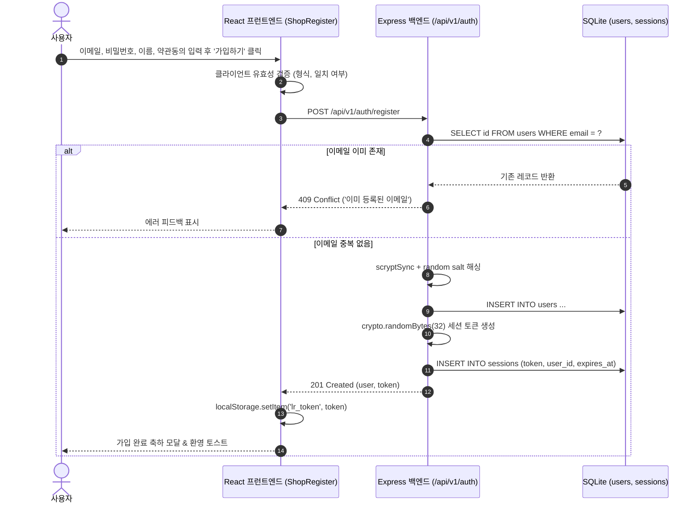
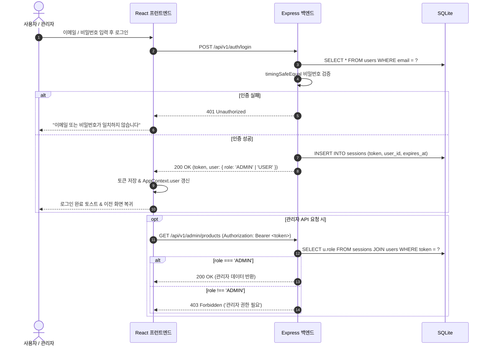
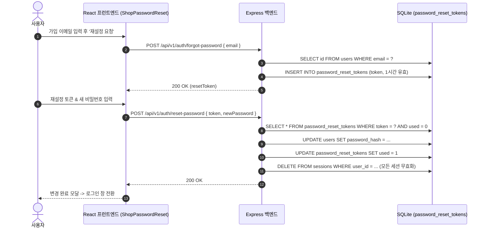

# luxuryRental 사용자 인증 및 세션 아키텍처 흐름도 (AUTH_FLOW)

## 1. 개요

luxuryRental의 인증 시스템은 **이메일/비밀번호 기반의 세션 인증(Bearer Token)**을 핵심으로 하며, 소셜 로그인 연동 인터페이스 및 안전한 비밀번호 복구 흐름을 지원합니다.

---

## 2. 인증 시퀀스 다이어그램 (Authentication Sequences)

### 2.1 회원가입 흐름 (User Registration)

---

### 2.2 로그인 및 권한 인가 흐름 (Login & Role Authorization)

---

### 2.3 비밀번호 재설정 흐름 (Password Recovery)

