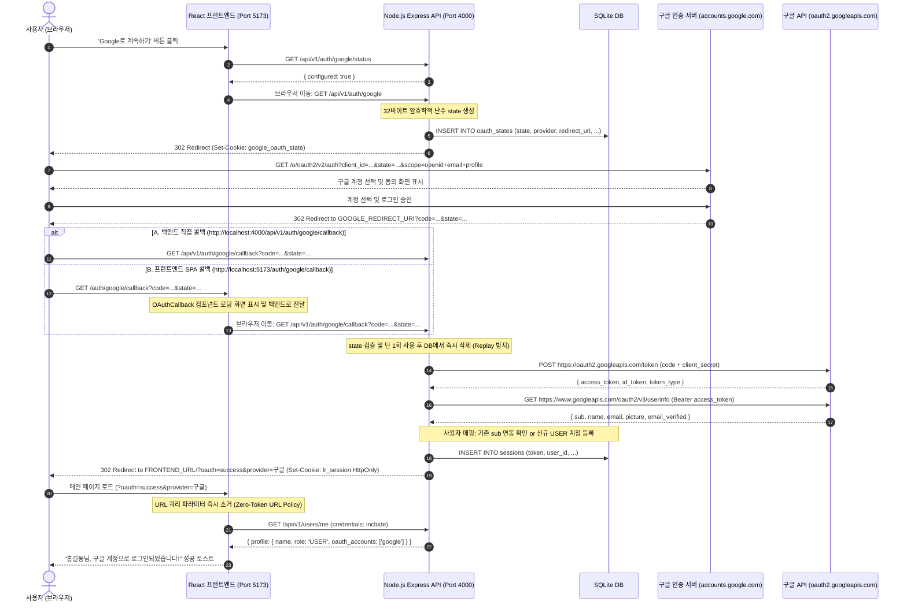

# luxuryRental — 구글(Google) OAuth 2.0 인증 흐름 상세 명세

본 문서는 luxuryRental 플랫폼의 구글 간편 로그인 요청 시작부터 콜백 처리, 토큰 교환, 세션 수립 및 프런트엔드 상태 동기화까지의 전 과정을 상세히 기술합니다.

---

## 1. 전체 OAuth 2.0 시퀀스 다이어그램

---

## 2. 지원되는 Callback URI 목록

구글 클라우드 콘솔(Google Cloud Console)의 **승인된 리디렉션 URI(Authorized redirect URIs)**에 환경에 맞게 다음 주소를 등록할 수 있습니다. luxuryRental은 서버 직접 콜백과 프런트엔드 SPA 중계 콜백을 모두 완벽히 지원합니다.

### 1) 백엔드 직접 수신 URI (권장 기본값)
- `http://localhost:4000/api/v1/auth/google/callback` (공식 표준 엔드포인트)
- `http://localhost:4000/auth/google/callback` (백엔드 탑레벨 별칭)
- `http://localhost:4000/oauth/google/callback` (백엔드 탑레벨 별칭)

### 2) 프런트엔드 SPA 수신 URI
- `http://localhost:5173/auth/google/callback` (프런트엔드 SPA 전용 콜백 라우트)
- `http://localhost:5173/oauth/callback` (통합 소셜 콜백 라우트)

---

## 3. 예외 및 보안 처리

| 상황 | 원인 | 콜백 파라미터 | 사용자 안내 |
|:---|:---|:---|:---|
| 사용자 동의 취소 | Google 인증 창 닫기/취소 | `?oauth=cancelled&provider=google` | "구글 로그인이 취소되었습니다." |
| State 불일치 | CSRF 변조 또는 만료 | `?oauth=invalid_state&provider=google` | "유효하지 않거나 만료된 요청입니다 (CSRF 검증 실패)." |
| 이메일 계정 충돌 | 기존 등록된 이메일과 중복 | `?oauth=email_conflict&email=...` | "동일한 이메일로 등록된 기존 계정이 있습니다. 이메일 로그인 후 계정을 연동해주세요." |
| 인가 코드 교환 실패 | 코드 만료 또는 유효하지 않은 시크릿 | `?oauth=token_exchange_failed&provider=google` | "구글 로그인에 실패했습니다." |

