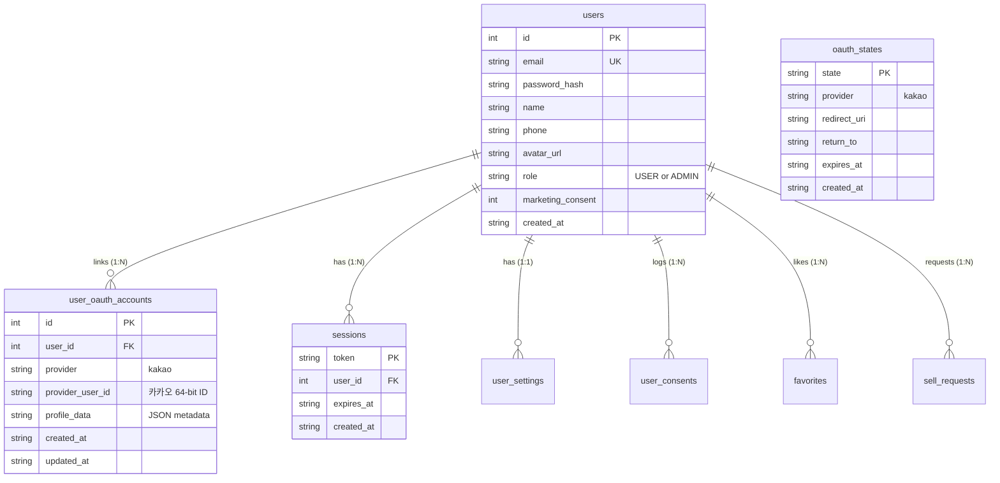

# luxuryRental — 카카오 계정 매핑 및 SQLite DB 구조 명세

본 문서는 카카오 OAuth 2.0으로 인증된 외부 사용자를 luxuryRental의 기존 SQLite 데이터베이스 체계와 안전하게 연결하고 보존하는 데이터 모델 및 비즈니스 규칙을 정의합니다.

---

## 1. 데이터베이스 스키마

기존 `users`, `sessions`, `user_settings`, `user_consents` 테이블을 100% 보존하면서, 다중 로그인 프로바이더를 수용할 수 있는 `user_oauth_accounts` 및 `oauth_states` 테이블을 신설했습니다.



### 테이블 DDL (`user_oauth_accounts`)
```sql
CREATE TABLE IF NOT EXISTS user_oauth_accounts (
  id INTEGER PRIMARY KEY AUTOINCREMENT,
  user_id INTEGER NOT NULL REFERENCES users(id) ON DELETE CASCADE,
  provider TEXT NOT NULL,
  provider_user_id TEXT NOT NULL,
  profile_data TEXT DEFAULT '{}',
  created_at TEXT NOT NULL DEFAULT (datetime('now')),
  updated_at TEXT NOT NULL DEFAULT (datetime('now')),
  UNIQUE(provider, provider_user_id)
);
```

---

## 2. 사용자 식별 및 매핑 규칙

### 2.1 카카오 고유 사용자 ID (`provider_user_id`)
- 카카오가 반환하는 고유 번호(예: `9988776655`, 64비트 정수형)를 문자열 형태로 저장하여 외부 식별자의 기본 키로 사용합니다.
- 이메일 주소는 사용자의 동의 철회, 이메일 변경 또는 미제공 상황이 발생할 수 있으므로 식별의 1차 키로 사용하지 않습니다.

### 2.2 기존 연동 회원 로그인 흐름
1. `user_oauth_accounts`에서 `provider = 'kakao' AND provider_user_id = ?`로 조회합니다.
2. 일치하는 레코드가 존재할 경우 연결된 `users` 테이블의 `user_id`를 획득합니다.
3. 카카오 프로필 사진이나 닉네임이 변경된 경우 프로필을 최신화하고 `updated_at`을 갱신합니다.
4. 새로운 세션 토큰(`sessions`)을 발급하고 HttpOnly 쿠키로 반환합니다.
5. **결과**: 기존 찜 목록(`favorites`), 주문/렌탈 이력, 판매 신청(`sell_requests`) 데이터가 완벽하게 유지됩니다.

### 2.3 신규 회원 자동 가입 흐름
1. 카카오 계정 ID가 DB에 없는 경우 신규 가입 처리를 수행합니다.
2. **이메일 처리**:
   - 사용자가 이메일 제공에 동의한 경우: `kakaoProfile.kakao_account.email` 사용
   - 이메일 미제공 또는 비공개인 경우: `kakao_{provider_user_id}@oauth.luxuryrental.com` 형식의 안전한 고유 이메일을 자동 부여
3. **이름/닉네임**: 카카오 프로필 닉네임을 기본으로 설정합니다.
4. **비밀번호**: 암호학적 난수(32바이트)를 생성하여 scrypt로 해싱한 후 저장합니다 (외부 공격자가 비밀번호 추론 불가).
5. **권한**: **반드시 `USER` 역할로 고정**합니다. 카카오 계정 정보만으로 `ADMIN` 권한이 부여되는 일은 원천 차단됩니다.
6. **법적 동의 로깅**: `user_consents` 테이블에 필수 서비스 이용약관(`TERMS_OF_SERVICE`) 및 개인정보 수집(`PRIVACY_COLLECTION`)에 대한 감사 로그를 접속 IP 및 User-Agent와 함께 즉시 기록합니다.
7. **기본 설정 생성**: `user_settings` 테이블에 기본 알림 및 테마 설정을 생성합니다.

### 2.4 이메일 충돌 및 계정 탈취 방지 정책 (Anti-Account-Takeover)
- 카카오에서 전달받은 이메일이 이미 luxuryRental의 기존 이메일 가입 회원과 동일한 경우:
- **자동 계정 통합 금지**: 이메일 주소 문자열만으로 기존 계정을 카카오 계정에 무단 연결하지 않습니다.
- **방어 동작**: 콜백 처리기에서 `?oauth=email_conflict&email=...` 파라미터로 리다이렉트하여 "동일한 이메일로 가입된 계정이 존재하므로, 기존 이메일로 로그인 후 연동해야 함"을 명확히 안내합니다.

---

## 3. 계정 연동 해제 (`POST /api/v1/auth/kakao/unlink`)

1. **인가 검증**: 로그인된 사용자만 호출할 수 있습니다 (`requireAuth`).
2. **고립 방지 검사**: 카카오 계정으로만 가입되어 자체 이메일/비밀번호가 없는 회원(`@oauth.luxuryrental.com`)이 연동을 해제하면 계정에 영구적으로 접근할 수 없게 되므로, 사전에 자체 비밀번호 및 이메일 설정을 완료하도록 요구합니다.
3. **연동 삭제**: `user_oauth_accounts` 테이블에서 해당 사용자의 카카오 연결 레코드를 삭제합니다. 기존 주문, 렌탈, 찜 데이터는 그대로 보존됩니다.
