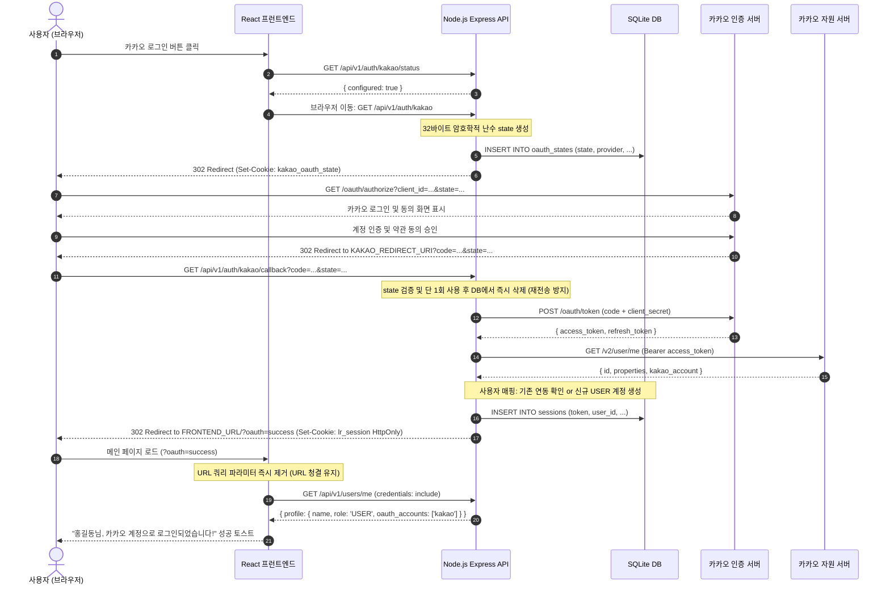

# luxuryRental — 카카오 OAuth 2.0 인증 흐름 상세 명세

본 문서는 luxuryRental 플랫폼의 카카오 간편 로그인 요청 시작부터 최종 토큰 발급, 세션 수립 및 프런트엔드 상태 동기화까지의 전 과정을 상세히 기술합니다.

---

## 1. 전체 OAuth 2.0 시퀀스 다이어그램



---

## 2. 세부 단계별 구현 명세

### 2.1 인가 요청 시작 (`GET /api/v1/auth/kakao`)
1. **서버 키 검증**: `KAKAO_REST_API_KEY` 설정 유무를 확인합니다. 미설정 시 `400 Bad Request` 또는 `?oauth=config_required`로 안내합니다.
2. **CSRF State 생성**: Node.js `crypto.randomBytes(32).toString('hex')`를 호출하여 64글자의 암호학적 난수를 생성합니다.
3. **만료시간 지정 저장**: SQLite `oauth_states` 테이블에 10분 만료(`datetime('now', '+10 minutes')`)로 저장합니다.
4. **이중 검증 쿠키 발급**: `kakao_oauth_state` 쿠키(HttpOnly, SameSite=Lax)를 설정하여 브라우저 수준의 일치성을 보장합니다.
5. **카카오 인가 화면 리다이렉트**:
   ```text
   https://kauth.kakao.com/oauth/authorize?client_id={REST_API_KEY}&redirect_uri={REDIRECT_URI}&response_type=code&state={STATE}
   ```

### 2.2 인가 코드 수신 및 콜백 처리 (`GET /api/v1/auth/kakao/callback`)
1. **사용자 취소 확인**: 카카오에서 `error=access_denied` 반환 시 프런트엔드로 `?oauth=cancelled` 리다이렉트합니다.
2. **State 1회성 소비(Anti-Replay)**:
   ```sql
   SELECT state FROM oauth_states WHERE state = ? AND provider = 'kakao' AND expires_at > datetime('now');
   DELETE FROM oauth_states WHERE state = ?;
   ```
   조회 즉시 레코드를 원자적으로 삭제하여 동일 state의 재사용 및 Replay 공격을 물리적으로 차단합니다.
3. **토큰 교환 (`POST https://kauth.kakao.com/oauth/token`)**:
   - `grant_type`: `authorization_code`
   - `client_id`: `KAKAO_REST_API_KEY`
   - `client_secret`: `KAKAO_CLIENT_SECRET` (서버 간 전송으로 브라우저에 절대 노출되지 않음)
   - `code`: 1회용 인가 코드
4. **사용자 정보 조회 (`GET https://kapi.kakao.com/v2/user/me`)**:
   - `Authorization: Bearer {access_token}` 헤더를 통해 고유 식별자(`id`), 닉네임, 프로필 이미지 URL, 이메일(선택)을 안전하게 수신합니다.

### 2.3 세션 발급 및 쿠키 전달 (Zero-Token URL Policy)
- **보안 원칙**: 인증 토큰, 카카오 토큰, 인가 코드를 URL 쿼리 파라미터로 절대로 전달하지 않습니다.
- **쿠키 설정**:
  ```http
  Set-Cookie: lr_session={sessionToken}; Path=/; HttpOnly; SameSite=Lax; Max-Age=604800
  ```
- **리다이렉트 목적지**: `http://localhost:5173/?oauth=success&provider=kakao`
- **프런트엔드 처리**:
  - `window.history.replaceState({}, document.title, window.location.pathname)`으로 주소창의 쿼리를 즉시 소거합니다.
  - `credentials: 'include'` 옵션을 통해 `GET /api/v1/users/me`를 호출하여 프로필 정보를 수신하고 전역 `AppContext.user` 상태를 갱신합니다.

---

## 3. 예외 및 실패 처리 매트릭스

| 원인 | 콜백 쿼리 / 상태 | 사용자 안내 UI | 조치 방안 |
|:---|:---|:---|:---|
| 사용자 동의 취소 | `?oauth=cancelled` | "카카오 로그인이 취소되었습니다." (Info) | 메인 화면 유지 |
| 서버 키 미설정 | `?oauth=config_required` | "서버에 카카오 REST API 키 설정이 필요합니다." (Error) | `.env` 설정 안내 |
| 잘못되거나 만료된 State | `?oauth=invalid_state` | "유효하지 않거나 만료된 요청입니다 (CSRF)." (Error) | 재시도 요청 |
| 동일 이메일 계정 충돌 | `?oauth=email_conflict` | "동일한 이메일로 가입된 계정이 있습니다. 이메일 로그인 후 이용해주세요." (Error) | 계정 탈취 방지 |
| 인가 코드 교환 실패 | `?oauth=token_exchange_failed` | "카카오 로그인에 실패했습니다. (token_exchange_failed)" | 재시도 유도 |
