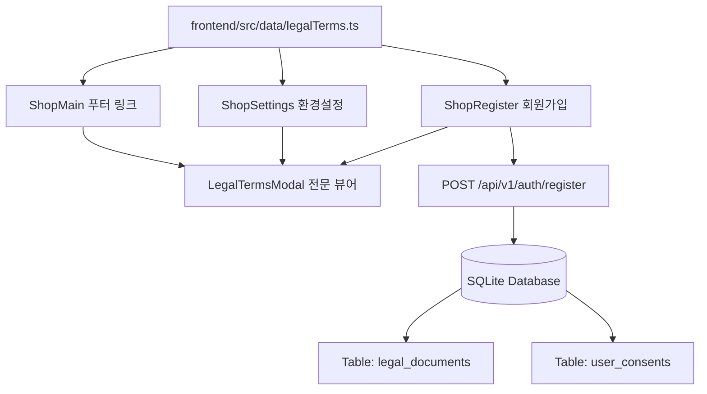

# [법적 문서 및 동의 시스템 명세] 이용약관, 개인정보처리방침 및 감사 로깅

**작성일**: 2026-11-04  
**버전**: v3.0  
**컴포넌트**: `legalTerms.ts`, `LegalTermsModal.tsx`, `ShopRegister.tsx`, `database.ts`, `legal.controller.ts`  

---

## 1. 시스템 설계 개요

전자상거래 및 명품 렌탈·판매 플랫폼에 요구되는 개인정보보호법, 정보통신망법, 전자상거래법의 규정을 충족하기 위해 단일 출처(Single Source of Truth) 원칙에 입각한 공통 법적 문서 시스템을 구축하였습니다.



---

## 2. 관리 약관 문서 체계 (v2.1)

| 문서 식별자 (`docType`) | 문서 공식 명칭 | 구분 | 필수 여부 | 시행일자 | 주요 내용 |
| :--- | :--- | :---: | :---: | :---: | :--- |
| `TERMS_OF_SERVICE` | LUXURYRENTAL 서비스 이용약관 | 약관 | **[필수]** | 2026-01-01 | 렌트 계약, 200% 정품보증, 반납 지연금, 파손/분실 보상 한도 |
| `PRIVACY_COLLECTION` | 개인정보 수집 및 이용 동의 | 동의서 | **[필수]** | 2026-01-01 | 식별정보(이메일, 비밀번호, 이름), 배송/연락처, 5년 법정보존 |
| `PRIVACY_POLICY` | LUXURYRENTAL 개인정보 처리방침 | 방침 | [안내] | 2026-01-01 | 제3자 위탁(우체국/CJ), 암호화 안전성 조치, 보호책임자 |
| `MARKETING_CONSENT` | 마케팅 정보 수신 및 활용 동의 | 동의서 | **[선택]** | 2026-01-01 | 이벤트 할인, 신상품 입고, SMS/푸시/알림톡, 즉시 철회권 |

---

## 3. 데이터베이스 스키마 명세

### 3.1 `legal_documents` (공식 법적 문서 버전 관리)
```sql
CREATE TABLE IF NOT EXISTS legal_documents (
  id INTEGER PRIMARY KEY AUTOINCREMENT,
  doc_type TEXT NOT NULL,
  title TEXT NOT NULL,
  short_title TEXT NOT NULL,
  version TEXT NOT NULL,
  effective_date TEXT NOT NULL,
  is_required INTEGER NOT NULL DEFAULT 1,
  summary TEXT NOT NULL,
  content TEXT NOT NULL,
  created_at TEXT NOT NULL DEFAULT (datetime('now')),
  UNIQUE(doc_type, version)
);
```

### 3.2 `user_consents` (회원별 동의 이력 감사 로그)
```sql
CREATE TABLE IF NOT EXISTS user_consents (
  id INTEGER PRIMARY KEY AUTOINCREMENT,
  user_id INTEGER NOT NULL REFERENCES users(id) ON DELETE CASCADE,
  doc_type TEXT NOT NULL,
  version TEXT NOT NULL DEFAULT 'v2.1',
  agreed INTEGER NOT NULL DEFAULT 1,
  ip_address TEXT DEFAULT '',
  user_agent TEXT DEFAULT '',
  created_at TEXT NOT NULL DEFAULT (datetime('now'))
);
```

---

## 4. 회원가입 및 설정 UX 흐름

1. **전체 동의 토글**:
   - `ShopRegister.tsx` 상단의 "모든 약관에 전체 동의합니다" 클릭 시 필수 2종 + 선택 1종이 동시에 체크/해제됨.
2. **개별 전문 확인**:
   - 각 조항 우측의 `[내용 보기 >]` 클릭 시 `LegalTermsModal` 팝업 표시.
   - 모달 하단의 "동의하고 확인 완료"를 클릭하면 해당 항목이 자동으로 체크되고 모달이 닫힘.
3. **서버 감사 기록**:
   - 가입 요청 시 클라이언트의 접속 IP(`x-forwarded-for` 또는 `remoteAddress`) 및 브라우저 User-Agent가 `user_consents` 테이블에 영구 저장됨.
4. **마이페이지 / 설정 동의 철회**:
   - 로그인 후 설정 메뉴에서 마케팅 알림을 끄면 실시간으로 `PUT /api/v1/legal/user/consents`를 통해 동의 철회 로그(`agreed = 0`)가 기록됨.

---

## 5. 시각적 검증 결과
- 스크린샷: `docs/screenshots_phase2/54_register_granular_legal_terms.png`
- 스크린샷: `docs/screenshots_phase2/55_register_legal_terms_modal_preview.png`
- 스크린샷: `docs/screenshots_phase2/56_settings_legal_terms_choice_modal.png`
