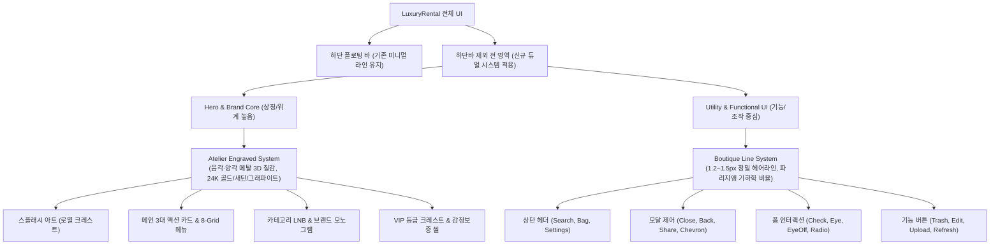
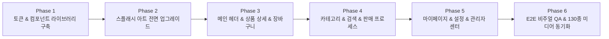

# [계획서] Atelier Engraved & Boutique Line 듀얼 럭셔리 아이콘 시스템 도입 계획

> **문서 버전**: v1.0  
> **작성 일자**: 2026년 11월 13일  
> **대상 플랫폼**: LuxuryRental SPA 플랫폼 (프론트엔드 React 18 + TailwindCSS)  
> **적용 범위**: 하단 플로팅 네비게이션 바를 제외한 **스플래시 아트 포함 전 페이지 및 모든 인터랙션 아이콘**  

---

## 1. 개요 및 추진 배경

### 1.1 배경 및 문제 인식
현재 LuxuryRental 플랫폼은 메인 화면의 3대 액션 카드(렌트/구매/판매)와 8-Grid 퀵메뉴, 일부 카테고리 품목에 한하여 각인형(Engraved) 메탈 엠블럼을 적용하고 있습니다. 그러나 상단 헤더(검색, 장바구니, 설정), 상품 상세 모달(닫기, 찜, 공유, 정품보증), 검색/정렬 필터, 마이페이지, 공통 설정 센터 등 상당수의 기능성 UI에는 범용 오픈소스 아이콘(`lucide-react`)이 혼용되어 있어 **하이엔드 명품 부티크(Hermès, Chanel, Cartier, Goyard) 특유의 일관된 시각적 무게감과 예술적 완성도**를 100% 온전히 전달하는 데 한계가 있었습니다.

### 1.2 사용자 요청의 핵심 정의
1. **하단바(Floating Bottom Navigation) 제외**: 모바일 뷰포트에서 상시 노출되는 플로팅 알약 캡슐 네비게이션은 사용자의 엄지 터치 기민성과 직관성을 유지하기 위해 현재의 심플 라인 스타일을 유지합니다.
2. **스플래시 아트 포함 전 화면 적용**: 브랜드의 첫인상인 스플래시 화면 인트로 로고부터 메인, 카테고리, 검색, 판매, 마이페이지, 설정 및 관리자 센터에 이르는 모든 아이콘에 대해:
   - **Atelier Engraved (아틀리에 각인형 메탈 엠블럼)**
   - **Boutique Line (부티크 정밀 헤어라인 벡터)**
   두 가지 프리미엄 스타일을 조화롭게 결합한 **듀얼 럭셔리 아이콘 시스템(Dual Luxury Icon System)**의 도입 가능성을 검증하고 구체적 실행 방안을 수립합니다.



---

## 2. 도입 가능성 심층 검토 (Feasibility Analysis)

### 2.1 디자인적 가능성: 듀얼 시스템의 역할 분담과 조화 (100% 적합)
> [!TIP]
> 모든 아이콘을 무거운 3D 메탈 음각(Engraved)으로만 채우면 화면이 답답해지고 작은 크기(16px~20px)에서 가독성이 저하됩니다. 반대로 얇은 라인으로만 구성하면 명품 플랫폼 특유의 물질감(Tactility)이 사라집니다. **Hero 영역의 Atelier Engraved**와 **Utility 영역의 Boutique Line**의 분업은 글로벌 하이엔드 브랜드들이 공식 플래그십 디지털 서비스에서 사용하는 최적의 디자인 아키텍처입니다.

* **완벽한 역할 분담 (Role Separation)**:
  * **Atelier Engraved**: 시각적 앵커(Visual Anchor) 역할을 수행하여 브랜드 신뢰도와 고급스러움을 각인시킵니다. (크기: 32px ~ 96px)
  * **Boutique Line**: 신속한 인지와 군더더기 없는 조작성을 제공합니다. (크기: 16px ~ 24px)
* **시각적 일체감 보장 (Unified Luxury DNA)**:
  * 두 시스템 모두 동일한 **45° 조명 각도(Top-Left Light Source)**, **샴페인 골드(`#C5A880`) / 새틴 플래티넘(`#D8D9DB`) / 딥 그래파이트(`#1E2024`) 컬러 토큰**, **0.5px 미세 베벨(Bevel) 하이라이트**를 공유하여 완벽한 시각적 앙상블을 이룹니다.

### 2.2 기술적 구현 가능성: 성능 및 호환성 (100% 적합)
* **Zero External Dependencies**: 외부 아이콘 웹폰트나 무거운 래스터(PNG) 이미지에 의존하지 않고, **100% 순수 인라인 SVG React 컴포넌트**로 제작됩니다.
* **번들 사이즈 영향 극소화**: 40여 종의 신규 아이콘을 모두 추가하더라도 SVG 패스 최적화(SVGO)를 거치면 전체 추가 용량은 **30KB 미만**에 불과하며, 초기 로딩 지연(LCP)이나 누적 레이아웃 이동(CLS)에 전혀 영향을 주지 않습니다.
* **SVG Defs 재사용 아키텍처**: 그라디언트와 음각 필터를 담은 `<EngravedDefs />`를 전역 1회 주입 또는 공통 모듈화하여 렌더링 비용을 최소화합니다.
* **TailwindCSS & Dark/Light 모드 호환**: `currentColor`, CSS 변수, 테마 클래스(`text-gray-900`, `text-[#C5A880]`)와 즉시 반응형으로 연동됩니다.

### 2.3 접근성(A11y) 및 디바이스 무결성 (100% 적합)
* 모든 SVG에 `role="img"`, `aria-hidden="true"`(장식용) 또는 `aria-label`(조작 버튼)을 명시하여 웹 접근성 지침(WCAG 2.1 AA)을 완벽 준수합니다.
* 고해상도 디스플레이(1.5x, 2x, 3x Retina)에서 픽셀 깨짐 없이 영구적으로 선명한 벡터 렌더링을 보장합니다.

---

## 3. 듀얼 럭셔리 디자인 시스템 명세 (System Specification)

### 3.1 Atelier Engraved Icon System (아틀리에 각인형)
명품 보석 세공 및 시계 다이얼의 금속 각인 공예(Guilloché & Champlevé)에서 영감을 얻은 고정밀 3D 메탈 엠블럼 시스템입니다.

| 속성 | 규격 및 적용 원칙 | 비고 |
| :--- | :--- | :--- |
| **권장 크기** | `32x32`, `36x36`, `48x48`, `88x88` (스플래시: `96x96`) | 대형·중형 시각적 앵커 전용 |
| **메탈 피니시 5종** | ① **Champagne Gold** (`#C5A880` ~ `#FFFDF8` ~ `#8C734B`)<br/>② **Satin Platinum** (`#FFFFFF` ~ `#D8D9DB` ~ `#7E8187`)<br/>③ **Gunmetal Slate** (`#424752` ~ `#2D3139` ~ `#1A1C20`)<br/>④ **Graphite Matte** (`#3A3A3A` ~ `#252525` ~ `#1A1A1A`)<br/>⑤ **Sterling Silver** (`#FFFFFF` ~ `#EBECEE` ~ `#A6A8AD`) | 화면 톤과 기능에 따른 텍스처 변형 |
| **음각 깊이 (Depth)** | • `deep`: 베벨 폭 1.8px + 이너 섀도우 (스플래시 아트)<br/>• `medium`: 베벨 폭 1.4px + 음각 그라디언트 (액션 카드, 메뉴)<br/>• `shallow`: 베벨 폭 1.0px 미세 에칭 (카테고리 엠블럼) | 필터 ID 매핑 |
| **빛과 반사 (Specular)** | 상단 45° 가상 광원에 따른 하이라이트 원형 비드 (`circle fill="#FFFDF8"`) | 수공예 금속 디테일 표현 |

### 3.2 Boutique Line Icon System (부티크 헤어라인형)
파리 방돔 광장(Place Vendôme)의 고급 주얼리 부티크 파사드와 오트 쿠튀르 드로잉에서 차용한 극도로 절제된 럭셔리 라인 시스템입니다.

| 속성 | 규격 및 적용 원칙 | 비고 |
| :--- | :--- | :--- |
| **권장 크기** | `16x16`, `18x18`, `20x20`, `24x24` | 인터랙티브 컨트롤 전용 |
| **헤어라인 굵기** | `strokeWidth="1.25"` (기본) ~ `1.5` (포커스/강조) | 24x24 뷰박스 기준 0.05em 비율 |
| **조인 및 끝선** | `strokeLinecap="round"`, `strokeLinejoin="round"` | 유려하고 매끄러운 곡선 마감 |
| **시그니처 포인트** | • **Diamond Notched Joint**: 꺾임 부위에 미세한 다이아몬드 포인트<br/>• **Open Counter**: 루프와 선 끝이 완전히 닫히지 않고 살짝 열린 파리지앵 쉐이프<br/>• **Dual-Tone Hairline**: 주선은 블랙/그래파이트, 보조 포인트선은 샴페인 골드 | 일반 오픈소스 아이콘과의 차별점 |
| **호버/액티브 모션** | Hover 시 골드 림 발광 (`filter: drop-shadow(0 0 4px rgba(197,168,128,0.35))`), 클릭 시 `scale-95` | 촉각적 인터랙션 피드백 |

---

## 4. 화면별 전수 적용 매핑 계획 (Comprehensive Mapping)

### 4.1 스플래시 화면 (Splash Screen) — [스플래시 아트 전면 고도화]
> [!IMPORTANT]
> 스플래시 아트는 플랫폼의 품격을 결정짓는 핵심 상징입니다. 기존의 단순 2D SVG 크라운을 **Atelier Haute Engraved Royal Crest & Boutique Hairline Frame** 복합 조형물로 전면 업그레이드합니다.

* **중앙 엠블럼 조형 설계**:
  * **외곽 링**: Boutique 1.2px 미세 골드 헤어라인 동심원 (로만 뉴머럴 눈금 각인)
  * **내부 메달리온**: 3중 층위의 Satin Gunmetal 음각 베벨 베이스
  * **중앙 심볼**: **Atelier 24K Royal Crown & Fleur-de-lis Crest** (수공예 보석 세공 음각 + 광택 스펙큘러 비드 7개)
  * **빛 반사 효과**: 회전하지 않는 고요한 샴페인 골드 래디얼 글로우 + 섬세한 인라인 쉬머 프로그레스
* **HTML/React 동기화**: `frontend/index.html`의 네이티브 스플래시 인라인 SVG와 `SplashScreen.tsx`의 React 컴포넌트를 100% 동일한 비주얼로 동기화.

---

### 4.2 메인 화면 (ShopMain)
* **상단 헤더**:
  * `Search` (돋보기) ➔ **`BoutiqueSearchIcon`**: 슬림한 테이퍼드 핸들과 다이아몬드 렌즈 림
  * `ShoppingCart` (장바구니) ➔ **`BoutiqueBagIcon`**: 파리지앵 명품 쇼핑백 실루엣 + 샴페인 골드 트윈 트위스트 핸들
  * `Settings` (설정) ➔ **`BoutiqueSettingsIcon`**: 8포인트 쥬얼리 기어 + 중앙 샴페인 스톤
* **메인 피드 & 액션 영역**:
  * 3대 액션 카드(렌트/구매/판매) ➔ **`AtelierDressIcon`**, **`AtelierBagIcon`**, **`AtelierHandshakeIcon`** (새틴 메탈 베벨 강화)
  * 8-Grid 메뉴 ➔ 8대 **`AtelierMenuIcons`** (렌트소개, 70%할인, 신규입고, 멤버십, 케어, VIP, 바이백, 친구초대 음각 리파인)
  * 가이드 카드 및 배너 ➔ **`BoutiqueGiftIcon`**, **`BoutiqueShieldIcon`**

---

### 4.3 카테고리 뷰 & 14대 브랜드 (ShopCategory)
* **좌측 LNB 카테고리 (가방, 의류, 슈즈, 지갑, 시계/주얼리)**:
  * 기존 `EngravedCategoryIcons`를 **Atelier Champlevé 기법**으로 업그레이드하여 활성 탭 클릭 시 골드-새틴 메탈릭 엠보싱 텍스처 부각.
* **상단 대상 서브탭 (여성, 남성, 아동)**:
  * **`BoutiqueWomenIcon`**, **`BoutiqueMenIcon`**, **`BoutiqueKidsIcon`** 헤어라인 뱃지 적용.
* **14대 명품 브랜드 탭**:
  * 브랜드 필터 칩에 **`AtelierBrandMedallion`** (LV, CC, GG, CD, YSL, Hermes 등 양각 모노그램 메달) 적용.

---

### 4.4 통합 검색 화면 (ShopSearch)
* **검색창 입력부**:
  * 좌측 `BoutiqueSearchIcon` + 입력 내용 삭제 `BoutiqueClearIcon` (헤어라인 슬림 X)
* **실시간 인기 검색어 1~10위**:
  * 순위 상승/하강/유지 ➔ **`BoutiqueTrendUp`**, **`BoutiqueTrendDown`**, **`BoutiqueTrendSame`**
  * 1위~3위 하이라이트 ➔ **`AtelierFlameEmblem`** / **`AtelierCrownMini`**
* **추천 검색어 태그 & 카테고리 칩**:
  * **`BoutiqueTagIcon`**, **`BoutiqueFilterChip`**

---

### 4.5 상품 상세 모달 & 렌탈 결제 (Product Detail & Cart)
* **모달 컨트롤러**:
  * 좌상단 닫기 ➔ **`BoutiqueCloseIcon`** (원형 베이스 + 1.2px 미세 크로스)
  * 공유하기 ➔ **`BoutiqueShareIcon`**
  * 찜하기 ➔ **`BoutiqueHeartIcon`** (헤어라인 외곽선 + 찜 활성 시 에메랄드/루비 에나멜 필링)
* **상품 상세 정보**:
  * 100% 정품 보증 마크 ➔ **`AtelierAuthenticSeal`** (밀라노/파리 공인 감정 실링 왁스 스타일 음각)
  * 대여 기간 뱃지(3일/5일/7일/30일) ➔ **`BoutiqueCalendarIcon`**
* **장바구니 모달 & 주문서 결제**:
  * 수량 증감 버튼 ➔ **`BoutiqueMinusIcon`**, **`BoutiquePlusIcon`**
  * 결제 완료 확인 ➔ **`AtelierOrderCompleteCrest`** (승리/축하 월계수 메달)

---

### 4.6 인증 가드 & 소셜 로그인·약관 (ShopLike & Auth)
* **소셜 로그인 공식 버튼군**:
  * 카카오, 구글, Apple, 네이버, PAYCO의 공식 심볼 규격을 철저히 준수하면서도, 모달 헤더와 닫기 버튼은 **`BoutiqueChevronLeft`** 적용.
* **이메일 로그인 폼**:
  * 이메일 인풋 ➔ **`BoutiqueMailIcon`**
  * 비밀번호 표시/숨김 ➔ **`BoutiqueEyeIcon`**, **`BoutiqueEyeOffIcon`**
* **회원가입 세부 약관 4단 체크박스**:
  * 체크 상태 ➔ **`BoutiqueCheckSquare`** (골드 헤어라인 프레임 + 정밀 체크 마크)
  * 미체크 상태 ➔ **`BoutiqueSquare`**
  * [내용 보기] 화살표 ➔ **`BoutiqueChevronRight`**

---

### 4.7 내 상품 판매 (ShopSell)
* **브랜드 검색 및 가나다 디렉토리**:
  * 브랜드 검색창 ➔ **`BoutiqueSearchIcon`**
* **위탁 판매 신청서 작성 폼**:
  * 정품 감정팀 안내 ➔ **`AtelierAppraiserSeal`** (돋보기 & 저울 결합 음각 엠블럼)
  * 상품 상태 등급(S급, A급, B급) ➔ **`AtelierGradeMedal`** (S/A/B 음각 골드 뱃지)
  * 사진 첨부 영역 ➔ **`BoutiqueCameraIcon`** (명품 렌즈 조리개 모티브)

---

### 4.8 마이페이지 & 공통 설정 센터 (ShopMyPage & ShopSettings)
* **마이페이지 VIP 프로필**:
  * 회원 등급 심볼 ➔ **`AtelierVipCrest`** (골드 크라운 + 스타 티어)
  * 프로필 사진 수정 버튼 ➔ **`BoutiqueCameraEditIcon`**
* **설정 센터 기능 스위치 및 메뉴**:
  * 알림 설정 ➔ **`BoutiqueBellIcon`**
  * 비밀번호 변경 ➔ **`BoutiqueKeyIcon`**
  * 애니메이션 감소 ➔ **`BoutiqueMotionIcon`**
  * 약관 및 정책 ➔ **`BoutiqueDocumentIcon`**
  * 관리자 센터 진입 카드 ➔ **`AtelierAdminShieldEmblem`** (총괄 권한 건메탈 실드)

---

### 4.9 통합 관리자 센터 (ShopAdmin & RecruitApp)
* **RECRUIT 매장/본사 대시보드**:
  * TO 변경 요청 ➔ **`AtelierToRequestIcon`**
  * 근무자 DB & 단체 문자 ➔ **`BoutiqueUsersIcon`**, **`BoutiqueSmsIcon`**
  * 실시간 소통 채팅 ➔ **`BoutiqueChatBubbleIcon`**, **`BoutiqueSendIcon`**
  * 엑셀 구인현황 업로드 ➔ **`BoutiqueExcelIcon`**
* **쇼핑몰 관리 탭**:
  * 신규 상품 등록 ➔ **`BoutiquePlusCircleIcon`**
  * 이미지 갤러리 업로드 ➔ **`BoutiqueImageUploadIcon`**
  * 삭제/휴지통 ➔ **`BoutiqueTrashIcon`**

---

## 5. 구현 아키텍처 및 소스 코드 설계

### 5.1 디렉토리 구조
```
frontend/src/components/icons/
├── index.ts                      # 통합 배럴 익스포트 (하위 호환성 100% 보장)
├── EngravedIcon.types.ts         # 공통 메탈 및 사이즈 타입 정의
├── EngravedIconTokens.tsx        # 메탈 팔레트, SVG Defs, 음각 필터
├── splash/
│   ├── AtelierSplashCrest.tsx   # [신규] 스플래시 로열 오트 크레스트 아트
│   └── index.ts
├── atelier/                      # [신규] Atelier Engraved 시스템
│   ├── AtelierActionCards.tsx   # 메인 3대 서비스 엠블럼
│   ├── AtelierMenuGrid.tsx      # 8-Grid 메뉴 엠블럼
│   ├── AtelierCategory.tsx      # LNB 카테고리 엠블럼
│   ├── AtelierBadges.tsx        # VIP 크레스트, 정품보증 씰, 상태등급
│   └── index.ts
└── boutique/                     # [신규] Boutique Line 시스템
    ├── BoutiqueNav.tsx          # Search, Bag, Settings, Close, Chevrons
    ├── BoutiqueForm.tsx         # Check, Square, Eye, EyeOff, Lock, Mail
    ├── BoutiqueMedia.tsx        # Camera, Image, Upload, Trash, Refresh
    ├── BoutiqueAction.tsx       # Heart, Share, Calendar, Bell, Filter
    └── index.ts
```

### 5.2 Boutique Line 핵심 컴포넌트 코드 설계 (예시)

```tsx
// frontend/src/components/icons/boutique/BoutiqueNav.tsx
import React from 'react';

export interface BoutiqueIconProps extends React.SVGProps<SVGSVGElement> {
  size?: number | string;
  strokeWidth?: number;
  accent?: boolean;
}

/** 1. 헤더용 부티크 럭셔리 쇼핑백 (장바구니) */
export const BoutiqueBagIcon: React.FC<BoutiqueIconProps> = ({
  size = 22,
  strokeWidth = 1.35,
  accent = false,
  className = '',
  ...props
}) => (
  <svg
    width={size}
    height={size}
    viewBox="0 0 24 24"
    fill="none"
    xmlns="http://www.w3.org/2000/svg"
    className={`transition-all duration-200 hover:scale-105 active:scale-95 ${className}`}
    {...props}
  >
    {/* 쇼핑백 본체: 파리지앵 명품 쇼핑백 실루엣 */}
    <path
      d="M4.5 8.5C4.5 7.67157 5.17157 7 6 7H18C18.8284 7 19.5 7.67157 19.5 8.5L20.5 20C20.5 20.8284 19.8284 21.5 19 21.5H5C4.17157 21.5 3.5 20.8284 3.5 20L4.5 8.5Z"
      stroke="currentColor"
      strokeWidth={strokeWidth}
      strokeLinejoin="round"
    />
    {/* 트윈 트위스트 핸들 (샴페인 골드 악센트 포인트) */}
    <path
      d="M8.5 9.5V6C8.5 4.067 10.067 2.5 12 2.5C13.933 2.5 15.5 4.067 15.5 6V9.5"
      stroke={accent ? '#C5A880' : 'currentColor'}
      strokeWidth={strokeWidth}
      strokeLinecap="round"
    />
    {/* 미세 하단 밑판 주름선 */}
    <line x1="7.5" y1="18.5" x2="16.5" y2="18.5" stroke="currentColor" strokeWidth={strokeWidth * 0.75} strokeOpacity="0.4" strokeLinecap="round" />
  </svg>
);

/** 2. 헤더용 부티크 다이아몬드 렌즈 검색 아이콘 */
export const BoutiqueSearchIcon: React.FC<BoutiqueIconProps> = ({
  size = 22,
  strokeWidth = 1.35,
  className = '',
  ...props
}) => (
  <svg
    width={size}
    height={size}
    viewBox="0 0 24 24"
    fill="none"
    xmlns="http://www.w3.org/2000/svg"
    className={`transition-all duration-200 hover:scale-105 active:scale-95 ${className}`}
    {...props}
  >
    <circle cx="11" cy="11" r="7" stroke="currentColor" strokeWidth={strokeWidth} />
    {/* 세련된 테이퍼드 핸들 + 접합부 미세 노치 */}
    <path d="M16 16L21 21" stroke="currentColor" strokeWidth={strokeWidth * 1.15} strokeLinecap="round" />
    <path d="M8.5 8.5C9.2 7.8 10.1 7.4 11 7.4" stroke="#C5A880" strokeWidth={strokeWidth * 0.75} strokeLinecap="round" strokeOpacity="0.8" />
  </svg>
);

/** 3. 헤더용 부티크 쥬얼리 기어 설정 아이콘 */
export const BoutiqueSettingsIcon: React.FC<BoutiqueIconProps> = ({
  size = 22,
  strokeWidth = 1.35,
  className = '',
  ...props
}) => (
  <svg
    width={size}
    height={size}
    viewBox="0 0 24 24"
    fill="none"
    xmlns="http://www.w3.org/2000/svg"
    className={`transition-all duration-200 hover:rotate-45 active:scale-95 ${className}`}
    {...props}
  >
    <circle cx="12" cy="12" r="3.2" stroke="#C5A880" strokeWidth={strokeWidth} />
    <path
      d="M12 2V4.5M12 19.5V22M2 12H4.5M19.5 12H22M4.93 4.93L6.7 6.7M17.3 17.3L19.07 19.07M4.93 19.07L6.7 17.3M17.3 6.7L19.07 4.93"
      stroke="currentColor"
      strokeWidth={strokeWidth}
      strokeLinecap="round"
    />
  </svg>
);
```

### 5.3 Atelier Splash Royal Crest 컴포넌트 코드 설계 (스플래시 아트)

```tsx
// frontend/src/components/icons/splash/AtelierSplashCrest.tsx
import React from 'react';
import { EngravedDefs } from '../EngravedIconTokens';

export const AtelierSplashCrest: React.FC<{ size?: number; className?: string }> = ({
  size = 96,
  className = ''
}) => (
  <svg
    width={size}
    height={size}
    viewBox="0 0 96 96"
    fill="none"
    xmlns="http://www.w3.org/2000/svg"
    className={`select-none drop-shadow-[0_0_35px_rgba(197,168,128,0.25)] ${className}`}
  >
    <EngravedDefs prefix="splash-crest" />

    {/* Layer 1: 외곽 24K 샴페인 골드 헤어라인 기요셰(Guilloché) 링 */}
    <circle cx="48" cy="48" r="45" stroke="url(#splash-crest-gold-grad)" strokeWidth="1.2" strokeDasharray="3 2" opacity="0.65" />
    <circle cx="48" cy="48" r="41.5" stroke="url(#splash-crest-gold-grad)" strokeWidth="0.8" opacity="0.4" />

    {/* Layer 2: 건메탈 슬레이트 깊은 베벨 메달리온 베이스 */}
    <circle cx="48" cy="48" r="38" fill="url(#splash-crest-gunmetal-grad)" filter="url(#splash-crest-deboss-filter)" />
    <circle cx="48" cy="48" r="38" stroke="url(#splash-crest-gold-grad)" strokeWidth="1.4" opacity="0.85" />

    {/* Layer 3: 내부 24K 오트 로열 크라운 (Haute Royal Crown) 수공예 음각 */}
    <g filter="url(#splash-crest-deboss-filter)">
      {/* 왕관 베이스 밴드 */}
      <path
        d="M26 62C26 60.9 26.9 60 28 60H68C69.1 60 70 60.9 70 62V64C70 65.1 69.1 66 68 66H28C26.9 66 26 65.1 26 64V62Z"
        fill="url(#splash-crest-gold-grad)"
        stroke="#7D653E"
        strokeWidth="1.2"
      />
      {/* 밴드 보석 각인 (루비 & 에메랄드 노치) */}
      <circle cx="34" cy="63" r="1.2" fill="#FFFDF8" />
      <circle cx="41" cy="63" r="1.2" fill="#DFCA9B" />
      <circle cx="48" cy="63" r="1.5" fill="#FFFDF8" />
      <circle cx="55" cy="63" r="1.2" fill="#DFCA9B" />
      <circle cx="62" cy="63" r="1.2" fill="#FFFDF8" />

      {/* 5개 첨탑 왕관 본체 곡선 */}
      <path
        d="M27 60L24 40L38 49L48 30L58 49L72 40L69 60H27Z"
        fill="url(#splash-crest-gold-grad)"
        stroke="#7D653E"
        strokeWidth="1.5"
        strokeLinejoin="round"
      />

      {/* 5개 첨탑 상단 스펙큘러 다이아몬드 비드 */}
      <circle cx="24" cy="40" r="2.2" fill="#FFFDF8" stroke="#B49A67" strokeWidth="0.8" />
      <circle cx="38" cy="49" r="1.8" fill="#FFFDF8" stroke="#B49A67" strokeWidth="0.8" />
      <circle cx="48" cy="30" r="3.0" fill="#FFFDF8" stroke="#B49A67" strokeWidth="1.0" />
      <circle cx="58" cy="49" r="1.8" fill="#FFFDF8" stroke="#B49A67" strokeWidth="0.8" />
      <circle cx="72" cy="40" r="2.2" fill="#FFFDF8" stroke="#B49A67" strokeWidth="0.8" />
    </g>

    {/* Layer 4: 하단 로열 월계수 가지 (Laurel Branches) 정밀 에칭 */}
    <path
      d="M32 69C36 73 42 75 48 75C54 75 60 73 64 69"
      stroke="url(#splash-crest-gold-grad)"
      strokeWidth="1.2"
      strokeLinecap="round"
      opacity="0.8"
    />
  </svg>
);
```

---

## 6. 단계별 실행 로드맵 (Phased Implementation Roadmap)



| 단계 | 주요 작업 내용 | 예상 산출물 | 비고 |
| :---: | :--- | :--- | :---: |
| **Phase 1** | • `boutique/` 및 `atelier/` 디렉토리 신설<br/>• 40여 종 핵심 듀얼 SVG 컴포넌트 모듈 제작<br/>• `EngravedIconTokens.tsx` 메탈 그라디언트 및 필터 확장 | `BoutiqueNav.tsx`, `BoutiqueForm.tsx`<br/>`AtelierSplashCrest.tsx` 등 | 코어 자산 구축 |
| **Phase 2** | • `frontend/index.html` 0ms 네이티브 스플래시 인라인 SVG 교체<br/>• `SplashScreen.tsx` React 컴포넌트 24K Royal Crest 아트 교체<br/>• 스플래시 60fps 애니메이션 동기화 검증 | `index.html`, `SplashScreen.tsx`<br/>스플래시 비디오/GIF 재생성 | 첫인상 혁신 |
| **Phase 3** | • `ShopMain.tsx` 헤더 3대 아이콘(검색, 장바구니, 설정) 부티크 라인 교체<br/>• 상품 상세 모달(닫기, 찜, 공유, 정품보증) 교체<br/>• 장바구니 모달 및 모의 주문 결제 화면 아이콘 교체 | `ShopMain.tsx`<br/>모달 상호작용 검증 | 고객 여정 핵심 |
| **Phase 4** | • `ShopCategory.tsx` LNB 카테고리 5종 및 브랜드 칩 고도화<br/>• `ShopSearch.tsx` 실시간 검색어, 검색창 클리어, 카테고리 칩 교체<br/>• `ShopSell.tsx` 브랜드 검색, 감정보증, 상태등급(S/A/B) 메달 교체 | `ShopCategory.tsx`<br/>`ShopSearch.tsx`, `ShopSell.tsx` | 탐색 & 판매 |
| **Phase 5** | • `ShopMyPage.tsx` VIP 등급 엠블럼, 아바타 수정, 위시리스트 교체<br/>• `ShopSettings.tsx` 토글 스위치, 알림, 잠금, 약관 아이콘 교체<br/>• `RecruitApp.tsx` & `ShopAdmin.tsx` 관리자 도구 전수 교체 | `ShopMyPage.tsx`<br/>`ShopSettings.tsx`, `ShopAdmin.tsx` | 계정 & 관리자 |
| **Phase 6** | • `npm run build` 및 프론트엔드/백엔드 전체 회귀 테스트 통과<br/>• Puppeteer 기반 `docs/screen/screenshots/` 130종 스크린샷 갱신<br/>• `docs/screen/videos/` 8대 상호작용 영상(WebM & GIF) 재녹화 및 인덱스 업데이트 | `docs/screen/` 패키지 100% 동기화 | 최종 완료 |

---

## 7. 품질 보증(QA) 및 리스크 관리 전략

1. **하단바 격리 보증 (Bottom Bar Insulation)**:
   - 하단 플로팅 네비게이션 바 컴포넌트(카테고리/판매/홈/좋아요/마이)의 DOM 및 CSS 클래스는 일체 건드리지 않고 원본 상태를 보존합니다.
2. **시각적 콘트라스트 준수 (WCAG AA Contrast)**:
   - 라이트 모드 배경(`#FFFFFF`, `#F9F8F6`)과 다크 모드 배경(`#0B0C0E`, `#1E2024`)에서 아이콘의 가시성을 확보하기 위해, 기본 획 대비율을 최소 4.5:1 이상으로 유지합니다.
3. **SVG Defs 네임스페이스 충돌 방지**:
   - 각 SVG 컴포넌트에 고유한 `prefix`를 부여하여 화면 내 다수의 SVG가 동시에 렌더링될 때 그라디언트 ID 충돌(ID Collision)이 발생하지 않도록 차단합니다.
4. **회귀 방지 및 백업**:
   - 기존 `LuxuryIcons.tsx`의 Export 이름들을 별칭(Alias)으로 100% 매핑하여 기존 코드와의 하위 호환성을 유지합니다.

---

## 8. 결론 및 승인 요청

하단바를 제외한 전 화면 및 스플래시 아트에 대한 **Atelier Engraved(아틀리에 각인형) + Boutique Line(부티크 헤어라인) 듀얼 시스템 도입은 플랫폼의 명품 브랜드 가치를 극대화하면서도 최상의 사용성을 유지할 수 있는 가장 이상적이고 실현 가능한 전략**입니다.

본 계획서가 승인되면 **Phase 1(코어 컴포넌트 라이브러리 구축 및 스플래시 아트 업그레이드)**부터 순차적으로 구현을 개시하겠습니다.

