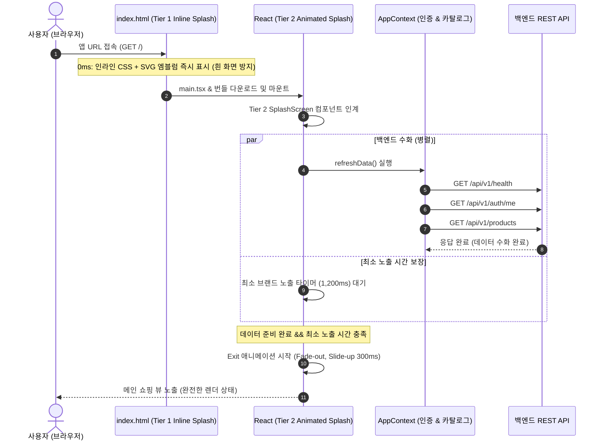
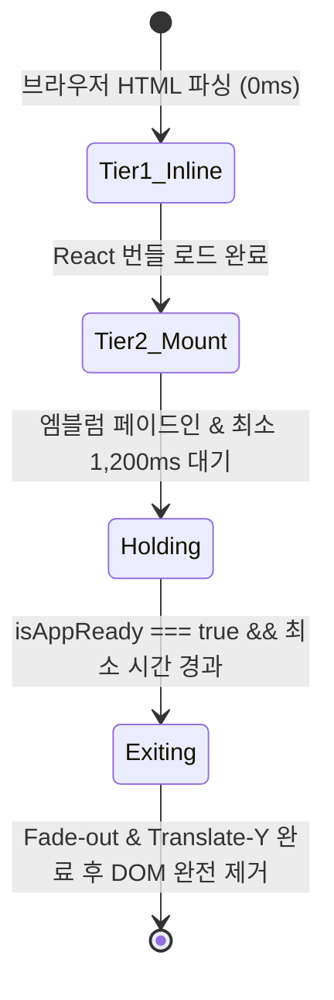

# [설계서] LuxuryRental 모바일 웹/앱 스플래시 화면 구현방안 및 계획서

> **문서 버전:** v1.0.0  
> **작성일:** 2026-11-09  
> **상태:** 제안 및 구현 대기 (Pending Execution)  
> **대상 플랫폼:** 모바일 웹 (PWA), 반응형 데스크톱  

---

## 1. 개요 및 목적 (Executive Summary)

### 1.1 추진 배경
LuxuryRental은 하이엔드 럭셔리 명품(샤넬, 에르메스, 루이비통, 롤렉스 등)의 단기 렌탈 및 구매를 제공하는 프리미엄 서비스입니다.  
초기 앱 로드 시 브라우저가 번들을 다운로드하고, 백엔드 API(인증 세션 `/auth/me`, 카탈로그 데이터 `/products`, 서버 헬스체크)를 조회하는 약 **400ms ~ 800ms**의 초기화 구간 동안 화면 깜빡임(FOUC, Flash of Unstyled Content)이나 콘텐츠 레이아웃 이동(CLS)이 발생할 수 있습니다.

### 1.2 핵심 목적
1. **럭셔리 브랜드 아이덴티티 극대화:** 앱 진입 첫인상에서 샴페인 골드 및 미드나잇 제트 톤의 절제된 모션 그래픽으로 독보적인 하이엔드 감성 전달.
2. **화면 깜빡임 제로화 (0ms Instant Load):** 스크립트가 파싱되기 전 브라우저 최초 렌더 단계부터 즉시 노출되는 네이티브 인라인 스플래시 구축.
3. **앱 상태 동기화 및 부드러운 전환:** 백엔드 인증 및 초기 카탈로그 로딩 완료 시점과 연동하여 스무스한 상향 페이드아웃(Slide & Fade-Out) 트랜지션 제공.
4. **사용자 경험 최적화 (빈도 제어):** 새로고침 및 세션 내 재진입 시 불필요한 대기 시간을 방지하는 스마트 세션 캐싱 및 감속 모션(Reduced Motion) 접근성 준수.

---

## 2. 시각 디자인 및 모션 사양 (Visual Design & Motion)

### 2.1 컬러 팔레트 & 타이포그래피
| 요소 | 컬러 코드 | 디자인 의도 |
| :--- | :--- | :--- |
| **Background** | `#0B0C0E` → `#13161B` (Deep Midnight Gradient) | 압도적인 무게감과 고급스러운 갤러리 쇼룸 분위기 연출 |
| **Primary Accent** | `#C5A880` (Champagne Gold) | 럭셔리 엠블럼, 테두리 디테일 및 헤어라인 골드 텍스처 |
| **Sub Accent** | `#8C734B` (Burnished Bronze) | 브랜드 서브 타이틀 및 로딩 인디케이터 |
| **Typography** | `Cinzel` / `Playfair Display` & `Pretendard` | 클래식 하이엔드 세리프 영문 로고와 현대적 산세리프 한글 조화 |

### 2.2 모션 시퀀스 (Timeline: 총 1,400ms 권장)
```
[ 0ms ] ─────────────────────────────────────────── Tier 1 Native Inline HTML Splash 렌더
[ 0 ~ 200ms ]  React 번들 파싱 & React DOM Hydration 시작
[ 200 ~ 600ms] 골드 크레스트 엠블럼 페이드인 (Opacity: 0 → 1, Scale: 0.94 → 1.0)
[ 400 ~ 800ms] 브랜드 워드마크 "LUXURY RENTAL" & 슬로건 슬라이드 업 페이드인
[ 600 ~ 1200ms] 샴페인 골드 미세 펄스 인디케이터 활성화 & 백엔드 데이터 병렬 수화 (Hydration)
[ 1200 ~ 1400ms] 전체 스플래시 상향 페이드아웃 (TranslateY: 0 → -20px, Opacity: 1 → 0)
[ 1400ms ] ────────────────────────────────────────── 메인 앱 화면 완전 진입 (Unmount)
```

---

## 3. 기술 아키텍처 (Technical Architecture)

### 3.1 2단계 듀얼 티어(Dual-Tier) 구조


### 3.2 Tier 1: 네이티브 인라인 스플래시 (`frontend/index.html`)
- **역할:** 자바스크립트가 다운로드되고 실행되기 전, 브라우저가 `index.html`을 파싱하자마자 0초 만에 화면을 채움.
- **특징:** 외부 CSS/JS 의존성 제로(Zero-dependency). 인라인 `<style>` 태그와 인라인 SVG만으로 구성.
- **제거 방식:** React 루트가 마운트되면 부드럽게 오버랩되거나 `splash-root`가 제거됨.

### 3.3 Tier 2: React 애니메이션 스플래시 (`SplashScreen.tsx`)
- **역할:** React 런타임 환경에서 인터랙티브 애니메이션을 수행하고, `AppContext`의 `isAuthLoading`, `isDataLoading` 상태와 동기화.
- **안전장치:**
  - **최소 노출 시간:** 1,200ms (너무 빠르게 번쩍이며 꺼지는 현상 방지)
  - **최대 타임아웃:** 3,500ms (네트워크가 지연되어도 앱이 멈추지 않고 강제 진입)
  - **접근성(Accessibility):** `userSettings.reduce_animations === true` 또는 `prefers-reduced-motion` 감지 시 즉시 0ms 진입.

---

## 4. 세션 관리 및 노출 빈도 정책 (Display Frequency)

| 구분 | 첫 접속 (Cold Boot) | 세션 내 페이지 이동 | 브라우저 새로고침 (F5) |
| :--- | :--- | :--- | :--- |
| **동작** | 정규 스플래시 (1.2초) 노출 | 스플래시 건너뜀 (0초 즉시 이동) | 설정 옵션에 따라 선택 (기본: 경량 로더 or 스플래시) |
| **제어 기법** | `sessionStorage.getItem('lr_splash_viewed')` 확인 | SPA 라우팅 (오버레이/뷰 전환 시 스플래시 미발생) | 탭 유지 시 세션 플래그 유지로 빠른 새로고침 지원 |

> [!TIP]
> **모바일 홈 화면 추가(PWA) 지원:**  
> 스마트폰 홈 화면 아이콘을 통해 PWA 독립 모드(`display: standalone`)로 진입할 경우 네이티브 모바일 앱과 100% 동일한 콜드 부트 스플래시 경험을 제공합니다.

---

## 5. 상세 구현 계획 및 파일 변경 내역

### 5.1 수정 및 생성 대상 파일
1. `frontend/index.html`
   - `<div id="native-splash">` 인라인 스플래시 마크업 추가
   - 0ms 인라인 CSS 애니메이션 및 로고 인라인 SVG 삽입
2. `frontend/src/components/ui/SplashScreen.tsx` **(신규 생성)**
   - 럭셔리 크레스트 엠블럼, 골드 시머, 로고 타이포, 슬로건 렌더링
   - 페이드아웃 상태 머신 (`'entering' | 'holding' | 'exiting' | 'hidden'`)
3. `frontend/src/context/AppContext.tsx`
   - `isAppReady` (백엔드 헬스 + 인증 확인 + 카탈로그 완료) 상태 제공
4. `frontend/src/main.tsx`
   - 최상단 오버레이 레이어에 `<SplashScreen />` 연동
   - 초기 수화 완료 시 언마운트 처리

### 5.2 컴포넌트 상태 다이어그램


---

## 6. 품질 검증 및 테스트 계획 (QA & Verification)

1. **콜드 부트 화면 전환 검증:**
   - 브라우저 캐시 비우기 및 강력 새로고침 시 흰 화면 번쩍임(0%) 확인
2. **네트워크 지연/오프라인 내구성 검증:**
   - 네트워크 3G 시뮬레이션 환경에서 최대 3.5초 안전 타임아웃 작동 확인
3. **접근성 검증:**
   - `prefers-reduced-motion` 활성화 시 모션 축소 및 즉시 진입 확인
4. **반응형 뷰포트 검증:**
   - 모바일 (360px, 390px, 440px), 태블릿 (768px), 데스크톱 (1920px) 전 해상도 검증 스크린샷 캡처

