# LUXURY RENTAL — 전 화면 및 상호작용 스크린샷 인덱스 (Phase 3)

본 디렉토리(`docs/screenshots_phase3/`)는 LuxuryRental 웹 애플리케이션의 **모든 화면, 모달, 인터랙션, 상태 변화, 관리자 대시보드 및 5대 반응형 뷰포트**를 **1.5x Retina 고해상도**로 자동 캡처한 전체 스크린샷 모음입니다.

**총 캡처 수량**: **81개**
**생성 일시**: 2026-11-05T01:00:43.332Z

---

## 1. 데스크톱 레이아웃

| 번호 | 미리보기 | 파일명 | 기능 및 화면 설명 | 세부 인터랙션 내용 | 해상도/환경 |
| :---: | :---: | :--- | :--- | :--- | :--- |
| 1 | 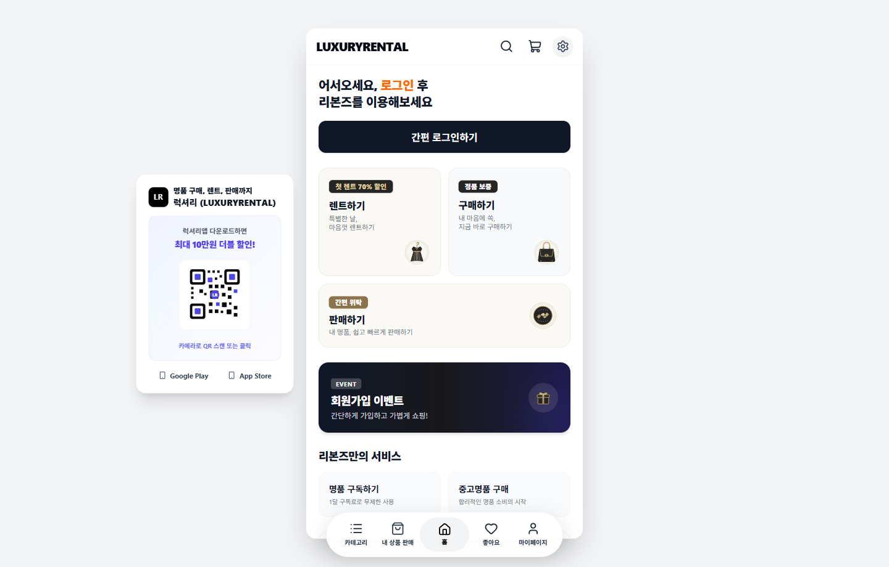 | `01_desktop_main_view.png` | **데스크톱 1440px 전체 뷰** | 중앙 448px 모바일 컨테이너 + 좌측 고해상도 SVG QR 스캐너 배너 + 스토어 다운로드 버튼 + 고객센터 안내 | `1440x920 Desktop` |
| 2 | 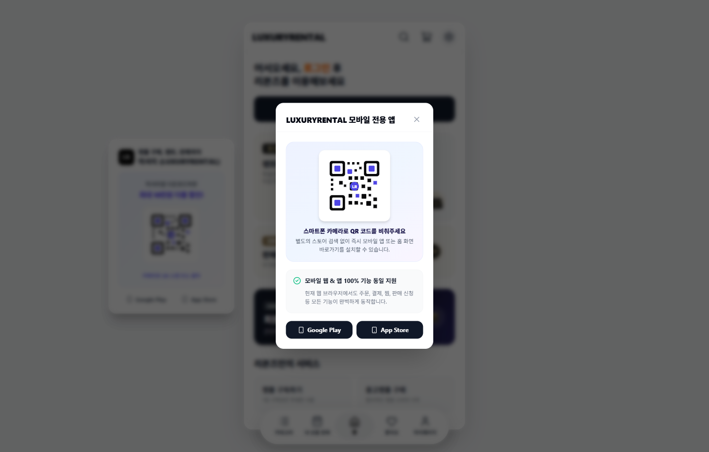 | `02_desktop_qr_download_modal.png` | **앱 다운로드 안내 모달** | Google Play 및 App Store 다운로드 링크 및 SMS 안내 전송 팝업 모달 | `1440x920 Desktop` |

---

## 2. 모바일 메인

| 번호 | 미리보기 | 파일명 | 기능 및 화면 설명 | 세부 인터랙션 내용 | 해상도/환경 |
| :---: | :---: | :--- | :--- | :--- | :--- |
| 1 | 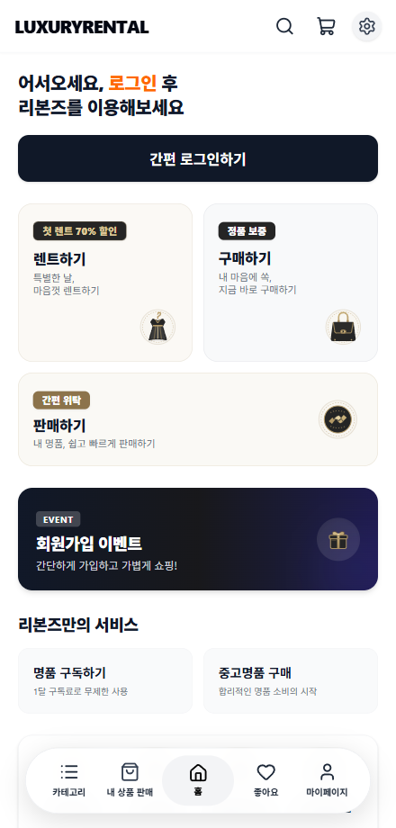 | `03_main_mobile_initial.png` | **모바일 메인 화면 상단** | 헤더(검색/장바구니/설정), 비로그인 안내 배너, 3대 서비스 액션 카드(렌트하기 70% 할인, 구매하기 정품 보증, 판매하기) | `440x920 Mobile` |
| 2 | 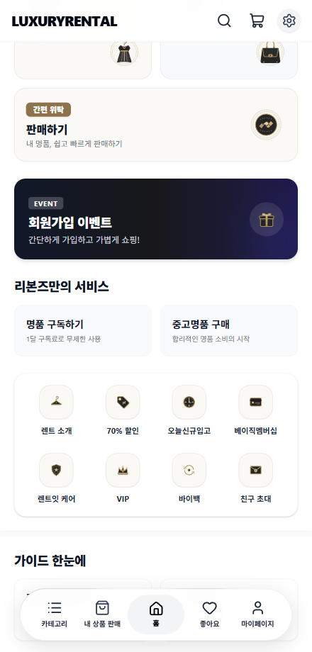 | `04_main_services_and_8grid_menu.png` | **리본즈만의 서비스 & 8-Grid 메뉴** | 고급스러운 음각 각인 아이콘 8종 (명품 렌트, 타임 세일, 24시간 퀵, VIP 멤버십, 안심 케어, 라운지, 바이백, 친구 초대) | `440x920 Mobile` |
| 3 | 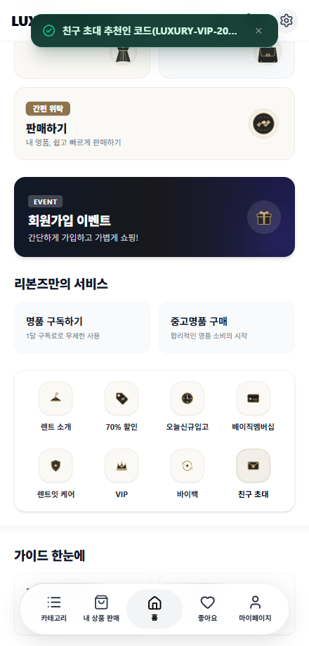 | `05_main_friend_invite_clipboard_toast.png` | **친구 초대 클립보드 복사 완료 토스트** | VIP 추천인 코드(LUXURY-VIP-2026) 복사 성공 토스트 및 인터랙션 | `440x920 Mobile` |
| 4 | 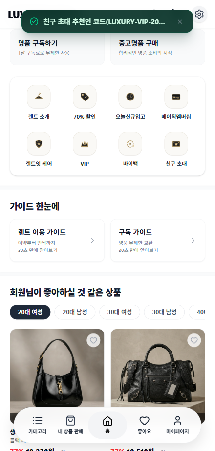 | `06_main_recommend_tab_20w.png` | **맞춤 추천 상품: 20대 여성 (기본)** | 20대 여성 인기 큐레이션 실사 명품 가방 그리드 및 가격/할인율 표시 | `440x920 Mobile` |
| 5 | 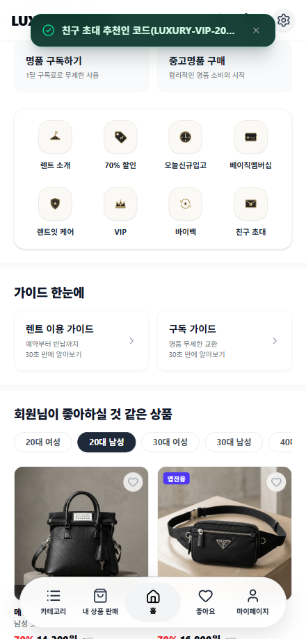 | `07_main_recommend_tab_20m.png` | **맞춤 추천 탭: 20대 남성** | 20대 남성 인기 상품 큐레이션 전환 | `440x920 Mobile` |
| 6 | 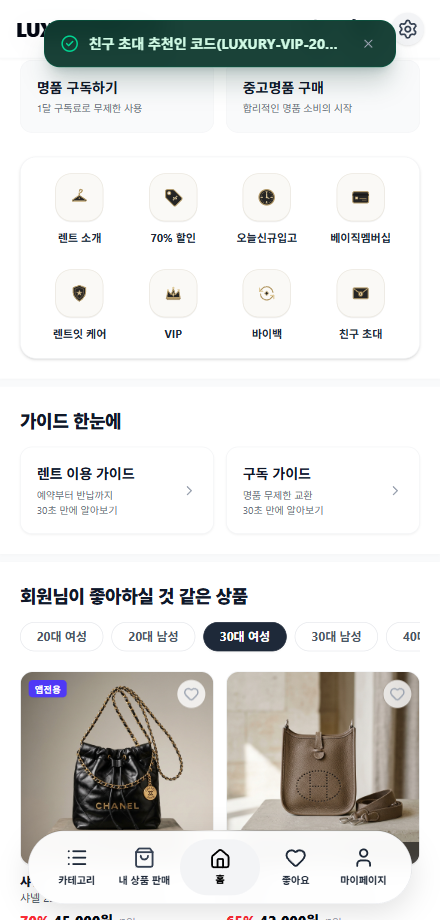 | `08_main_recommend_tab_30w.png` | **맞춤 추천 탭: 30대 여성** | 30대 여성 인기 상품 큐레이션 전환 | `440x920 Mobile` |
| 7 | 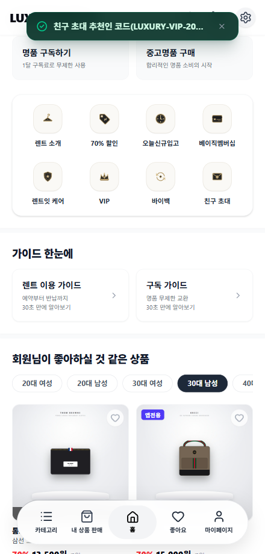 | `09_main_recommend_tab_30m.png` | **맞춤 추천 탭: 30대 남성** | 30대 남성 인기 상품 큐레이션 전환 | `440x920 Mobile` |
| 8 | 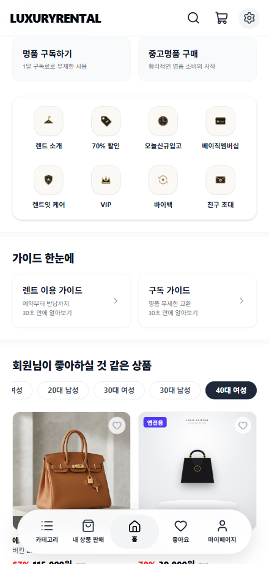 | `10_main_recommend_tab_40w.png` | **맞춤 추천 탭: 40대 여성** | 40대 여성 인기 상품 큐레이션 전환 | `440x920 Mobile` |
| 9 | 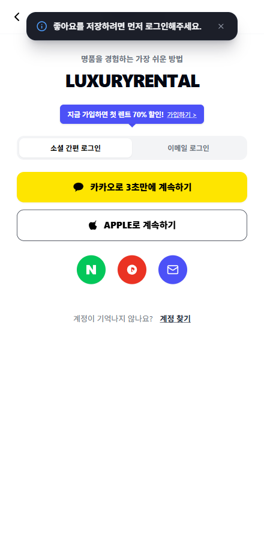 | `11_main_recommend_favorite_toggle.png` | **비로그인 찜 클릭 시 로그인 안내** | 비로그인 상태에서 좋아요 클릭 시 로그인 유도 토스트 및 로그인 오버레이 자동 안내 | `440x920 Mobile` |
| 10 | 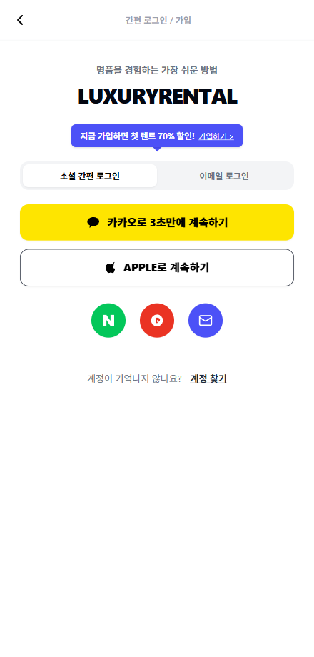 | `25_main_floating_bottom_nav.png` | **하단 플로팅 알약 내비게이션 바** | 홈, 카테고리, 내 상품 판매, 좋아요, 마이페이지 5대 탭 플로팅 바 | `440x920 Mobile` |

---

## 3. 상품 상세 및 장바구니

| 번호 | 미리보기 | 파일명 | 기능 및 화면 설명 | 세부 인터랙션 내용 | 해상도/환경 |
| :---: | :---: | :--- | :--- | :--- | :--- |
| 1 | 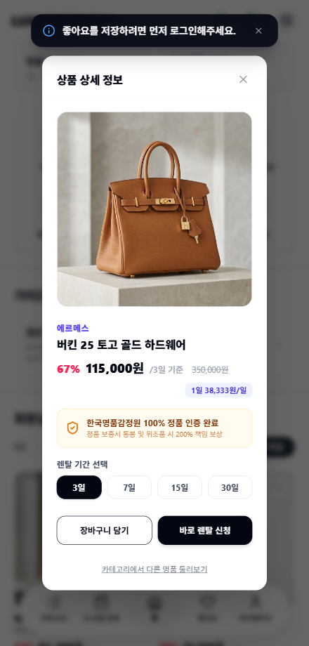 | `12_product_detail_modal_3days.png` | **상품 상세 모달 (3일 기준 기본)** | 실사 제품 룩북, 한국명품감정원 100% 정품 인증 배지, 3일 기준 대여료 실시간 계산기 | `440x920 Mobile` |
| 2 | 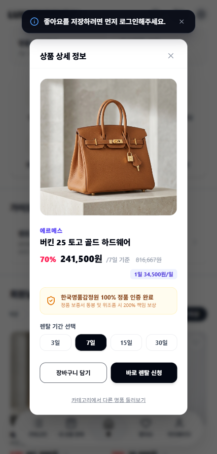 | `13_product_detail_modal_7days.png` | **상품 상세 모달 (7일 선택)** | 7일 선택 시 실시간 대여료 재계산 및 선택 버튼 활성화 | `440x920 Mobile` |
| 3 | 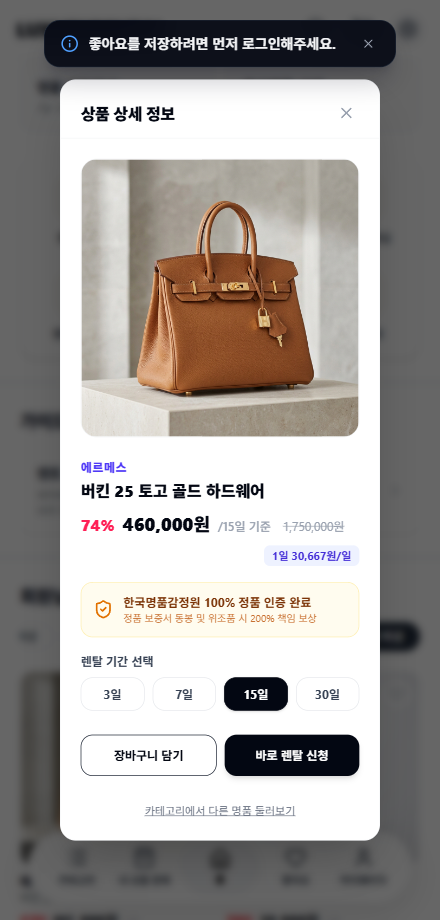 | `14_product_detail_modal_15days.png` | **상품 상세 모달 (15일 선택)** | 15일 선택 시 실시간 대여료 재계산 및 혜택 요약 | `440x920 Mobile` |
| 4 | 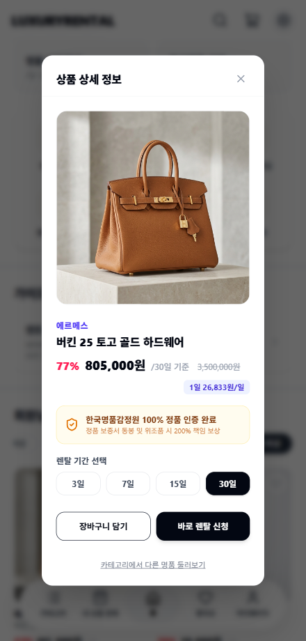 | `15_product_detail_modal_30days.png` | **상품 상세 모달 (30일 선택)** | 30일 선택 시 월간 렌탈 할인 요금 표시 | `440x920 Mobile` |
| 5 | 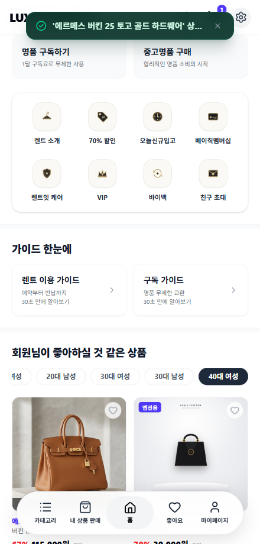 | `16_product_detail_add_to_cart_toast.png` | **장바구니 담기 완료 토스트** | 장바구니 추가 성공 안내 토스트 및 모달 닫힘 | `440x920 Mobile` |
| 6 | 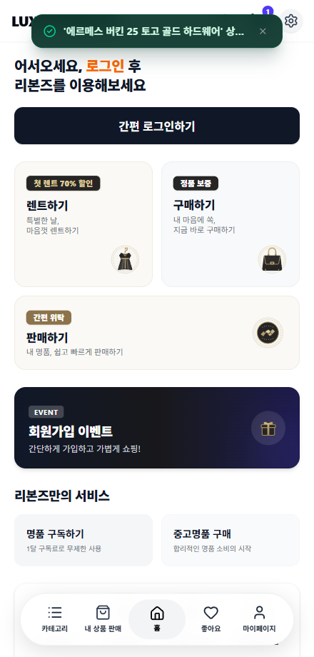 | `17_cart_header_badge.png` | **헤더 장바구니 실시간 수량 배지** | 장바구니 아이콘 우측 상단 인디고 원형 배지에 수량(1) 실시간 반영 | `440x920 Mobile` |
| 7 | 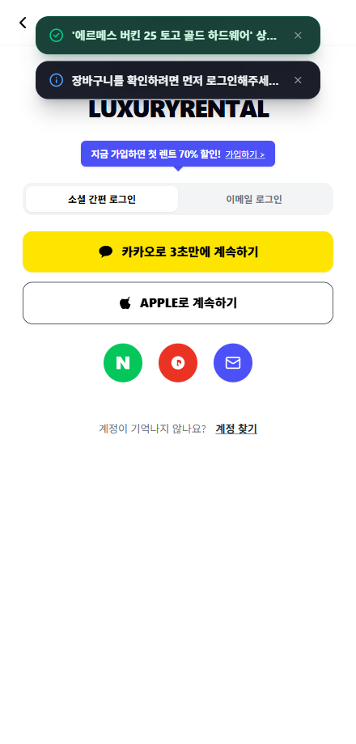 | `18_cart_modal_view.png` | **장바구니 팝업 모달** | 담긴 렌탈 상품 정보, 렌탈 기간, 보증금 0원 프로모션, 무료 왕복 특송 배송비, 총 예상 대여료 계산 요약 | `440x920 Mobile` |
| 8 |  | `19_cart_modal_checkout_toast.png` | **렌탈 주문 배송 정보 입력 화면** | 수령인 성명, 휴대폰 번호, 배송지 주소, 배송 메모 입력 및 VIP 왕복 특송 무료 혜택 | `440x920 Mobile` |

---

## 4. 신규 입고 & 푸터

| 번호 | 미리보기 | 파일명 | 기능 및 화면 설명 | 세부 인터랙션 내용 | 해상도/환경 |
| :---: | :---: | :--- | :--- | :--- | :--- |
| 1 |  | `20_main_rent_new_arrivals.png` | **Rent New Arrivals 가로 스크롤** | 매주 수요일 업데이트되는 신규 입고 명품 카드 가로 스크롤 뷰 | `440x920 Mobile` |
| 2 | 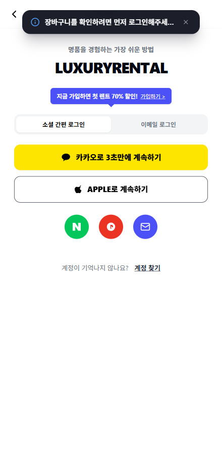 | `21_main_footer_escrow_and_links.png` | **토스 에스크로 및 정책 푸터** | 토스페이먼츠 구매안전 에스크로 배지, 고객센터, 정책안내, 이용약관, 개인정보처리방침 링크 | `440x920 Mobile` |
| 3 |  | `22_footer_customer_service_modal.png` | **고객센터 안내 팝업 모달** | 평일 운영시간, 대표번호(1544-0000), 이메일, 카카오톡 채널 안내 | `440x920 Mobile` |
| 4 |  | `23_footer_service_policy_modal.png` | **정책 안내 팝업 모달** | 100% 정품 인증 검수, 가품 시 200% 책임보상, 일상 스크래치 무상 케어 보증 | `440x920 Mobile` |
| 5 |  | `24_footer_terms_of_service_modal.png` | **전자상거래 표준 이용약관 모달** | 총칙, 회원가입, 대여 계약, 청약철회, 손해배상 등 법적 공시 전문 | `440x920 Mobile` |

---

## 5. 통합 검색 오버레이

| 번호 | 미리보기 | 파일명 | 기능 및 화면 설명 | 세부 인터랙션 내용 | 해상도/환경 |
| :---: | :---: | :--- | :--- | :--- | :--- |
| 1 | 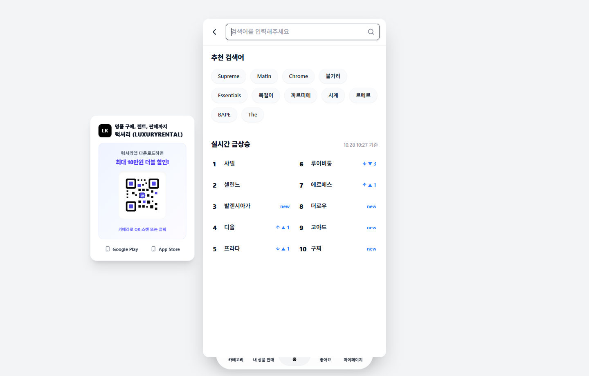 | `26_search_overlay_desktop_aligned_0px.png` | **데스크톱 1440px 검색창 0px 오프셋 정렬** | 슬라이드 완료 후 가로 스크롤(scrollX: 0) 및 앱 중앙 컨테이너와의 완벽한 0px 경계 정렬 | `1440x920 Desktop` |
| 2 | 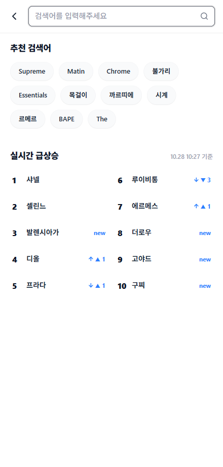 | `27_search_overlay_mobile_default.png` | **모바일 검색 오버레이 기본** | 최근 검색어 칩, 실시간 급상승 브랜드 순위 1~10위, 추천 태그 | `440x920 Mobile` |
| 3 | 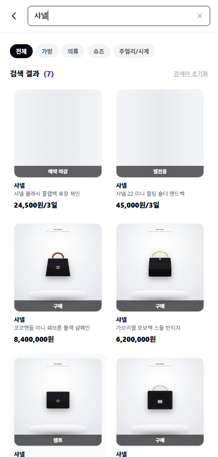 | `28_search_typing_chanel.png` | **샤넬 실시간 검색 결과** | 샤넬 클래식 플랩백, 22 미니백 등 고화질 실사 제품 카드 및 READY 상태 | `440x920 Mobile` |
| 4 | 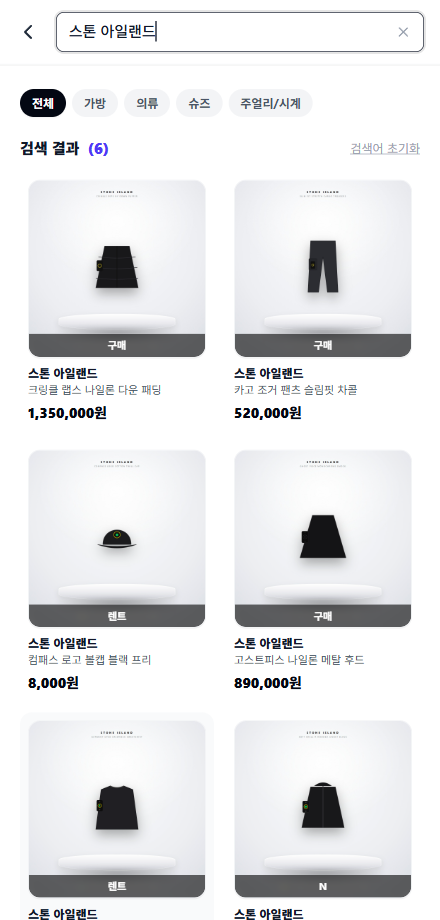 | `29_search_typing_stone_island.png` | **스톤 아일랜드 실시간 검색 결과** | 스톤 아일랜드 나일론 메탈, 쉐도우 프로젝트 실사 의류 카탈로그 | `440x920 Mobile` |
| 5 | 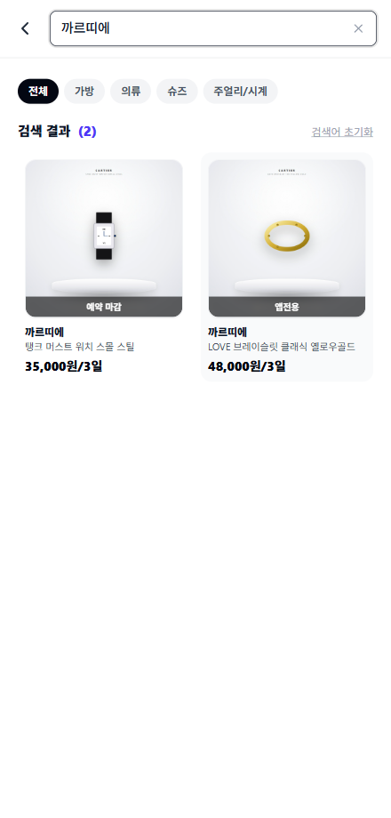 | `30_search_keyword_chip_cartier.png` | **추천 검색어 칩 클릭 결과** | 추천 태그 클릭 시 검색어 자동 입력 및 결과 필터링 | `440x920 Mobile` |

---

## 6. 회원 인증 오버레이

| 번호 | 미리보기 | 파일명 | 기능 및 화면 설명 | 세부 인터랙션 내용 | 해상도/환경 |
| :---: | :---: | :--- | :--- | :--- | :--- |
| 1 |  | `31_login_overlay_default.png` | **간편 로그인 오버레이 기본** | 공식 로고 적용 카카오/네이버/Apple/PAYCO 소셜 로그인 및 이메일 로그인 폼 | `440x920 Mobile` |
| 2 |  | `32_login_error_validation.png` | **로그인 실패 유효성 검증 토스트** | 존재하지 않는 계정 또는 비밀번호 불일치 시 직관적인 에러 토스트 안내 | `440x920 Mobile` |
| 3 | 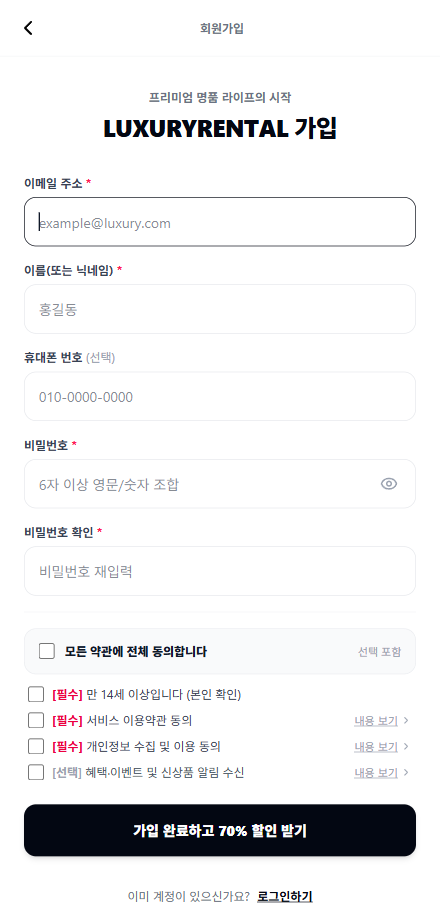 | `33_register_overlay_initial.png` | **회원가입 오버레이 초기 화면** | 이름, 이메일, 비밀번호, 휴대폰 번호 입력 및 필수/선택 법적 약관 동의 체크박스 | `440x920 Mobile` |
| 4 | 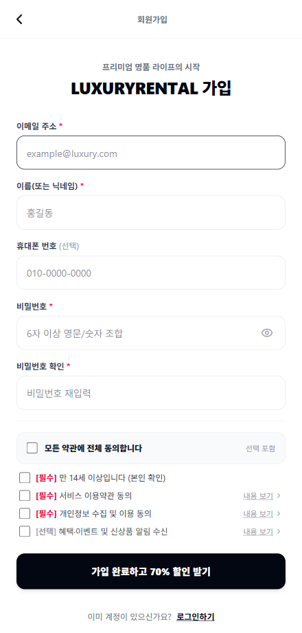 | `34_register_view_terms_modal.png` | **회원가입 필수 약관 전문 팝업** | 회원가입 화면에서 이탈 없이 약관 전문을 검토할 수 있는 인앱 약관 모달 | `440x920 Mobile` |
| 5 | 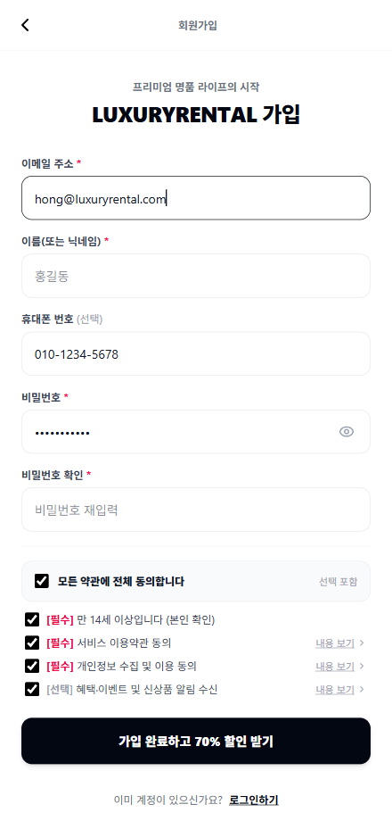 | `35_register_form_filled.png` | **회원가입 폼 입력 완료 상태** | 입력값 완성 및 약관 전체 동의 체크박스 활성화 상태 | `440x920 Mobile` |
| 6 | 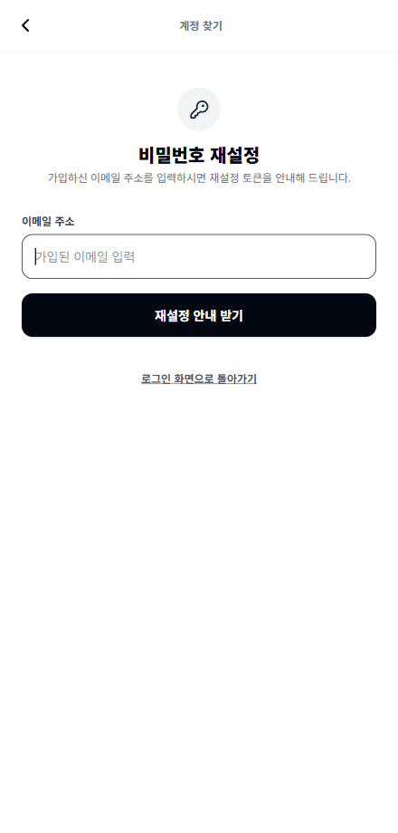 | `36_password_reset_step1_email.png` | **비밀번호 재설정 Step 1: 이메일 입력** | 가입 이메일 주소 입력 및 보안 토큰 전송 요청 단계 | `440x920 Mobile` |
| 7 | 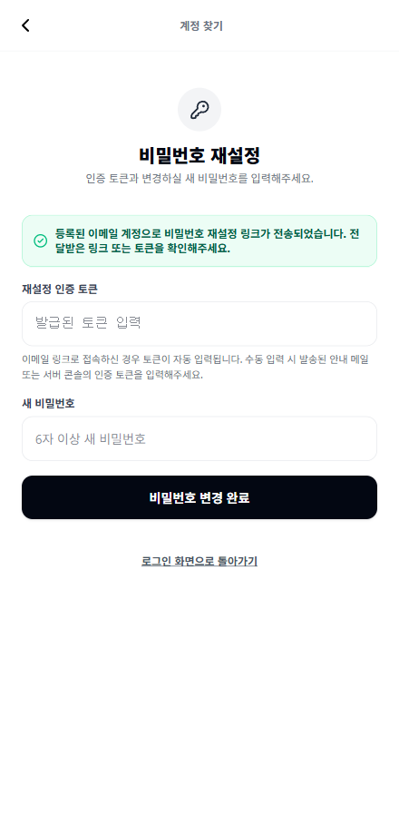 | `37_password_reset_step2_token.png` | **비밀번호 재설정 Step 2: 토큰 및 새 비밀번호 입력** | 인증 토큰 발송 성공 안내 토스트, 토큰 입력 필드, 신규 비밀번호 변경 폼 | `440x920 Mobile` |

---

## 7. 카테고리 및 브랜드

| 번호 | 미리보기 | 파일명 | 기능 및 화면 설명 | 세부 인터랙션 내용 | 해상도/환경 |
| :---: | :---: | :--- | :--- | :--- | :--- |
| 1 | 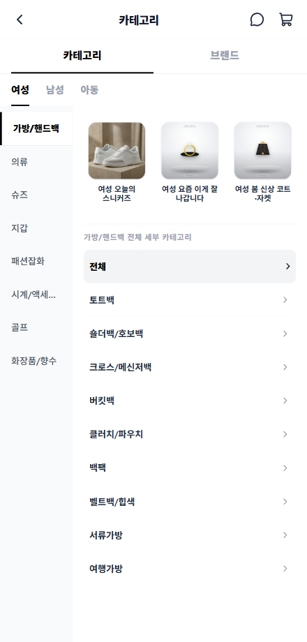 가방 (기본)" /> | `38_category_women_bags.png` | **카테고리: 여성 > 가방 (기본)** | 좌측 서브메뉴(가방, 의류, 슈즈, 지갑, 시계/액세서리) 및 가방 카탈로그 | `440x920 Mobile` |
| 2 | 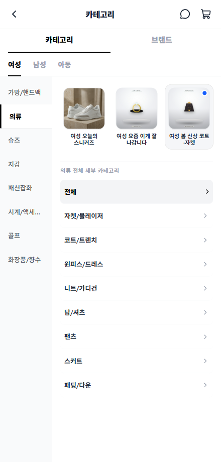 의류" /> | `39_category_women_clothing.png` | **카테고리: 여성 > 의류** | 의류 카테고리 룩북 및 상품 목록 | `440x920 Mobile` |
| 3 | 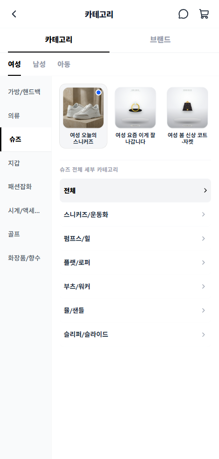 슈즈" /> | `40_category_women_shoes.png` | **카테고리: 여성 > 슈즈** | 슈즈/스니커즈 카테고리 룩북 및 상품 목록 | `440x920 Mobile` |
| 4 | 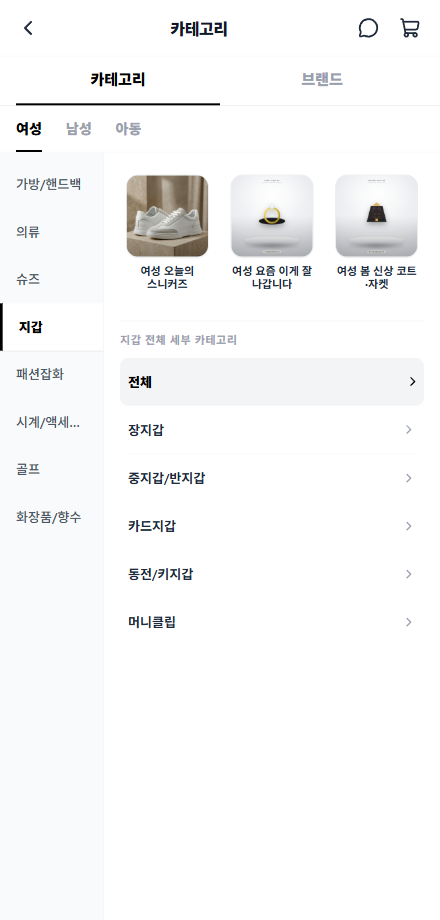 지갑" /> | `41_category_women_wallet.png` | **카테고리: 여성 > 지갑** | 지갑/카드홀더 카테고리 룩북 및 상품 목록 | `440x920 Mobile` |
| 5 | 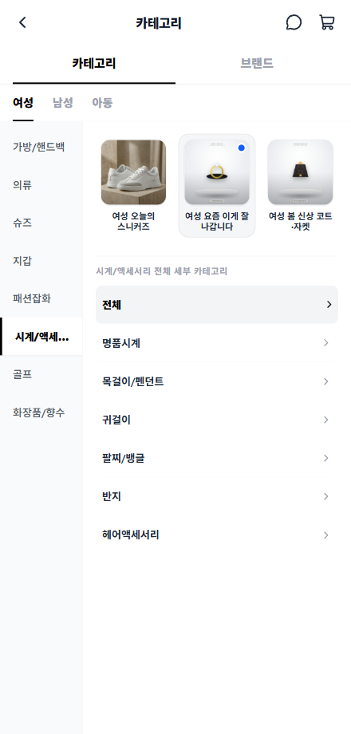 시계/액세서리" /> | `42_category_women_watch.png` | **카테고리: 여성 > 시계/액세서리** | 하이엔드 워치 및 주얼리 카테고리 | `440x920 Mobile` |
| 6 | 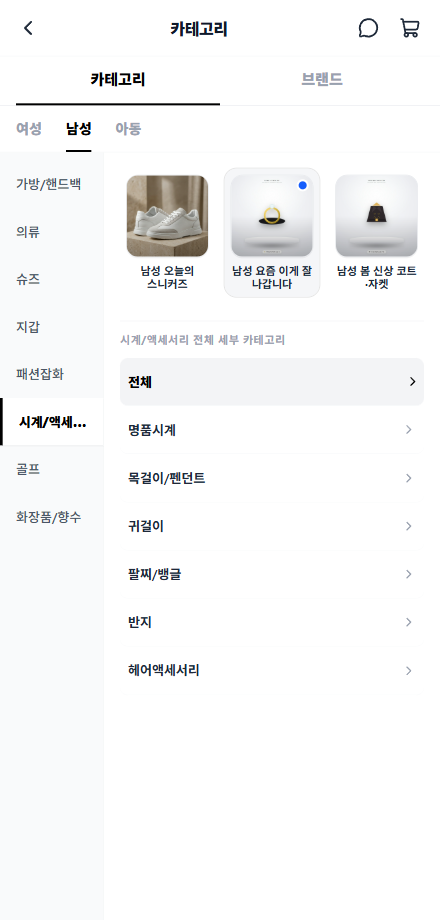 | `43_category_subtab_men.png` | **카테고리 대상: 남성** | 남성 럭셔리 라인업 서브탭 전환 | `440x920 Mobile` |
| 7 | 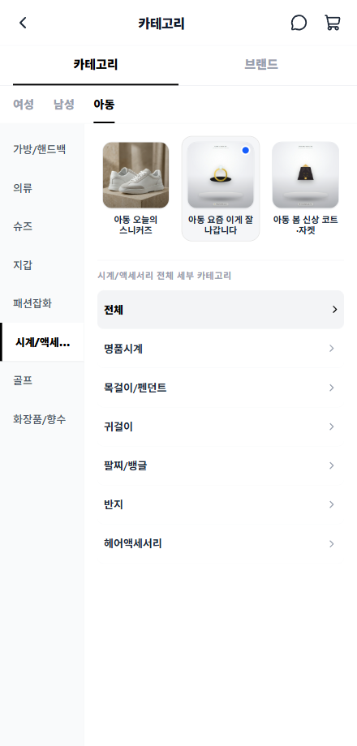 | `44_category_subtab_kids.png` | **카테고리 대상: 아동** | 키즈 명품 라인업 서브탭 전환 | `440x920 Mobile` |
| 8 | 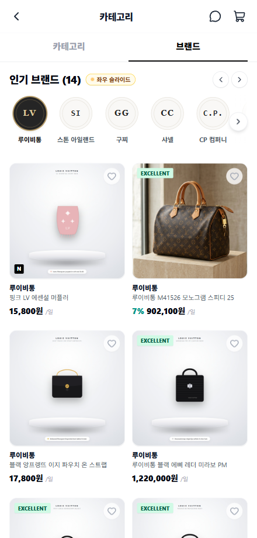 | `45_brand_tab_louis_vuitton.png` | **브랜드 탭: 루이비통 (Louis Vuitton)** | 루이비통 브랜드 칩 활성화 및 6종 고화질 실사 제품(스피디, 네오노에, 포쉐트 등) 그리드 | `440x920 Mobile` |
| 9 | 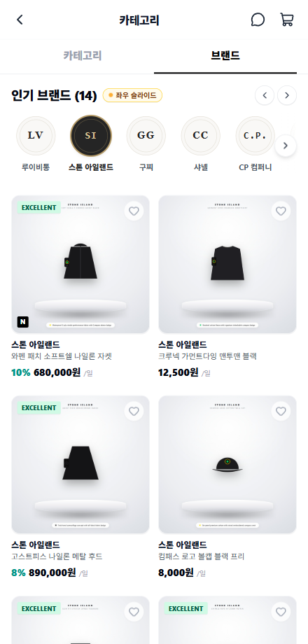 | `46_brand_tab_stone_island.png` | **브랜드 탭: 스톤 아일랜드** | 스톤 아일랜드 6종 실사 의류(나일론 메탈 오버셔츠, 소프트쉘 등) | `440x920 Mobile` |
| 10 | 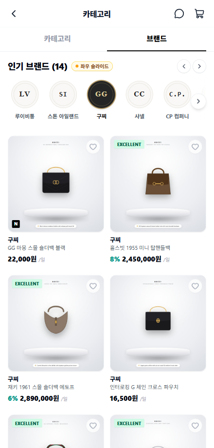 | `47_brand_tab_gucci.png` | **브랜드 탭: 구찌 (Gucci)** | 구찌 6종 실사 백/지갑(재키 1961, GG 마몽, 디오니소스 등) | `440x920 Mobile` |
| 11 | 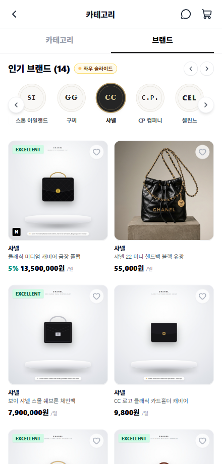 | `48_brand_tab_chanel.png` | **브랜드 탭: 샤넬 (Chanel)** | 샤넬 6종 실사 백(클래식 플랩백, 22백, 보이샤넬 등) | `440x920 Mobile` |
| 12 | 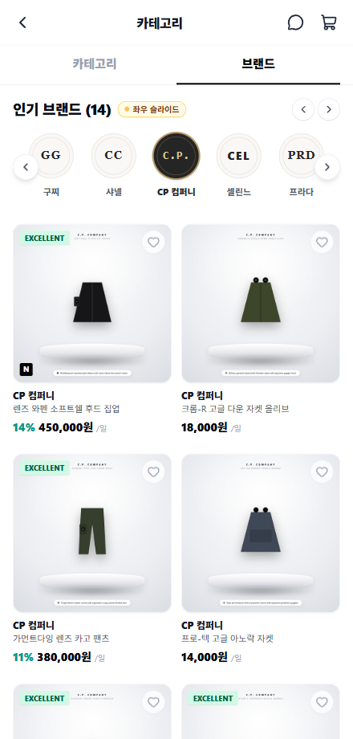 | `49_brand_tab_cp_company.png` | **브랜드 탭: CP 컴퍼니** | CP 컴퍼니 6종 실사 아우터(렌즈 와펜 소프트쉘, 고글 후디 등) | `440x920 Mobile` |
| 13 | 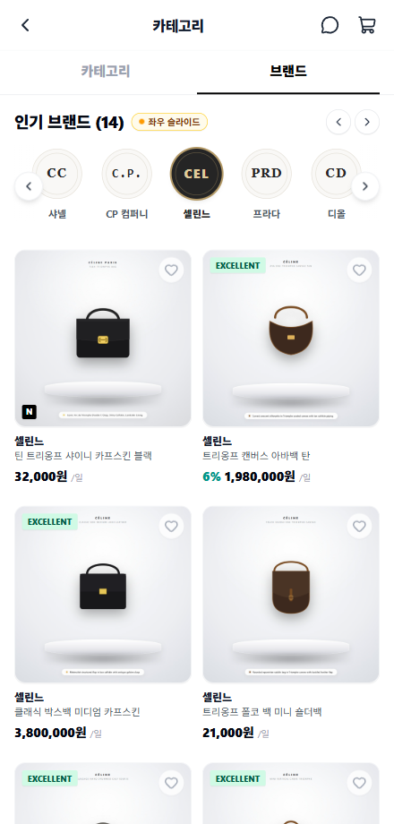 | `50_brand_tab_celine.png` | **브랜드 탭: 셀린느 (Celine)** | 셀린느 6종 실사 백(트리옹프 숄더백, 벨트백, 라지 카바스 등) | `440x920 Mobile` |

---

## 8. 내 상품 판매

| 번호 | 미리보기 | 파일명 | 기능 및 화면 설명 | 세부 인터랙션 내용 | 해상도/환경 |
| :---: | :---: | :--- | :--- | :--- | :--- |
| 1 | 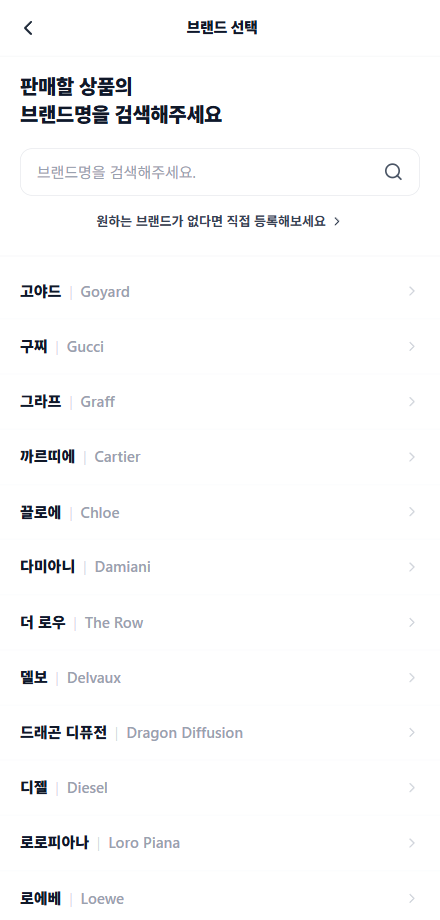 | `51_sell_page_initial.png` | **내 상품 판매 초기 화면** | 브랜드 검색창, 가나다순 브랜드 셀렉터 칩, 간편 위탁/판매 신청 가이드 | `440x920 Mobile` |
| 2 | 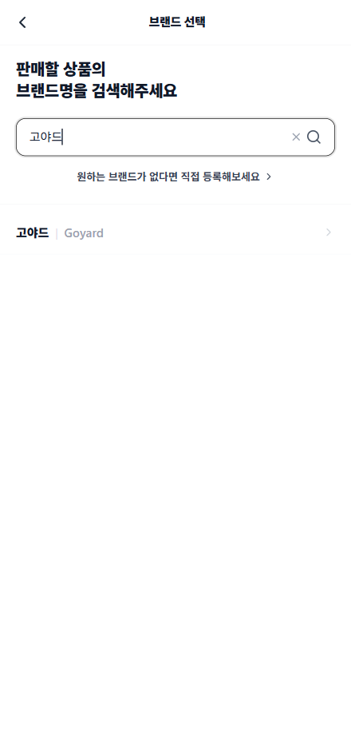 | `52_sell_page_brand_search_typing.png` | **판매 브랜드 실시간 검색** | 브랜드명 검색 필터링 및 일치 브랜드 즉시 노출 | `440x920 Mobile` |
| 3 | 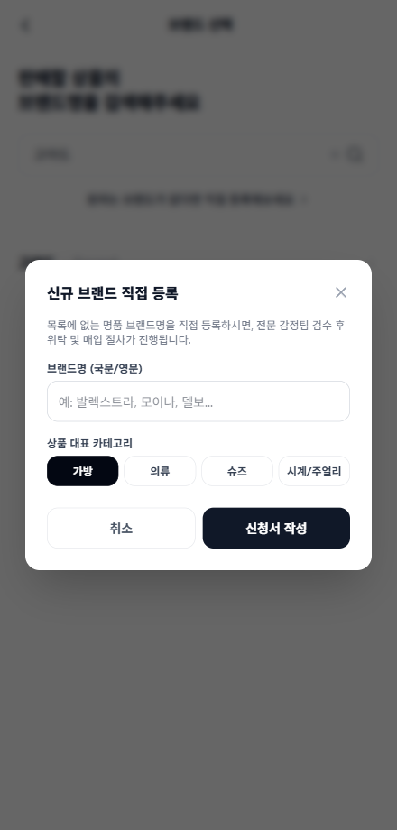 | `53_sell_page_direct_register_modal.png` | **브랜드 직접 등록 팝업 모달** | 리스트 외 신규 럭셔리 브랜드 수기 입력 및 감정 의뢰 모달 | `440x920 Mobile` |
| 4 |  | `54_sell_page_brand_confirm_modal.png` | **판매 감정 신청 정보 입력 모달** | 신청 브랜드 확인, 비회원 연락처 및 성함 입력 폼 | `440x920 Mobile` |
| 5 |  | `55_sell_page_submitted_toast.png` | **판매 신청 접수 완료 안내** | 전문 감정팀 24시간 내 배정 및 회신 완료 안내 팝업 | `440x920 Mobile` |

---

## 9. 일반 회원 세션

| 번호 | 미리보기 | 파일명 | 기능 및 화면 설명 | 세부 인터랙션 내용 | 해상도/환경 |
| :---: | :---: | :--- | :--- | :--- | :--- |
| 1 | 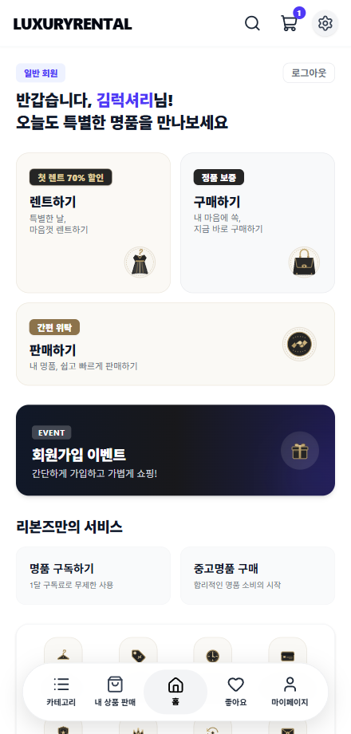 | `56_customer_login_home.png` | **일반 회원 로그인 메인 화면** | 상단 "일반 회원" 배지, "김럭셔리님 반갑습니다" 맞춤 환영 메시지 및 로그아웃 버튼 | `440x920 Mobile` |
| 2 | 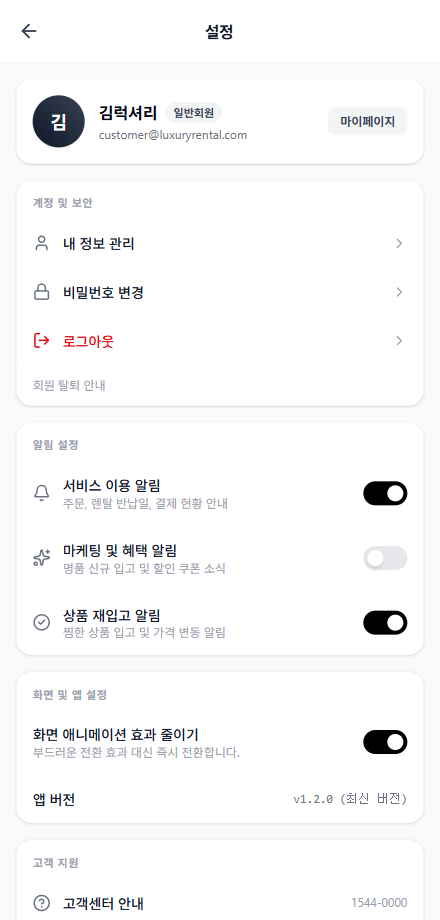 | `57_customer_settings_page.png` | **일반 회원 공통 설정 페이지** | 회원 프로필 요약 카드, 알림/애니메이션 감축 스위치, 비밀번호 변경, 로그아웃 (관리자 대시보드 카드 철저히 미노출) | `440x920 Mobile` |
| 3 | 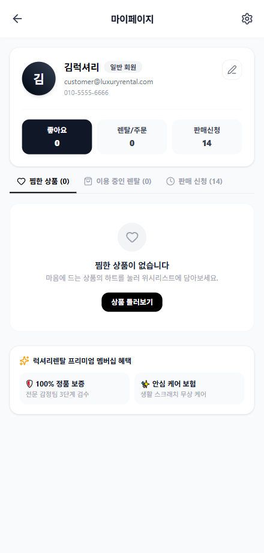 | `58_customer_mypage_favorites.png` | **고객 마이페이지: 찜한 상품 탭** | 회원 등급(VIP), 닉네임, 프로필 수정 버튼, 찜한 상품(FAVORITES) 실사 갤러리 | `440x920 Mobile` |
| 4 |  | `59_customer_mypage_sell_requests.png` | **고객 마이페이지: 내 판매 신청 내역 탭** | 고객이 신청한 명품 판매/위탁 신청 건의 접수 상태(검토중/승인) 실시간 트래킹 | `440x920 Mobile` |
| 5 |  | `60_customer_mypage_profile_edit_modal.png` | **프로필 사진 및 정보 수정 모달** | 프로필 아바타 이미지 업로드 UI, 닉네임, 연락처 변경 폼 | `440x920 Mobile` |

---

## 10. 최고관리자 세션

| 번호 | 미리보기 | 파일명 | 기능 및 화면 설명 | 세부 인터랙션 내용 | 해상도/환경 |
| :---: | :---: | :--- | :--- | :--- | :--- |
| 1 | 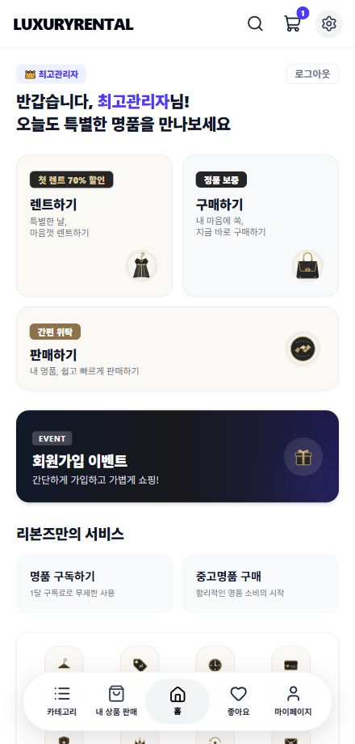 | `61_admin_login_home.png` | **최고관리자 로그인 메인 화면** | 상단 "👑 최고관리자" 황금 인디고 배지 및 관리자 프로필 | `440x920 Mobile` |
| 2 |  | `62_admin_settings_dashboard_entry_card.png` | **관리자 전용 설정 페이지** | 최고관리자에게만 독점 노출되는 "통합 관리자 대시보드" 진입 카드 (ADMIN ONLY) | `440x920 Mobile` |
| 3 |  | `63_admin_mypage_admin_role.png` | **관리자 마이페이지 화면** | 최고관리자 권한 배지 및 시스템 관리 안내 | `440x920 Mobile` |

---

## 11. 통합 관리자 대시보드

| 번호 | 미리보기 | 파일명 | 기능 및 화면 설명 | 세부 인터랙션 내용 | 해상도/환경 |
| :---: | :---: | :--- | :--- | :--- | :--- |
| 1 |  | `64_admin_recruit_dashboard_store.png` | **매장 구인/채용 현황 대시보드 (매장 모드)** | 실시간 충원 통계, 매장별 TO 현황, 긴급 구인 요청 리스트 및 글래스모피즘 UI | `1920x1080 Desktop` |
| 2 |  | `65_admin_recruit_to_request_modal.png` | **TO 변경 요청 글래스모피즘 모달** | 매장 관리자 권한 TO 증원/감원 요청 팝업 | `1920x1080 Desktop` |
| 3 |  | `66_admin_recruit_form_filled.png` | **신규 구인 요청 작성 폼 입력 상태** | 근무일자, 직무, 근무시간, 휴게시간, 인원수, 추천인 입력 상태 | `1920x1080 Desktop` |
| 4 |  | `67_admin_recruit_workers_db_and_sms_modal.png` | **근무자 DB 및 단체 문자 발송 모달** | 체크박스로 선택된 매장 근무자 대상 맞춤 공지 SMS 발송 모달 | `1920x1080 Desktop` |
| 5 |  | `68_admin_recruit_chat_interaction.png` | **실시간 소통 및 채팅 상호작용** | 매장 관리자 및 본사 총괄 담당자 간 실시간 업무 지시 및 상태 공유 채팅 | `1920x1080 Desktop` |
| 6 |  | `69_admin_role_switch_headquarters.png` | **본사 총괄 관리자(ADMIN) 모드 전환** | 전국 매장 구인 현황 집계 및 본사 전용 관리 도구(엑셀 업로드, 채용 확정 등록) 활성화 | `1920x1080 Desktop` |
| 7 |  | `70_admin_excel_upload_modal.png` | **35개 매장 구인 현황 엑셀 일괄 업로드 모달** | 35개 매장 TO 데이터 미리보기 및 데이터베이스 일괄 반영 모달 | `1920x1080 Desktop` |
| 8 |  | `71_admin_hire_result_modal.png` | **채용 결과 등록 팝업 모달** | 최종 합격자 확정 및 문자 통보 모달 | `1920x1080 Desktop` |
| 9 |  | `72_admin_shop_management_table.png` | **쇼핑몰 상품 관리 테이블** | 서버 DB와 연동된 명품 렌탈 상품 목록, 브랜드, 1일/3일 대여료, 이미지 갤러리 관리 버튼 | `1920x1080 Desktop` |
| 10 |  | `73_admin_shop_add_product_modal.png` | **신규 명품 상품 등록 모달** | 신규 상품 즉시 등록 및 DB 반영 확인 알림 모달 | `1920x1080 Desktop` |
| 11 |  | `74_admin_shop_image_gallery_modal.png` | **상품 이미지 갤러리 관리 모달** | 해당 상품에 연결된 실사 룩북 갤러리 조회, 신규 룩북 사진 파일 첨부 및 등록/삭제 인터랙션 | `1920x1080 Desktop` |
| 12 |  | `75_admin_sell_requests_management.png` | **고객 명품 판매/위탁 신청 관리 탭** | 고객들이 신청한 명품 판매 접수 건 검토, 승인/반려 상태 변경 컨트롤러 | `1920x1080 Desktop` |
| 13 |  | `76_admin_return_to_main_app.png` | **메인 쇼핑몰 앱으로 부드러운 복귀** | 관리자 대시보드에서 일반 소비자 쇼핑몰 화면으로의 완벽한 뷰 전환 | `1920x1080 Desktop` |

---

## 12. 반응형 뷰포트 검증

| 번호 | 미리보기 | 파일명 | 기능 및 화면 설명 | 세부 인터랙션 내용 | 해상도/환경 |
| :---: | :---: | :--- | :--- | :--- | :--- |
| 1 |  | `77_responsive_360_small_mobile.png` | **360px 소형 모바일** | 초소형 안드로이드 폰 뷰포트 레이아웃 무결성 | `360x780` |
| 2 |  | `78_responsive_390_standard_mobile.png` | **390px 표준 모바일** | 표준 아이폰 뷰포트 레이아웃 무결성 | `390x844` |
| 3 |  | `79_responsive_430_large_mobile.png` | **430px 대형 모바일** | 대화면 프로 맥스 뷰포트 레이아웃 무결성 | `430x932` |
| 4 |  | `80_responsive_768_tablet.png` | **768px 태블릿 세로** | 아이패드/태블릿 세로 모드 중앙 정렬 레이아웃 무결성 | `768x1024` |
| 5 |  | `81_responsive_1920_ultrawide.png` | **1920px 울트라와이드 데스크톱** | FHD 와이드 모니터 뷰포트 레이아웃 무결성 | `1920x1080` |

---

