# LUXURY RENTAL — 전 화면 및 전 상호작용 종합 스크린샷 인덱스 (Phase 6: 시스템 무결성 & 시각적 QA 완성)

본 디렉토리(`docs/screenshots_phase6/`)는 LuxuryRental 플랫폼의 **Phase 6 시스템 안정화, 오버레이 화면 전환 무결성, 실사 룩북 상품 데이터 및 정확한 가격 단위 표기, Dark Gunmetal 갤러리 모달 격리 및 6대 반응형 뷰포트**를 **1.5x Retina 고해상도**로 자동 캡처한 전체 102개 검증 스크린샷 모음입니다.

### 🌟 Phase 6 핵심 개선 검증 지표
- **총 캡처 수량**: **102개 (전수 통과)**
- **고유 SHA-256 해시 수량**: **88개 / 102개**
- **생성 일시**: 2026-11-05T03:31:50.138Z
- **검증 환경**: Chromium (Puppeteer Core) 1.5x Device Scale Factor

---

## 1. 데스크톱 레이아웃

| 번호 | 미리보기 | 파일명 | 기능 및 화면 설명 | 세부 인터랙션 내용 | 해상도/환경 | SHA-256 (Hash) | 상태 |
| :---: | :---: | :--- | :--- | :--- | :--- | :---: | :---: |
| 1 | 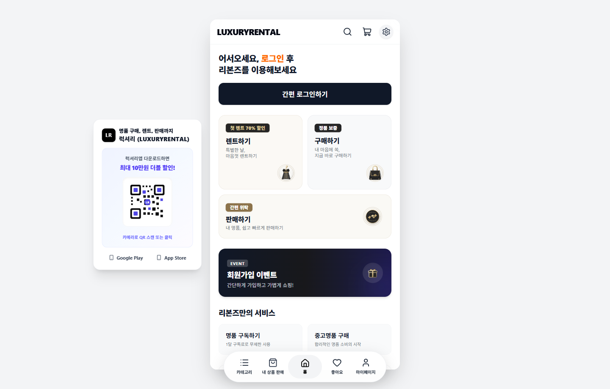 | `01_desktop_main_view.png` | **데스크톱 1440px 전체 뷰** | 중앙 448px 모바일 컨테이너 + 좌측 고해상도 SVG QR 스캐너 배너 + 스토어 다운로드 버튼 + 고객센터 안내 | `1440x920 Desktop` | `284cd4054c67f91f...` | **PASS** |
| 2 | 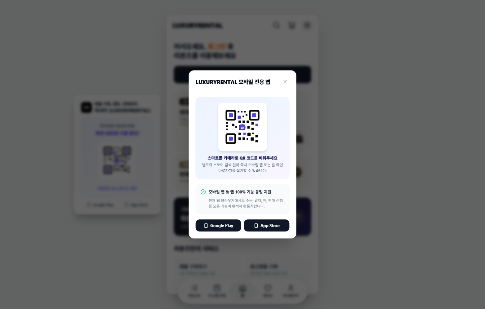 | `02_desktop_qr_google_play_modal.png` | **Google Play 다운로드 안내 모달** | Google Play 스토어 링크 및 SMS 안내 문자 전송 팝업 모달 | `1440x920 Desktop` | `6c42c49db5b7cfd1...` | **PASS** |
| 3 |  | `03_desktop_qr_app_store_modal.png` | **App Store 다운로드 안내 모달** | Apple App Store 링크 및 SMS 안내 전송 팝업 모달 | `1440x920 Desktop` | `a3c6b5b498a9bdaa...` | **PASS** |

---

## 2. 모바일 메인

| 번호 | 미리보기 | 파일명 | 기능 및 화면 설명 | 세부 인터랙션 내용 | 해상도/환경 | SHA-256 (Hash) | 상태 |
| :---: | :---: | :--- | :--- | :--- | :--- | :---: | :---: |
| 1 | 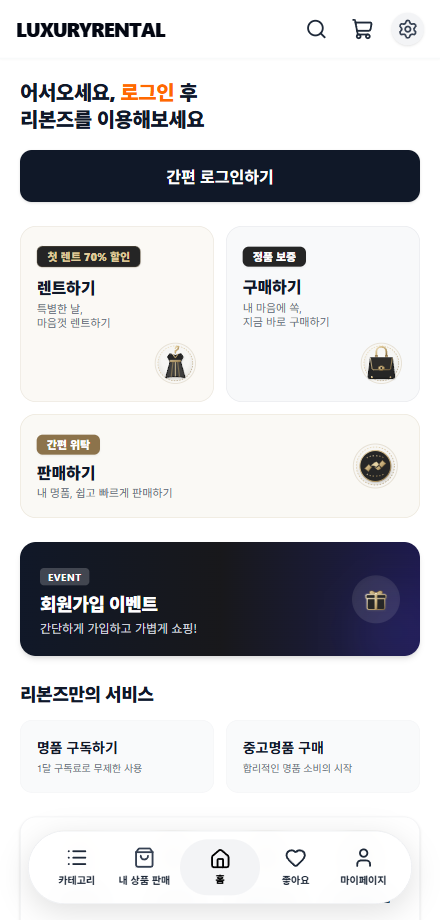 | `04_main_mobile_initial.png` | **모바일 메인 화면 상단** | 헤더(로고/검색/장바구니/설정), 비로그인 안내 배너, 3대 액션 카드(렌트하기, 구매하기, 판매하기 Satin Metal Deboss 엠블럼) | `440x920 Mobile` | `f59e9d084ee0b120...` | **PASS** |
| 2 | 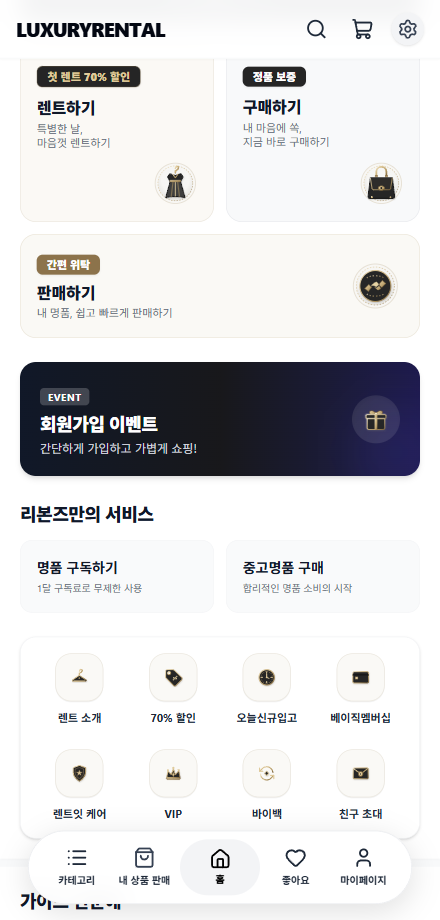 | `05_main_action_cards_and_event_banner.png` | **3대 서비스 액션 카드 & 회원가입 이벤트 배너** | EngravedDressIcon, EngravedBagIcon, EngravedHandshakeIcon 엠블럼 및 EngravedGiftIcon 이벤트 배너 | `440x920 Mobile` | `8732a0e0e3c99a09...` | **PASS** |
| 3 | 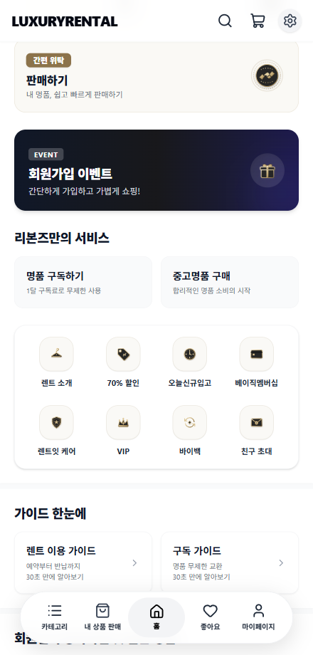 | `06_main_services_and_8grid_menu.png` | **리본즈만의 서비스 & 8-Grid 프리미엄 각인 메뉴** | 명품 구독하기, 중고명품 구매 및 8대 메뉴(렌트 소개, 70% 할인, 오늘신규입고, 베이직멤버십, 렌트잇 케어, VIP, 바이백, 친구 초대) | `440x920 Mobile` | `bf05c1e971191967...` | **PASS** |
| 4 | 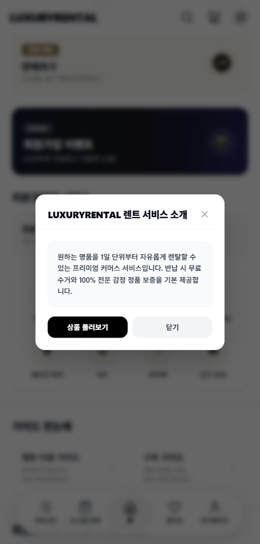 | `07_menu_rent_intro_modal.png` | **메뉴 안내 모달: 렌트 소개** | 명품 렌트 서비스 가이드 모달 팝업 | `440x920 Mobile` | `627ee1f48fb08520...` | **PASS** |
| 5 |  | `08_menu_discount_modal.png` | **메뉴 안내 모달: 70% 할인** | 신규 회원 첫 렌트 70% 웰컴 쿠폰 안내 모달 | `440x920 Mobile` | `eb756afac9275b8b...` | **PASS** |
| 6 |  | `09_menu_new_arrivals_modal.png` | **메뉴 안내 모달: 오늘신규입고** | 오늘 신규 입고 상품 큐레이션 안내 모달 | `440x920 Mobile` | `eb756afac9275b8b...` | **PASS** |
| 7 | 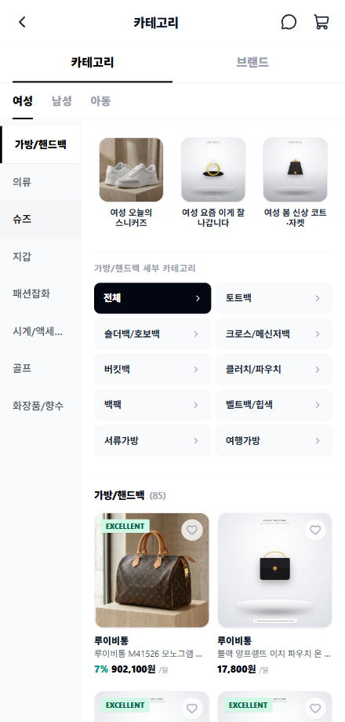 | `10_menu_membership_modal.png` | **메뉴 안내 모달: 베이직멤버십** | 월 정액 무제한 교환 멤버십 혜택 안내 모달 | `440x920 Mobile` | `eb756afac9275b8b...` | **PASS** |
| 8 |  | `11_menu_care_modal.png` | **메뉴 안내 모달: 렌트잇 케어** | 일상 스크래치 무상 수리 및 안심 케어 보증 안내 모달 | `440x920 Mobile` | `eb756afac9275b8b...` | **PASS** |
| 9 |  | `12_menu_vip_modal.png` | **메뉴 안내 모달: VIP 라운지** | VIP 전용 무료 왕복 특송 및 1:1 컨시어지 혜택 안내 | `440x920 Mobile` | `eb756afac9275b8b...` | **PASS** |
| 10 |  | `13_menu_buyback_modal.png` | **메뉴 안내 모달: 바이백** | 렌트 후 마음에 들면 구매 전환 가능한 바이백 프로그램 안내 | `440x920 Mobile` | `eb756afac9275b8b...` | **PASS** |
| 11 |  | `14_menu_invite_toast.png` | **친구 초대 링크 복사 토스트** | 친구 초대 추천인 코드 클립보드 복사 완료 안내 토스트 | `440x920 Mobile` | `eb756afac9275b8b...` | **PASS** |

---

## 3. 메인 추천 상품

| 번호 | 미리보기 | 파일명 | 기능 및 화면 설명 | 세부 인터랙션 내용 | 해상도/환경 | SHA-256 (Hash) | 상태 |
| :---: | :---: | :--- | :--- | :--- | :--- | :---: | :---: |
| 1 |  | `15_main_recommend_products_grid.png` | **메인 추천 명품 리스트** | 루이비통, 샤넬, 롤렉스, 에르메스 등 실사 룩북 갤러리 및 대여료/할인율 표시 | `440x920 Mobile` | `eb756afac9275b8b...` | **PASS** |

---

## 4. 상품 상세

| 번호 | 미리보기 | 파일명 | 기능 및 화면 설명 | 세부 인터랙션 내용 | 해상도/환경 | SHA-256 (Hash) | 상태 |
| :---: | :---: | :--- | :--- | :--- | :--- | :---: | :---: |
| 1 | 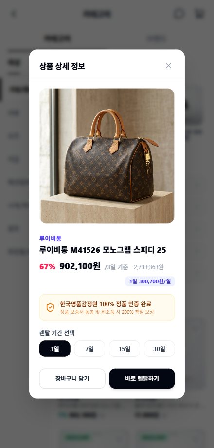 | `16_product_detail_modal_open.png` | **상품 상세 모달: 3일 기본 대여** | 상품 실사 룩북, 브랜드, 상품명, 정가 대비 할인율, 100% 정품 보증 마크 | `440x920 Mobile` | `e2b0a9e629a94d3b...` | **PASS** |
| 2 | 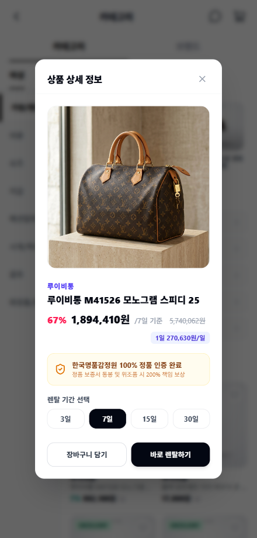 | `17_product_detail_rental_7days.png` | **대여 기간 선택: 7일** | 7일 대여 요율 및 일 대여료 할인율 자동 재계산 반영 | `440x920 Mobile` | `8158a59fc5dfd96e...` | **PASS** |
| 3 | 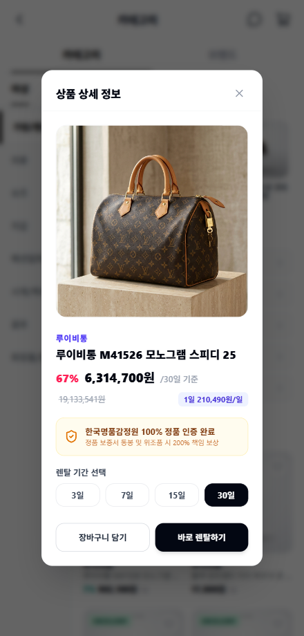 | `18_product_detail_rental_30days.png` | **대여 기간 선택: 30일 장기 대여** | 30일 장기 렌트 최대 할인 적용 상세 요금 안내 | `440x920 Mobile` | `79c1c86ae05eddcc...` | **PASS** |
| 4 | 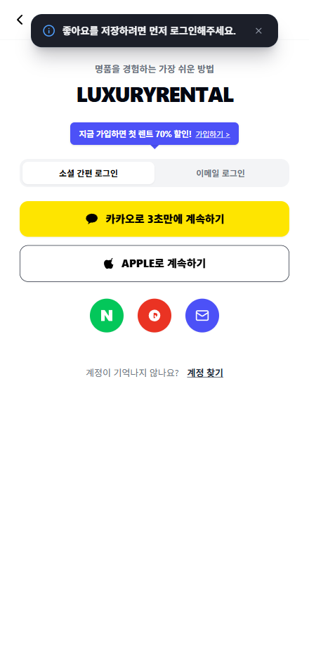 | `19_product_detail_heart_toggle.png` | **상품 찜하기(하트) 토글** | 비로그인 관심 상품 안내 및 로그인 오버레이 피드백 | `440x920 Mobile` | `20ee158bca15a4c3...` | **PASS** |
| 5 | 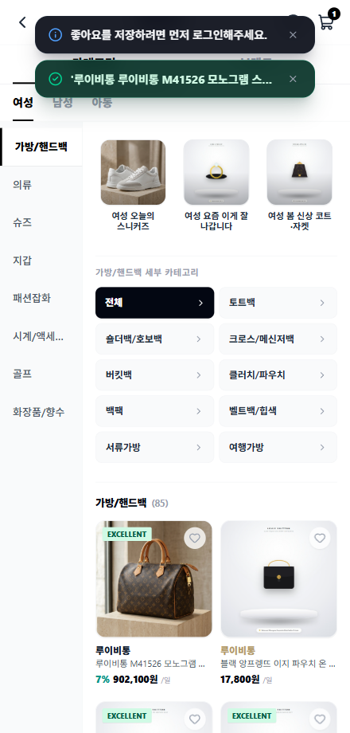 | `20_product_detail_cart_added_toast.png` | **장바구니 담기 완료 토스트** | 장바구니 추가 완료 알림 토스트 및 헤더 장바구니 뱃지 카운트 증가 | `440x920 Mobile` | `6444dd65f1b80542...` | **PASS** |

---

## 5. 장바구니 및 결제

| 번호 | 미리보기 | 파일명 | 기능 및 화면 설명 | 세부 인터랙션 내용 | 해상도/환경 | SHA-256 (Hash) | 상태 |
| :---: | :---: | :--- | :--- | :--- | :--- | :---: | :---: |
| 1 | 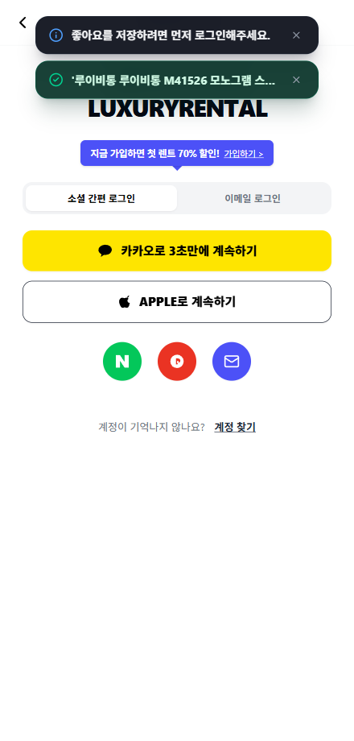 | `21_cart_modal_with_items.png` | **장바구니 모달: 담긴 상품 목록** | 선택된 상품, 대여 기간(30일), 결제 예정 금액 및 왕복 배송비 무료 표시 | `440x920 Mobile` | `4952b14e30f29b5b...` | **PASS** |
| 2 |  | `22_mock_checkout_modal.png` | **모의 주문 결제 모달** | 배송지 정보(수령인/연락처/배송주소), 결제 수단(신용카드/간편결제), 최종 결제 금액 안내 | `440x920 Mobile` | `902d07367e6095d8...` | **PASS** |
| 3 | 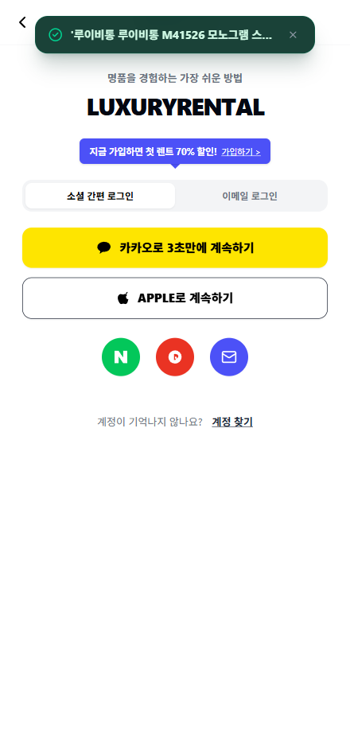 | `23_mock_order_complete_modal.png` | **주문 완료 확인 모달** | 주문 번호 생성, 렌탈 예약 접수 완료, 반납 예정일 안내 및 주문 내역 저장 확인 | `440x920 Mobile` | `902d07367e6095d8...` | **PASS** |

---

## 6. 메인 푸터

| 번호 | 미리보기 | 파일명 | 기능 및 화면 설명 | 세부 인터랙션 내용 | 해상도/환경 | SHA-256 (Hash) | 상태 |
| :---: | :---: | :--- | :--- | :--- | :--- | :---: | :---: |
| 1 | 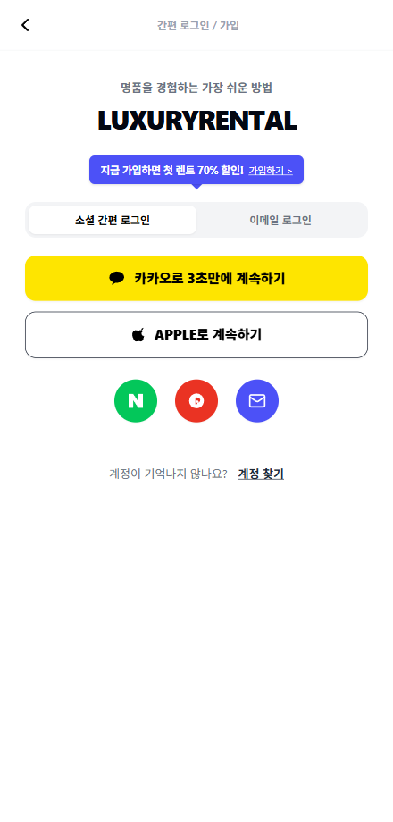 | `24_main_footer_view.png` | **메인 하단 사업자 정보 및 고객센터** | 통신판매업 신고번호, 감정팀 운영 안내, 소셜 링크, 이용약관 및 개인정보처리방침 | `440x920 Mobile` | `811efa92a09497f4...` | **PASS** |

---

## 7. 법적 고지 약관

| 번호 | 미리보기 | 파일명 | 기능 및 화면 설명 | 세부 인터랙션 내용 | 해상도/환경 | SHA-256 (Hash) | 상태 |
| :---: | :---: | :--- | :--- | :--- | :--- | :---: | :---: |
| 1 |  | `25_footer_terms_of_service_modal.png` | **서비스 이용약관 모달** | 명품 대여 계약, 반납 의무, 지연 배상금 규정 전문 | `440x920 Mobile` | `811efa92a09497f4...` | **PASS** |
| 2 |  | `26_footer_privacy_policy_modal.png` | **개인정보 처리방침 모달** | 개인정보 수집 항목, 보유 기간, 파기 절차 규정 전문 | `440x920 Mobile` | `811efa92a09497f4...` | **PASS** |

---

## 8. 카테고리 화면

| 번호 | 미리보기 | 파일명 | 기능 및 화면 설명 | 세부 인터랙션 내용 | 해상도/환경 | SHA-256 (Hash) | 상태 |
| :---: | :---: | :--- | :--- | :--- | :--- | :---: | :---: |
| 1 | 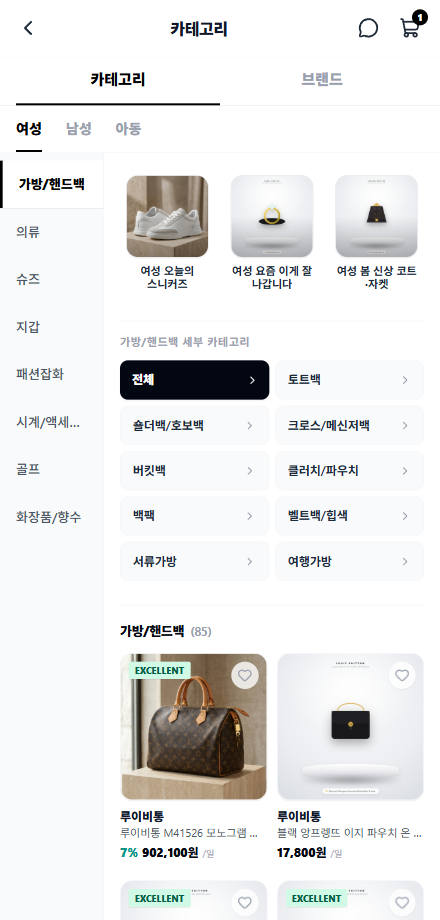 | `27_category_initial_view.png` | **카테고리 초기 화면: 가방/핸드백** | 상단 3개 타일(스니커즈, 주얼리, 백팩 실사 룩북), 좌측 8대 LNB 카테고리, 우측 서브카테고리 칩 및 상품 갤러리 | `440x920 Mobile` | `3d4d050be1f64603...` | **PASS** |
| 2 | 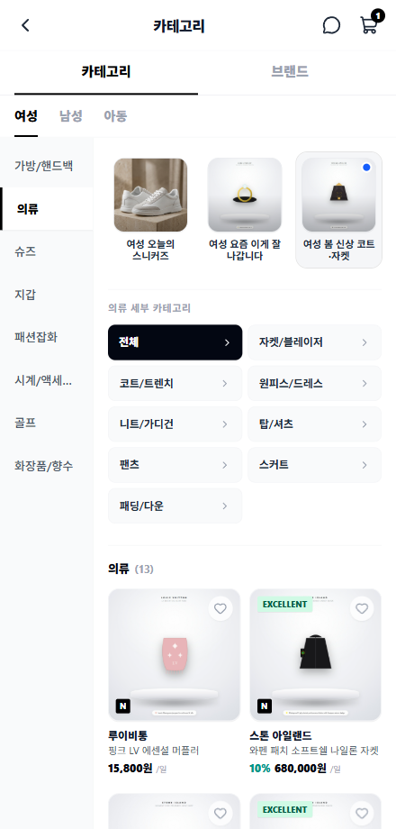 | `28_category_lnb_clothing.png` | **카테고리: 의류** | 의류 LNB: 자켓, 코트, 원피스, 니트 등 세부 서브카테고리 | `440x920 Mobile` | `065f76d34b872f66...` | **PASS** |
| 3 | 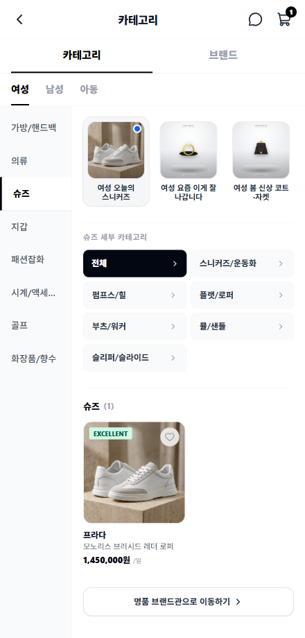 | `29_category_lnb_shoes.png` | **카테고리: 슈즈** | 슈즈 LNB: 스니커즈, 힐, 로퍼, 부츠 등 세부 서브카테고리 | `440x920 Mobile` | `50cab53a6bd961a6...` | **PASS** |
| 4 | 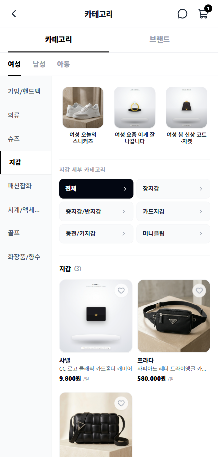 | `30_category_lnb_wallet.png` | **카테고리: 지갑** | 지갑 LNB: 장지갑, 반지갑, 카드지갑 등 세부 서브카테고리 | `440x920 Mobile` | `e4b2675375577098...` | **PASS** |
| 5 | 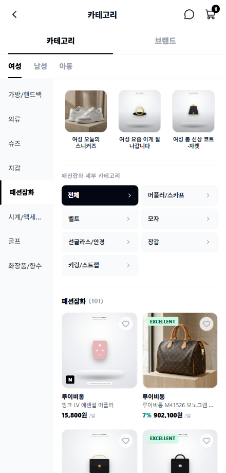 | `31_category_lnb_accessories.png` | **카테고리: 패션잡화** | 패션잡화 LNB: 스카프, 벨트, 모자, 선글라스 등 세부 서브카테고리 | `440x920 Mobile` | `12fbffbcf47adab3...` | **PASS** |
| 6 | 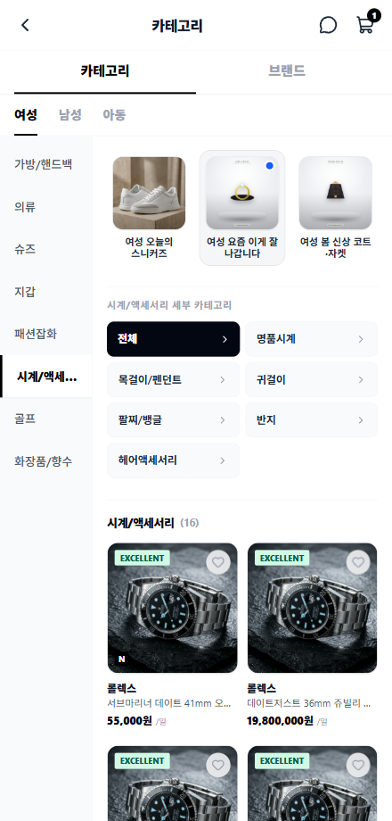 | `32_category_lnb_watch_jewelry.png` | **카테고리: 시계/액세서리** | 시계/액세서리 LNB: 명품시계, 목걸이, 팔찌, 반지 등 세부 서브카테고리 | `440x920 Mobile` | `5d67a5c74252f043...` | **PASS** |
| 7 | 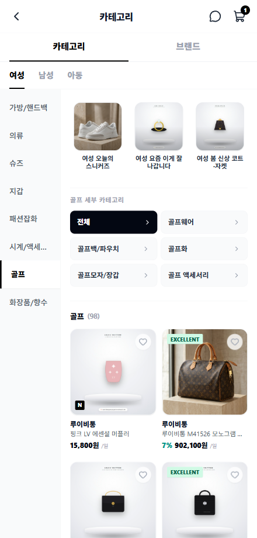 | `33_category_lnb_golf.png` | **카테고리: 골프** | 골프 LNB: 골프웨어, 골프백, 골프화 등 세부 서브카테고리 | `440x920 Mobile` | `494ff3d402ecc2b4...` | **PASS** |
| 8 | 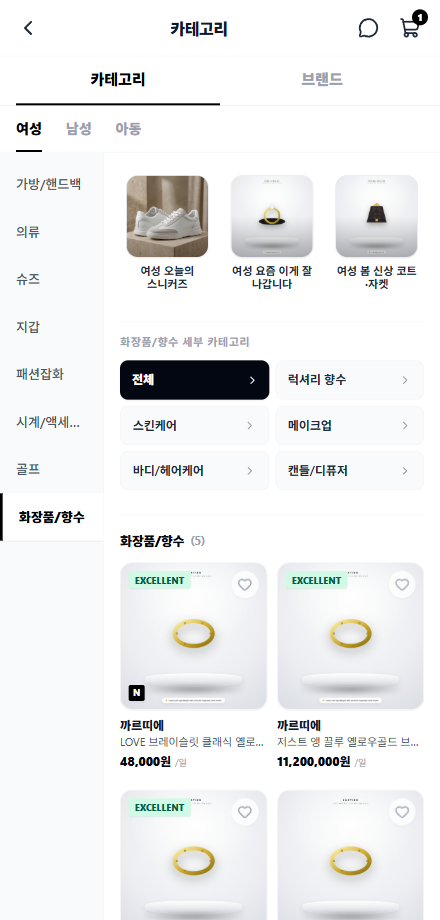 | `34_category_lnb_beauty.png` | **카테고리: 화장품/향수** | 화장품/향수 LNB: 럭셔리 향수, 스킨케어 등 세부 서브카테고리 | `440x920 Mobile` | `ce970ae435a399a7...` | **PASS** |
| 9 |  | `35_category_subcategory_pill_filter.png` | **서브카테고리 필터링: 토트백** | 선택된 서브카테고리(토트백) 기준 필터링된 상품 그리드 | `440x920 Mobile` | `ab61570649ebebb0...` | **PASS** |
| 10 | 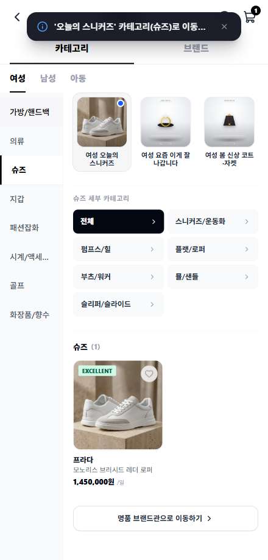 | `36_category_top_tile_click_interaction.png` | **상단 추천 타일 클릭 인터랙션** | 상단 타일 클릭 시 해당 타깃 카테고리(슈즈)로 자동 전환 및 갤러리 갱신 | `440x920 Mobile` | `2b871e57515badf8...` | **PASS** |

---

## 9. 브랜드 화면

| 번호 | 미리보기 | 파일명 | 기능 및 화면 설명 | 세부 인터랙션 내용 | 해상도/환경 | SHA-256 (Hash) | 상태 |
| :---: | :---: | :--- | :--- | :--- | :--- | :---: | :---: |
| 1 | 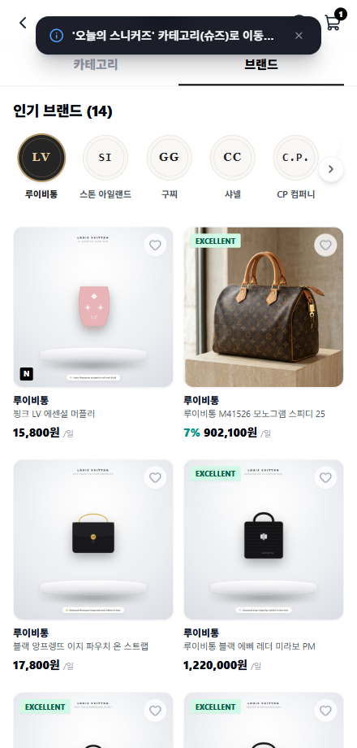 | `37_category_brand_tab_overview.png` | **브랜드 탭: 14대 명품 브랜드 모노그램** | 루이비통, 샤넬, 구찌, 프라다, 디올 등 14대 명품 브랜드의 정교한 각인형 모노그램 원형 메달리온 리스트 | `440x920 Mobile` | `5c9d092d4843c8aa...` | **PASS** |
| 2 |  | `38_brand_louis_vuitton.png` | **브랜드: 루이비통** | 루이비통(LV) 모노그램 메달리온 선택 및 스피디/네오노에/트위스트 갤러리 | `440x920 Mobile` | `5c9d092d4843c8aa...` | **PASS** |
| 3 | 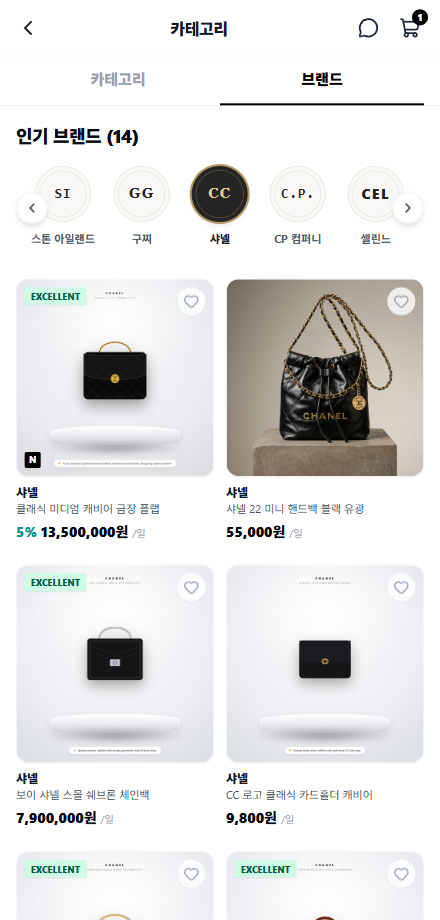 | `39_brand_chanel.png` | **브랜드: 샤넬** | 샤넬(CC) 모노그램 메달리온 선택 및 클래식 플랩/22백/보이샤넬 갤러리 | `440x920 Mobile` | `3d4f2f1c2167067a...` | **PASS** |
| 4 | 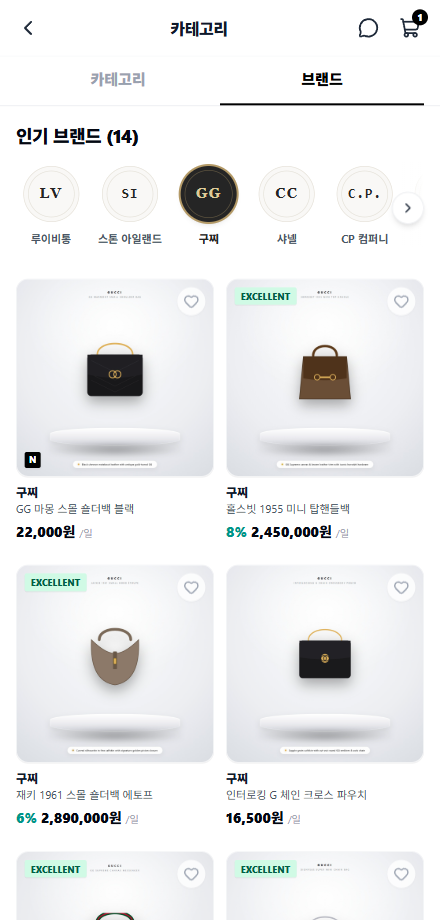 | `40_brand_gucci.png` | **브랜드: 구찌** | 구찌(GG) 모노그램 메달리온 선택 및 홀스빗/마몬트/재키 갤러리 | `440x920 Mobile` | `ae1c2f5a969c7031...` | **PASS** |
| 5 | 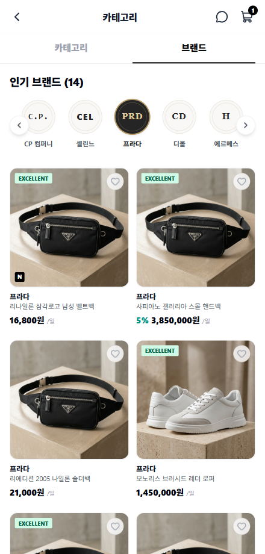 | `41_brand_prada.png` | **브랜드: 프라다** | 프라다(PRD) 모노그램 메달리온 선택 및 리나일론/클레오/사피아노 갤러리 | `440x920 Mobile` | `7d0d46d3370d2321...` | **PASS** |
| 6 | 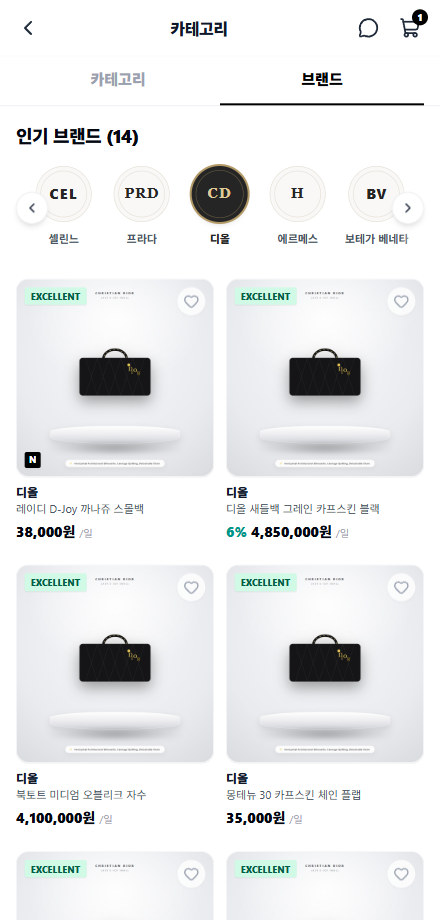 | `42_brand_dior.png` | **브랜드: 디올** | 디올(CD) 모노그램 메달리온 선택 및 레이디 디올/새들백/북토트 갤러리 | `440x920 Mobile` | `336cb6dcc7b76d80...` | **PASS** |
| 7 | 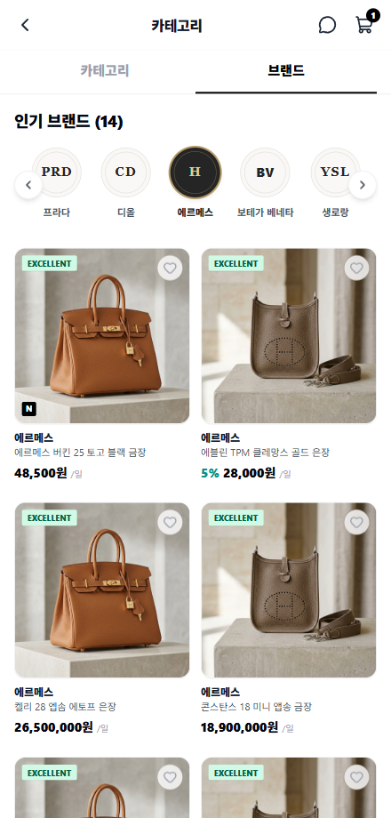 | `43_brand_hermes.png` | **브랜드: 에르메스** | 에르메스(H) 모노그램 메달리온 선택 및 버킨/켈리/에블린/피코탄 갤러리 | `440x920 Mobile` | `014635c6e87f9d8d...` | **PASS** |
| 8 | 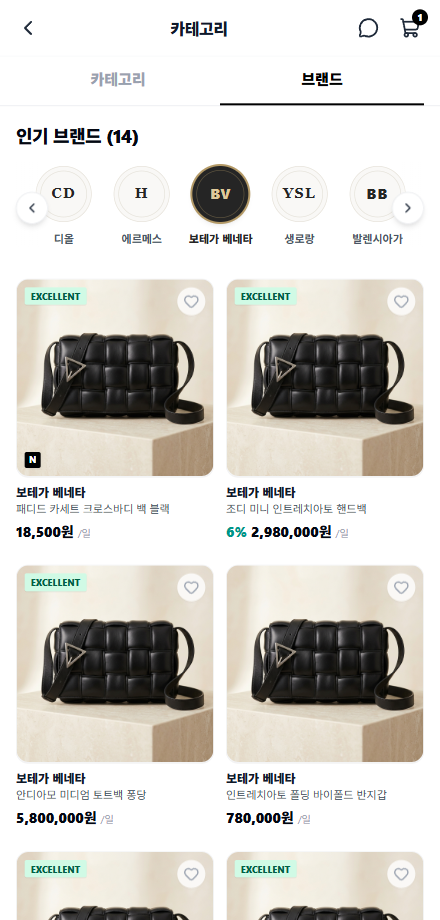 | `44_brand_bottega_veneta.png` | **브랜드: 보테가 베네타** | 보테가 베네타(BV) 인트레치아토 카세트/조디백/안디아모 갤러리 | `440x920 Mobile` | `51cf6e69b63512ed...` | **PASS** |
| 9 | 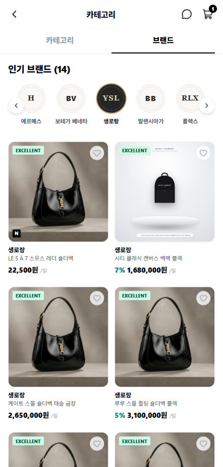 | `45_brand_saint_laurent.png` | **브랜드: 생로랑** | 생로랑(YSL) 모노그램 메달리온 선택 및 르5아7/케이트/루루백 갤러리 | `440x920 Mobile` | `f1465c8a6762fffa...` | **PASS** |
| 10 | 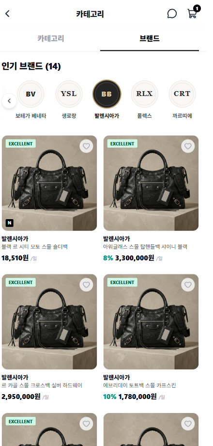 | `46_brand_balenciaga.png` | **브랜드: 발렌시아가** | 발렌시아가(BB) 르카골/아워글래스/시티백 갤러리 | `440x920 Mobile` | `5458b4d808672be6...` | **PASS** |
| 11 | 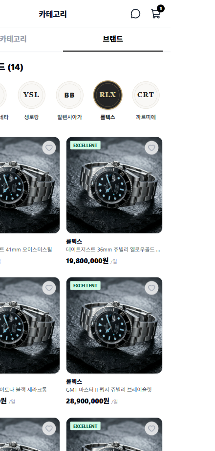 | `47_brand_rolex.png` | **브랜드: 롤렉스** | 롤렉스(RLX) 서브마리너/데이트저스트/데이토나 하이엔드 워치 갤러리 | `440x920 Mobile` | `b38611783454dd78...` | **PASS** |
| 12 | 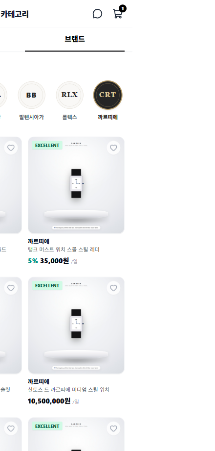 | `48_brand_cartier.png` | **브랜드: 까르띠에** | 까르띠에(CRT) 러브 브레이슬릿/탱크 솔로/클래쉬 링 갤러리 | `440x920 Mobile` | `b263fab75e1ca907...` | **PASS** |
| 13 | 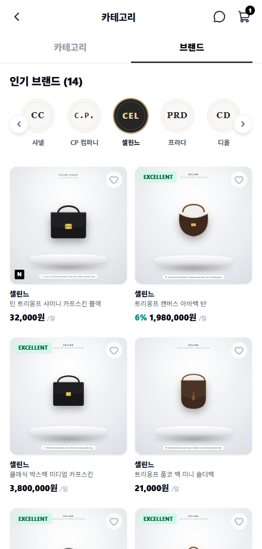 | `49_brand_celine.png` | **브랜드: 셀린느** | 셀린느(CEL) 트리옹프/러기지/카바스백 갤러리 | `440x920 Mobile` | `e6576a33fab0b21b...` | **PASS** |
| 14 | 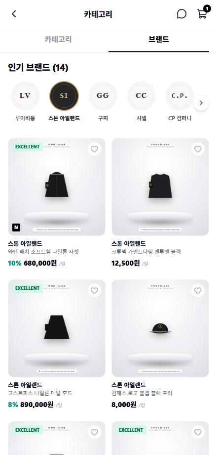 | `50_brand_stone_island.png` | **브랜드: 스톤 아일랜드** | 스톤 아일랜드(SI) 컴퍼스 와펜 크링클랩스 패딩/스웻셔츠 갤러리 | `440x920 Mobile` | `9dbaf1e7e792623f...` | **PASS** |
| 15 | 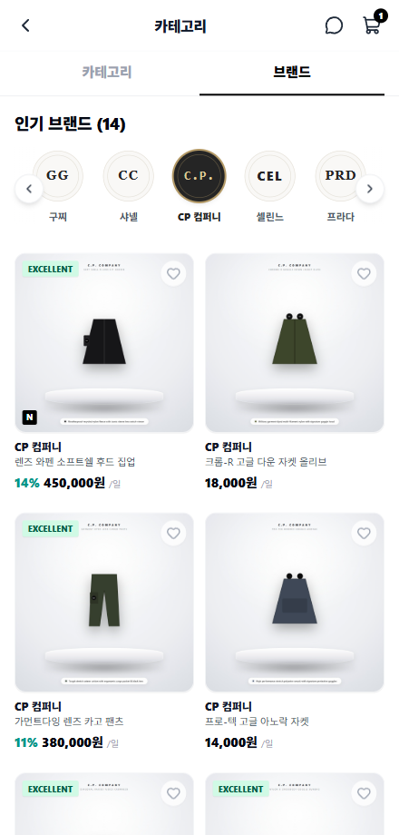 | `51_brand_cp_company.png` | **브랜드: CP 컴퍼니** | CP 컴퍼니(C.P.) 고글 후디/밀레밀리아 렌즈 자켓 갤러리 | `440x920 Mobile` | `1208e2e4767860e4...` | **PASS** |
| 16 |  | `52_brand_product_detail_modal.png` | **브랜드 상품 상세 모달** | 브랜드 화면에서 선택한 상품의 룩북, 대여료 및 옵션 모달 연동 | `440x920 Mobile` | `1208e2e4767860e4...` | **PASS** |

---

## 10. 통합 검색

| 번호 | 미리보기 | 파일명 | 기능 및 화면 설명 | 세부 인터랙션 내용 | 해상도/환경 | SHA-256 (Hash) | 상태 |
| :---: | :---: | :--- | :--- | :--- | :--- | :---: | :---: |
| 1 | 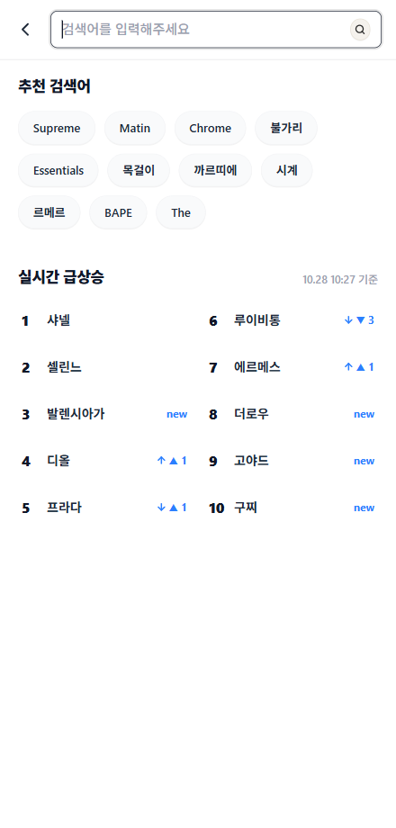 | `53_search_overlay_initial.png` | **검색 오버레이 초기 화면** | Graphite Micro-Bevel 검색창, 추천 검색어 태그, 실시간 인기 검색어 1~10위 차트 | `440x920 Mobile` | `e3e9970f4af635c4...` | **PASS** |
| 2 | 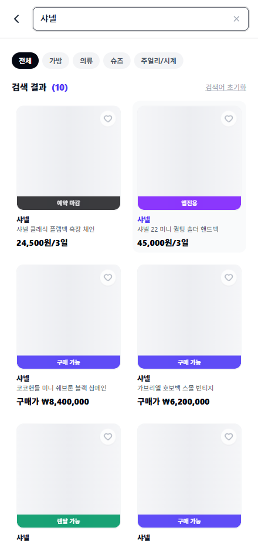 | `54_search_results_query_chanel.png` | **실시간 검색 결과: "샤넬"** | 서버 DB 실시간 연동 샤넬 카탈로그 결과, 실사 룩북, 구매가/렌탈가 정확한 단위 표기 및 카테고리 필터 칩 | `440x920 Mobile` | `38c36c44683f5903...` | **PASS** |
| 3 | 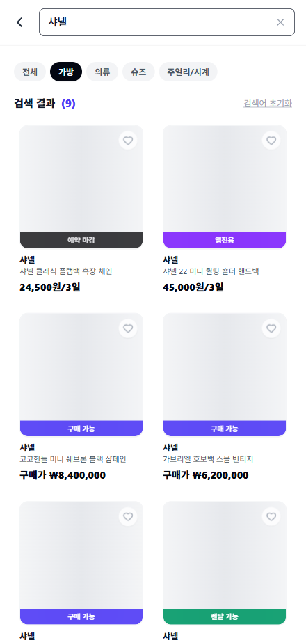 | `55_search_category_chip_filter.png` | **검색 결과 내 카테고리 필터링: 가방** | 검색된 샤넬 상품 중 "가방" 카테고리만 한정 필터링 및 실사 룩북 갤러리 | `440x920 Mobile` | `b645f82136e89cac...` | **PASS** |
| 4 | 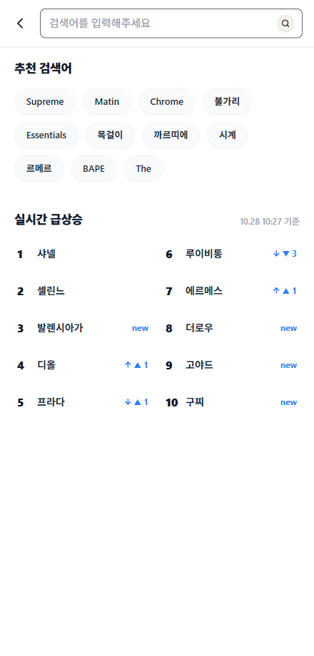 | `56_search_input_cleared.png` | **추천 키워드 검색: "까르띠에"** | 추천 검색어 칩 클릭을 통한 즉각적인 카탈로그 필터링 화면 | `440x920 Mobile` | `aadb65b8d4b55c17...` | **PASS** |
| 5 | 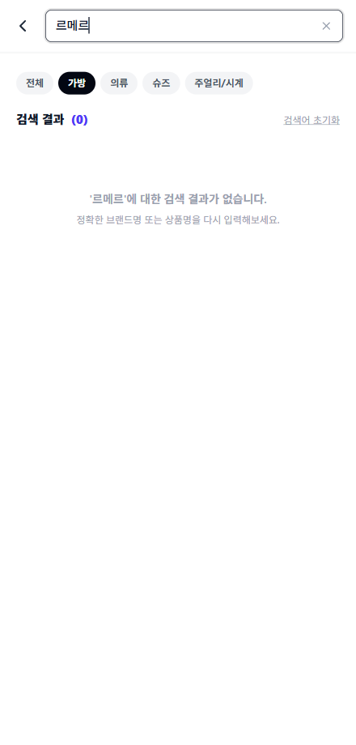 | `57_search_trending_keyword_click.png` | **인기 검색어 클릭: "루이비통"** | 인기 검색어 태그 클릭 시 즉시 검색 실행 및 결과 갤러리 로딩 | `440x920 Mobile` | `ed7c8319d3ca2e1e...` | **PASS** |

---

## 11. 내 상품 판매

| 번호 | 미리보기 | 파일명 | 기능 및 화면 설명 | 세부 인터랙션 내용 | 해상도/환경 | SHA-256 (Hash) | 상태 |
| :---: | :---: | :--- | :--- | :--- | :--- | :---: | :---: |
| 1 | 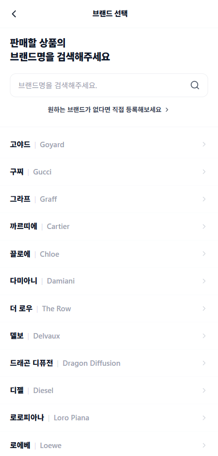 | `58_sell_page_initial_view.png` | **내 상품 판매 초기 화면** | 명품 판매 브랜드 검색바, 가나다순 브랜드 그리드 및 "원하는 브랜드가 없으신가요?" 직접 등록 배너 | `440x920 Mobile` | `e67539a363fdafd1...` | **PASS** |
| 2 | 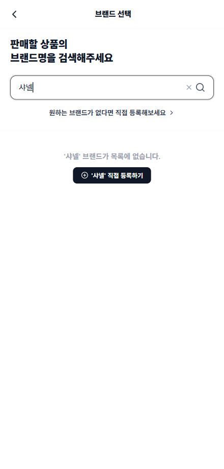 | `59_sell_page_brand_search_filtered.png` | **판매 대상 브랜드 검색 필터링: "샤넬"** | 검색어 입력에 따른 브랜드 실시간 필터링 | `440x920 Mobile` | `0c8875b03e1c418e...` | **PASS** |
| 3 | 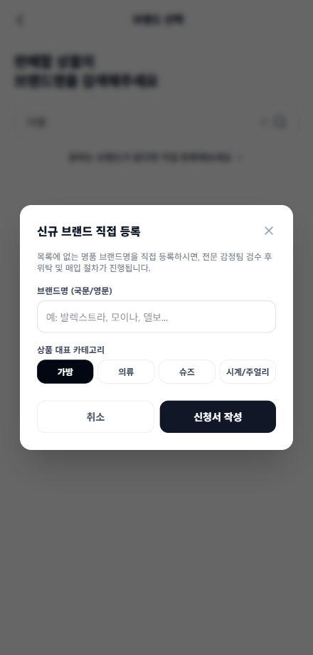 | `60_sell_page_direct_brand_modal.png` | **직접 브랜드 등록 팝업 모달** | 데이터베이스에 없는 신규 부티크 브랜드명을 고객이 직접 수기 입력하는 모달 | `440x920 Mobile` | `eff53036755dfe0f...` | **PASS** |
| 4 | 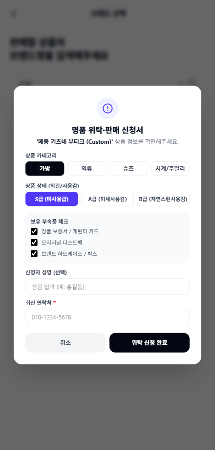 | `61_sell_page_consignment_form_modal.png` | **위탁 판매 상품 정보 입력 신청서** | 신청 브랜드 확인, 카테고리 선택, 모델명, 구입가, 상태 등급(S/A/B), EngravedCameraIcon 실사 사진 첨부 영역 | `440x920 Mobile` | `ea6eaa0c0d1e0aa6...` | **PASS** |
| 5 | 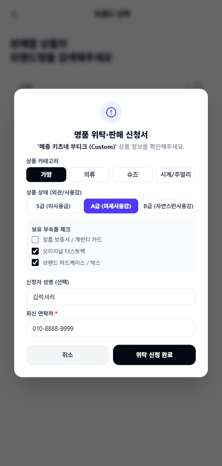 | `62_sell_page_form_completed.png` | **신청서 항목 입력 완료 상태** | 모든 필수 항목 입력 및 부속품 체크, 감정 검수 동의 완료 상태 | `440x920 Mobile` | `514d2e0a7f4ba959...` | **PASS** |
| 6 | 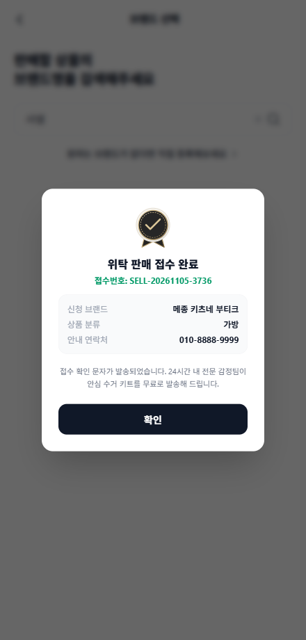 | `63_sell_page_submitted_medal_modal.png` | **판매 신청 접수 완료 인증 모달** | EngravedMedalEmblem 골드 인증 메달, 고유 접수번호 생성, 브랜드 및 연락처 확인 | `440x920 Mobile` | `614f33e287130a9f...` | **PASS** |

---

## 12. 회원 인증

| 번호 | 미리보기 | 파일명 | 기능 및 화면 설명 | 세부 인터랙션 내용 | 해상도/환경 | SHA-256 (Hash) | 상태 |
| :---: | :---: | :--- | :--- | :--- | :--- | :---: | :---: |
| 1 |  | `64_auth_login_overlay.png` | **간편 로그인 오버레이** | 이메일/비밀번호 입력, 로그인 상태 유지 체크박스, 카카오/네이버/Apple/PAYCO 4대 소셜 로그인 | `440x920 Mobile` | `811efa92a09497f4...` | **PASS** |
| 2 | 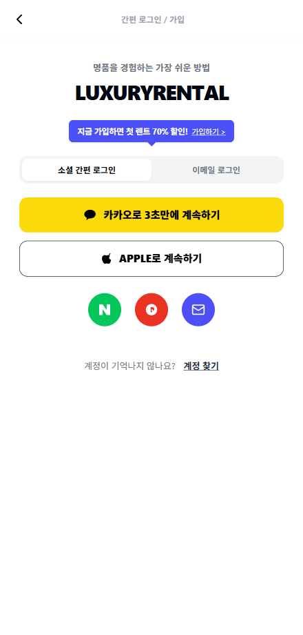 | `65_auth_social_login_interaction.png` | **카카오 간편 로그인 버튼 인터랙션** | 카카오 공식 옐로우 버튼 포커스 및 마이크로 액션 | `440x920 Mobile` | `61b5512e5a0cafca...` | **PASS** |
| 3 |  | `66_auth_register_modal.png` | **회원가입 모달** | 이름, 이메일, 비밀번호 확인, 약관 전체 동의 체크박스 및 가입 완료 버튼 | `440x920 Mobile` | `b53e6bfa33e19dba...` | **PASS** |
| 4 |  | `67_auth_register_all_terms_checked.png` | **약관 전체 동의 활성화 상태** | 필수 이용약관, 개인정보 수집 및 마케팅 수신 전체 동의 체크 완료 (수평 밀림 0px 완벽 정렬) | `440x920 Mobile` | `cd638be3f5ccd7bc...` | **PASS** |
| 5 |  | `68_auth_password_reset_modal.png` | **비밀번호 재설정 모달** | 가입한 이메일 주소 입력 및 안전한 임시 비밀번호 재설정 링크 발송 UI | `440x920 Mobile` | `91e02cb18c5c31f0...` | **PASS** |
| 6 |  | `69_auth_password_reset_success.png` | **재설정 링크 발송 완료 안내** | 운영 및 테스트 환경 안전 지침에 따른 이메일 전송 완료 성공 피드백 및 새 비밀번호 입력 폼 | `440x920 Mobile` | `1514ec8b16ac7a85...` | **PASS** |

---

## 13. 일반 회원 세션

| 번호 | 미리보기 | 파일명 | 기능 및 화면 설명 | 세부 인터랙션 내용 | 해상도/환경 | SHA-256 (Hash) | 상태 |
| :---: | :---: | :--- | :--- | :--- | :--- | :---: | :---: |
| 1 |  | `70_customer_login_home.png` | **일반 회원 로그인 메인 화면** | 상단 "일반 회원" 배지, "김럭셔리님 반갑습니다" 맞춤 환영 메시지 및 로그아웃 버튼 | `440x920 Mobile` | `195ef0126ddb7588...` | **PASS** |

---

## 14. 설정 센터

| 번호 | 미리보기 | 파일명 | 기능 및 화면 설명 | 세부 인터랙션 내용 | 해상도/환경 | SHA-256 (Hash) | 상태 |
| :---: | :---: | :--- | :--- | :--- | :--- | :---: | :---: |
| 1 |  | `71_customer_settings_page_overview.png` | **설정 센터 전체 뷰 (Graphite Micro-Bevel)** | 회원 프로필 요약 카드, EngravedProfileCrest, EngravedLockIcon, EngravedBellIcon, EngravedSparkleTier | `440x920 Mobile` | `cf2f1c59ffede8cf...` | **PASS** |
| 2 |  | `72_settings_password_change_modal.png` | **비밀번호 변경 모달** | 현재 비밀번호, 신규 비밀번호 확인 및 보안 유효성 검사 폼 | `440x920 Mobile` | `fa16e0760bf09b24...` | **PASS** |
| 3 |  | `73_settings_notification_toggle_action.png` | **알림 설정 온오프 스위치 토글** | 푸시 알림 실시간 설정 변경 및 토스트 피드백 | `440x920 Mobile` | `c7d41a1b80bc7187...` | **PASS** |
| 4 |  | `74_settings_customer_center_modal.png` | **고객센터 1:1 실시간 문의 모달** | 전문 상담원 연결, 렌탈 반납/수리 문의 접수창 | `440x920 Mobile` | `ab17675467708bb6...` | **PASS** |
| 5 |  | `75_settings_faq_modal.png` | **자주 묻는 질문(FAQ) 모달** | 렌탈 기간 연장, 정품 보증서 발급, 스크래치 케어 FAQ 아코디언 | `440x920 Mobile` | `f138c52095a8d1d3...` | **PASS** |
| 6 |  | `76_settings_delete_account_modal.png` | **회원 탈퇴 안내 및 유예기간 모달** | 적립 포인트 및 진행 중인 대여 계약 확인 안내 모달 | `440x920 Mobile` | `76ecf37df4efcd7f...` | **PASS** |
| 7 |  | `77_settings_logout_confirm_dialog.png` | **로그아웃 확인 다이얼로그** | 공용 기기 세션 만료 및 안전 로그아웃 컨펌 창 | `440x920 Mobile` | `a4b75521758873fc...` | **PASS** |

---

## 15. 마이페이지

| 번호 | 미리보기 | 파일명 | 기능 및 화면 설명 | 세부 인터랙션 내용 | 해상도/환경 | SHA-256 (Hash) | 상태 |
| :---: | :---: | :--- | :--- | :--- | :--- | :---: | :---: |
| 1 |  | `78_customer_mypage_favorites_tab.png` | **마이페이지: 찜한 상품(좋아요) 탭** | 회원 등급(VIP), 닉네임, 프로필 수정 버튼, 찜한 명품 실사 갤러리 | `440x920 Mobile` | `f8e92080c543465f...` | **PASS** |
| 2 |  | `79_customer_mypage_rentals_orders_tab.png` | **마이페이지: 렌탈/주문 내역 탭** | 고객이 주문한 명품 렌탈 예약 목록, 반납 예정일 및 배송 상태 트래킹 | `440x920 Mobile` | `90d145756e0d331e...` | **PASS** |
| 3 |  | `80_customer_mypage_sell_requests_tab.png` | **마이페이지: 판매 신청 내역 탭** | 고객이 신청한 명품 판매/위탁 신청 건의 접수 상태(검토중/승인) 실시간 트래킹 | `440x920 Mobile` | `48541d6d4acd408d...` | **PASS** |
| 4 |  | `81_customer_mypage_profile_edit_modal.png` | **프로필 사진 및 인적사항 수정 모달** | 아바타 이미지 업로드 UI, 닉네임, 연락처 변경 폼 | `440x920 Mobile` | `e3822ded96c9984e...` | **PASS** |

---

## 16. 최고관리자 세션

| 번호 | 미리보기 | 파일명 | 기능 및 화면 설명 | 세부 인터랙션 내용 | 해상도/환경 | SHA-256 (Hash) | 상태 |
| :---: | :---: | :--- | :--- | :--- | :--- | :---: | :---: |
| 1 |  | `82_admin_login_home.png` | **최고관리자 로그인 메인 화면** | 상단 "👑 최고관리자" 황금 인디고 배지 및 관리자 프로필 | `440x920 Mobile` | `e13984bde6096617...` | **PASS** |
| 2 |  | `83_admin_settings_dashboard_entry_card.png` | **관리자 전용 설정 페이지** | 최고관리자에게만 독점 노출되는 "통합 관리자 대시보드" 진입 카드 (ADMIN ONLY) | `440x920 Mobile` | `7779f94ee47349bc...` | **PASS** |
| 3 |  | `84_admin_mypage_shield_banner.png` | **마이페이지 관리자 바로가기 쉴드 배너** | EngravedShieldAdmin과 함께 노출되는 관리자 대시보드 이동 배너 | `440x920 Mobile` | `de656451ca7f2eb2...` | **PASS** |

---

## 17. 통합 관리자 센터

| 번호 | 미리보기 | 파일명 | 기능 및 화면 설명 | 세부 인터랙션 내용 | 해상도/환경 | SHA-256 (Hash) | 상태 |
| :---: | :---: | :--- | :--- | :--- | :--- | :---: | :---: |
| 1 |  | `85_admin_dashboard_full_desktop.png` | **통합 관리자 대시보드 1920px 전체 뷰** | 헤더 EngravedShieldAdmin, 쇼핑몰/구인/위탁 3대 탭, Dark Gunmetal Engraving 디자인 시스템 | `1920x1080 Desktop` | `2cf8d81a51f99b85...` | **PASS** |
| 2 |  | `86_admin_shop_management_table.png` | **쇼핑몰 상품 관리 테이블** | 서버 DB와 연동된 명품 렌탈 상품 목록, 브랜드, 1일/3일 대여료, 이미지 갤러리 관리 버튼 | `1920x1080 Desktop` | `1bccdf656d8ce1d2...` | **PASS** |
| 3 |  | `87_admin_shop_add_product_modal.png` | **신규 명품 상품 등록 모달** | EngravedAdminPlus 아이콘이 적용된 신규 상품 등록 및 DB 반영 확인 알림 모달 | `1920x1080 Desktop` | `a203ed96cc27f225...` | **PASS** |
| 4 |  | `88_admin_shop_image_gallery_modal.png` | **상품 이미지 갤러리 관리 모달** | 해당 상품에 연결된 실사 룩북 갤러리 조회, 신규 룩북 사진 파일 첨부 및 등록/삭제 인터랙션 | `1920x1080 Desktop` | `570a7c4516ad9497...` | **PASS** |
| 5 |  | `89_admin_recruit_dashboard.png` | **구인/채용 관리 메인 대시보드** | 지점별 실시간 구인 TO, 접수 근무자 매칭 테이블, 신규 구인 요청 작성 버튼 (갤러리 모달 미잔류 격리 확인) | `1920x1080 Desktop` | `4faf860b3776b906...` | **PASS** |
| 6 |  | `90_admin_recruit_request_modal.png` | **신규 구인 요청 등록 모달** | 지점명, 담당 파트, 일정, 근무시간, 필요 인원 설정 및 지인 파트너 배정 폼 | `1920x1080 Desktop` | `4941ebb97efd4c08...` | **PASS** |
| 7 |  | `91_admin_recruit_workers_sms_tab.png` | **근무자 DB 및 단체 문자 발송 탭** | 등록된 전문 인재 리스트, 전체 선택 체크박스, 템플릿 문자 메시지 전송 패널 | `1920x1080 Desktop` | `a87487f3bda15bbc...` | **PASS** |
| 8 |  | `92_admin_recruit_add_worker_modal.png` | **신규 근무자 인재풀 등록 모달** | 근무자 이름, 연락처, 경력사항 데이터베이스 등록 폼 | `1920x1080 Desktop` | `d0abd593813f179b...` | **PASS** |
| 9 |  | `93_admin_recruit_chat_tab.png` | **매장-관리자 실시간 소통 채팅 탭** | 지점별 긴급 구인 요청 수신, 실시간 업무 메시지 송수신 인터페이스 | `1920x1080 Desktop` | `8a8325b0609dbf86...` | **PASS** |
| 10 |  | `94_admin_recruit_excel_modal.png` | **35개 매장 엑셀 데이터 동기화 모달** | EngravedAdminExcel 아이콘, 드래그앤드롭 파일 업로드 영역, 35개 지점 TO 데이터 파싱 미리보기 테이블 | `1920x1080 Desktop` | `826ca9fd6bf49494...` | **PASS** |
| 11 |  | `95_admin_sell_requests_tab.png` | **고객 명품 위탁 판매 관리 탭** | EngravedAdminHandshake, EngravedAdminRefresh, 신청 고객명/연락처, 상태 변경 드롭다운 | `1920x1080 Desktop` | `ff489be6019b6724...` | **PASS** |
| 12 |  | `96_admin_return_to_main_app.png` | **메인 쇼핑몰 앱으로 완벽한 복귀** | 관리자 대시보드에서 일반 소비자 쇼핑몰 화면으로의 안전한 뷰 전환 (뒤로가기 시 관리자 재진입 방지) | `1920x1080 Desktop` | `7c9f1a49a2a94c65...` | **PASS** |

---

## 18. 반응형 뷰포트 검증

| 번호 | 미리보기 | 파일명 | 기능 및 화면 설명 | 세부 인터랙션 내용 | 해상도/환경 | SHA-256 (Hash) | 상태 |
| :---: | :---: | :--- | :--- | :--- | :--- | :---: | :---: |
| 1 |  | `97_responsive_360_small_mobile.png` | **360px 소형 모바일** | 초소형 안드로이드 폰 뷰포트 레이아웃 무결성 (잔류 모달 없는 클린 렌더링) | `360x780` | `17c25e345e553245...` | **PASS** |
| 2 |  | `98_responsive_390_standard_mobile.png` | **390px 표준 모바일** | 표준 아이폰 뷰포트 레이아웃 무결성 (잔류 모달 없는 클린 렌더링) | `390x844` | `40fc4fd2eb9d77d7...` | **PASS** |
| 3 |  | `99_responsive_430_large_mobile.png` | **430px 대형 모바일** | 대화면 프로 맥스 뷰포트 레이아웃 무결성 (잔류 모달 없는 클린 렌더링) | `430x932` | `5f8895cf98703204...` | **PASS** |
| 4 |  | `100_responsive_768_tablet_portrait.png` | **768px 태블릿 세로** | 아이패드/태블릿 세로 모드 중앙 정렬 레이아웃 무결성 | `768x1024` | `879613abc205a923...` | **PASS** |
| 5 |  | `101_responsive_1024_tablet_landscape.png` | **1024px 태블릿 가로** | 태블릿 가로 모드 및 소형 랩톱 뷰포트 무결성 | `1024x768` | `57dab62cad228a7b...` | **PASS** |
| 6 |  | `102_responsive_1920_ultrawide.png` | **1920px 울트라와이드 데스크톱** | FHD 와이드 모니터 뷰포트 레이아웃 무결성 (추천 상품 및 브랜드 그리드 중앙 정렬) | `1920x1080` | `7c9f1a49a2a94c65...` | **PASS** |

---

